# Package Managers, Environments, & Streamlit

## Key Course Topics

  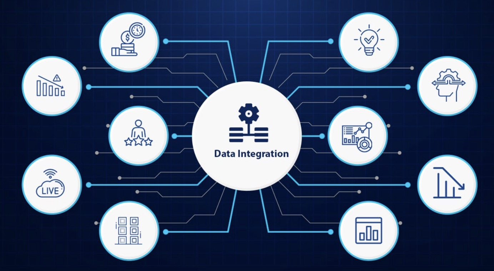

> Creating a unified view dataset via data augmentation from a variety of similar yet disparate sources.

 

  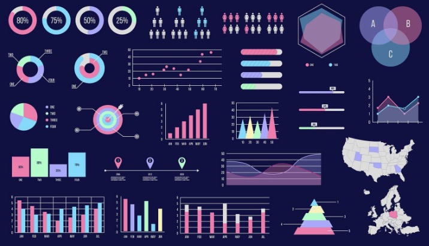

> Dashboarding with `streamlit`

 

  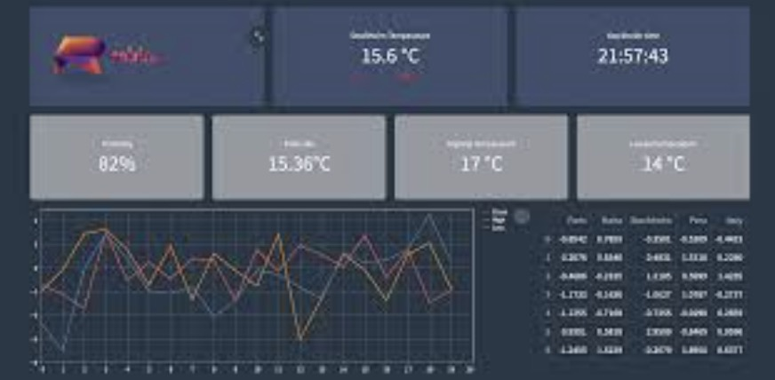

> Building vizualization systems like the cool one above.

 

  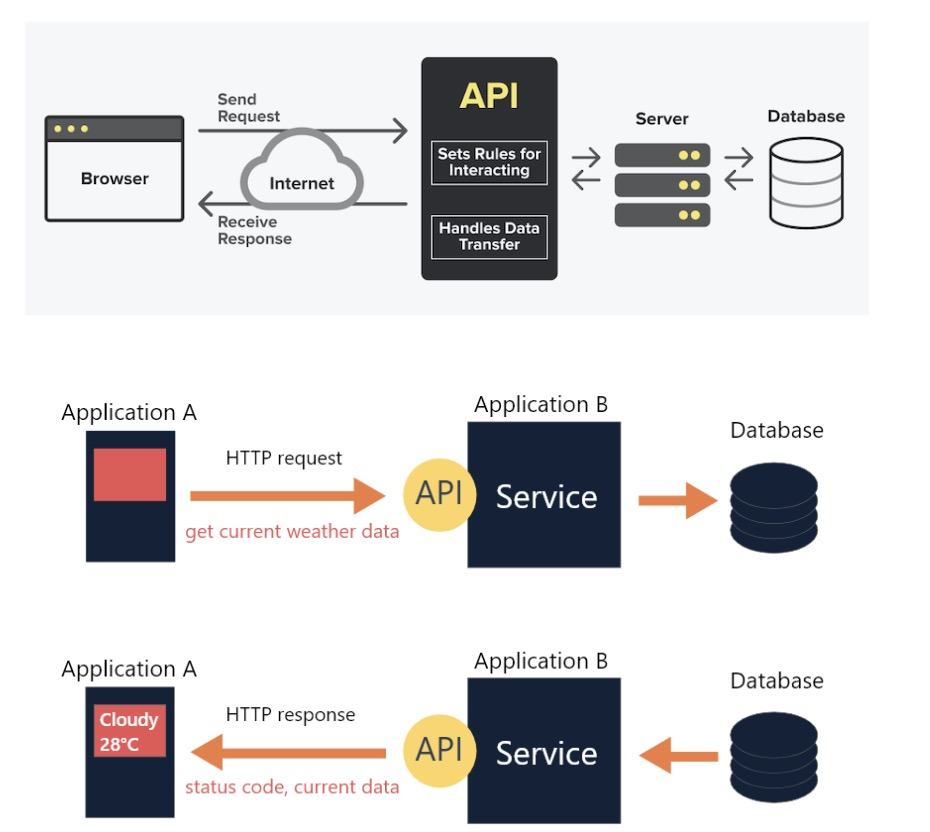

> How to use and build APIs (Application Programming Interfaces).

 

  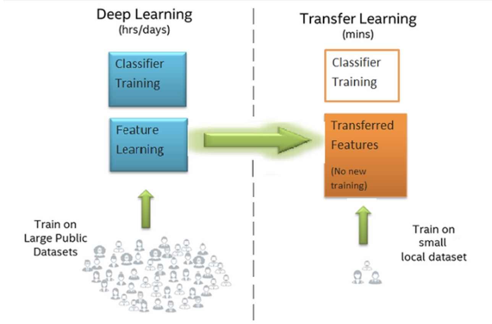

> Transfer learning in an image classification context.

 

  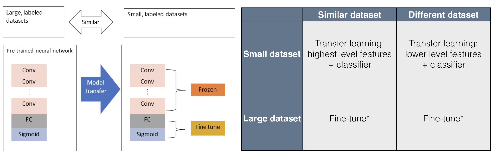

> Freezing vs. Fine-Tuning

 

  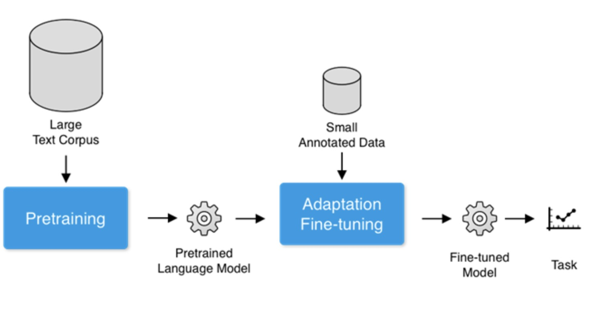

> Transfer Learning in Natural Langauge Processing.

## Modern AI Tools: Agents and AgenticAI

  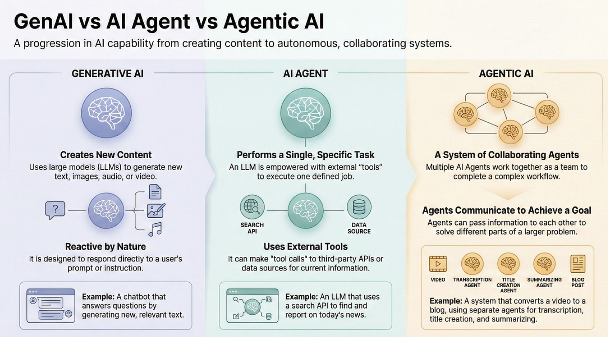

> AI Tools

 

  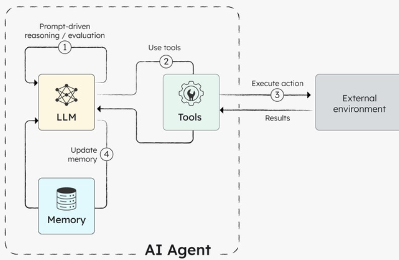

> AI Agent

 

  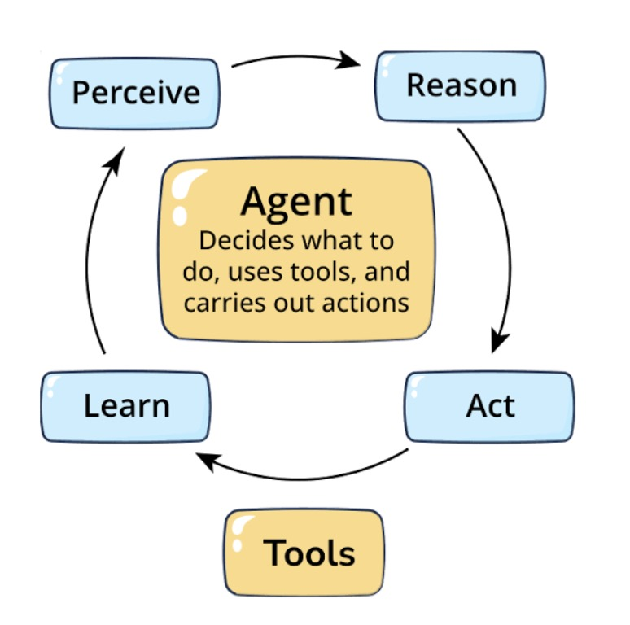

> One AI Agent in Agentic AI ecosystem.

 

  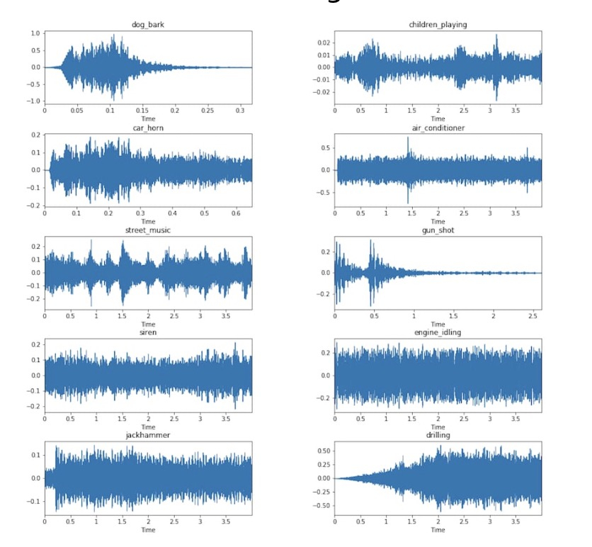

> Audio Signals

 

  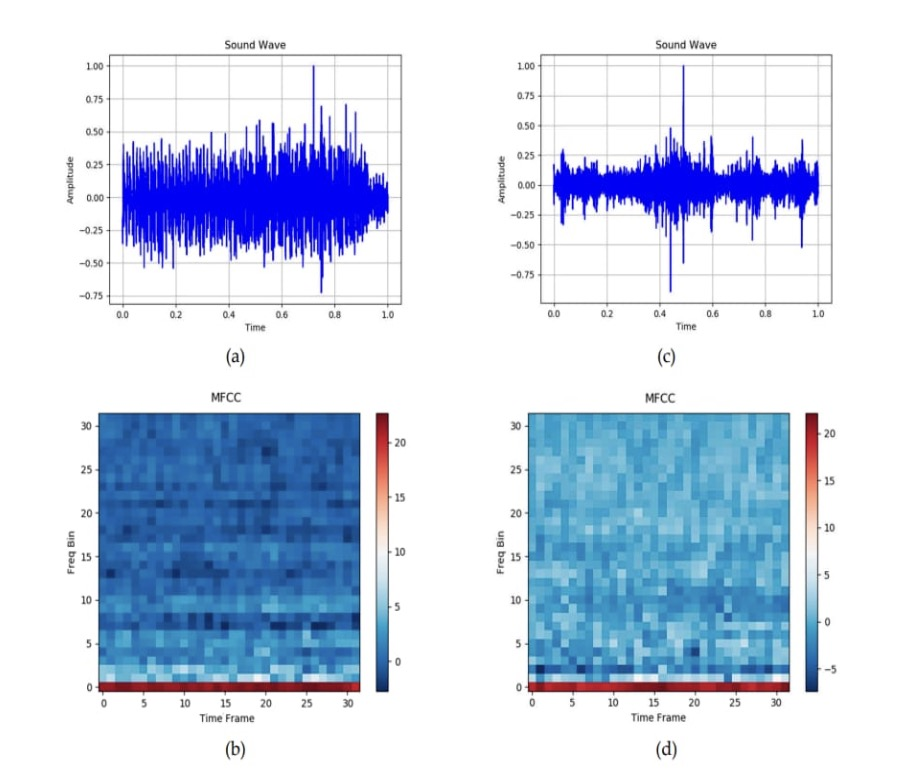

> Feature Extraction of Audio Signals

 

  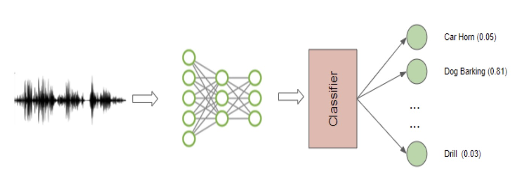

> Audio Analytics Applications