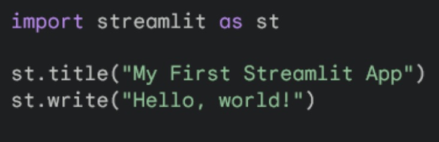
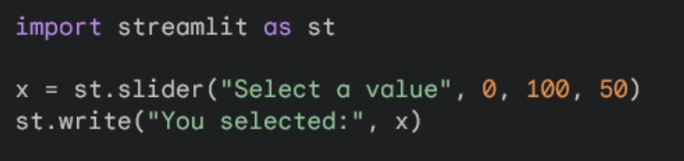
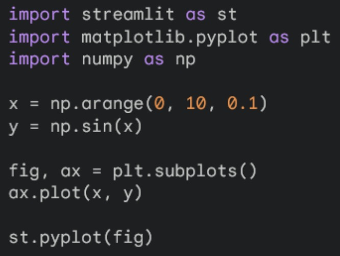
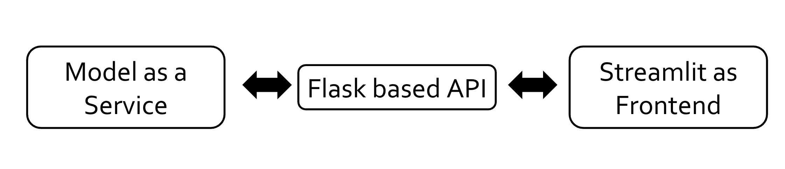

# Streamlit

## App Development With Streamlit

  

> Streamlit: Creates a simple Streamlit app with a title and a greeting message.

 

  

> Widgets: Features a slider that allows the user to select a value between 0 and 100, displayed below the slider.

 

  

> Data Visualization: Generates a sine wave plot using Matplotlib and displays it within the Streamlit app.

 

  

> Typical Architecture: Streamlit as Frontend and API as Backend
