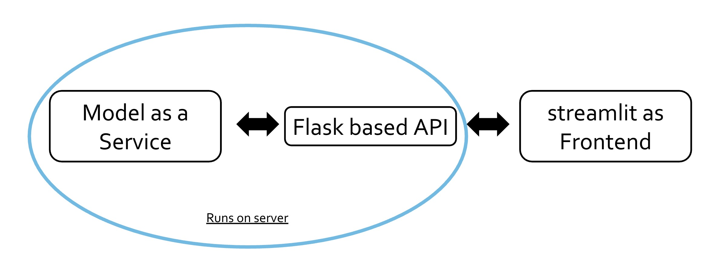
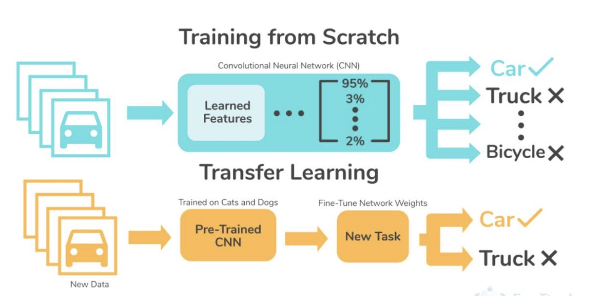
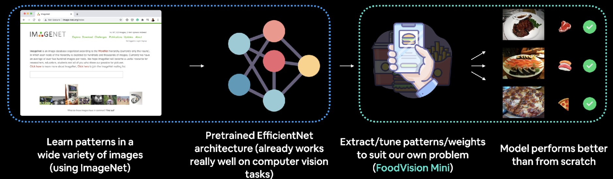
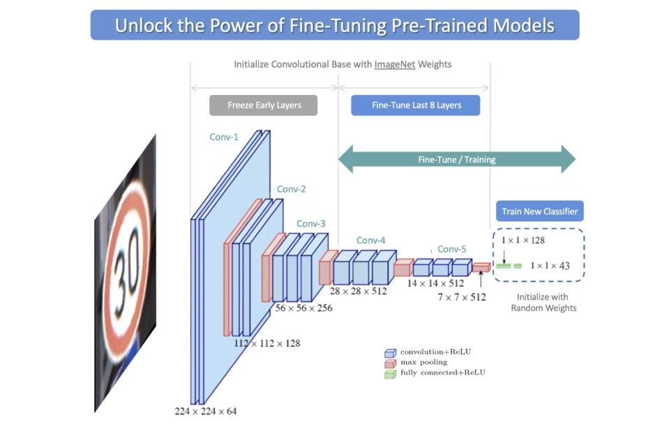

# APIs, Data Augmentation, & Transfer Learning

## SQL and Relational Databases

  

> Relational Database Management System

## Postman App APIs

  

> Deploy a model as a service via an API

## Intro to Transfer Learning

  

> Training Models: these models can be saved and deployed for the world to use. Training these models require a large amount of computing resources and dollars. Let's rather use models that have already been created and build our applications by piggy backing on them.

 

  

> Transfer Learning: These models are robust, and have been tested in detail and perform extremely well. We can take the patterns (also called weights) that another model has learned from a different use case and use it solve our own problem. We could also take the patterns from a language model (a model that's been through large amounts of text to learn a representation of language) and use them as the basis of a model to classify different text samples.

 

  

> We can leverage an existing model (a neural network architecture) proven to work on problems like our own. We can leverage a working model which has already learned patterns on similar data to our own. This often results in achieving great results with less custom data from available small datasets.

 

  

> A study into the effects of whether training from scratch or using transfer learning was better from a practitioner's point of view found transfer learning to be far more beneficial in terms of cost and time. Suddenly lots more people can do world-class work with less resources and less data

 

  

> Finetuning: the first way to use pretrained models in CNN applications. Instead of random initialization, we initialize the network with a pretrained network. Rest of the training looks as usual.

 

  

> Feature Extraction: the second way to use pretrained models in ConvNet applications. Here, we will freeze the weights for all the Convolution layers. The last or last few fully connected layers are replaced with a new one with random weights and only this layer is trained.

