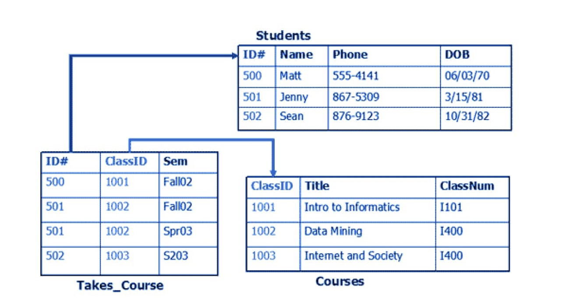
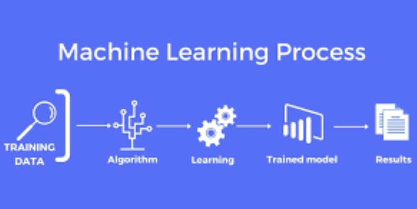
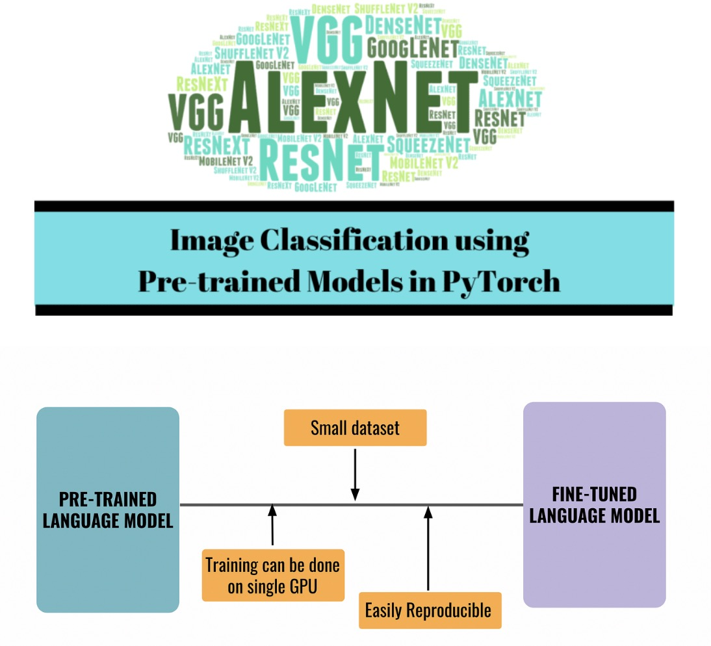
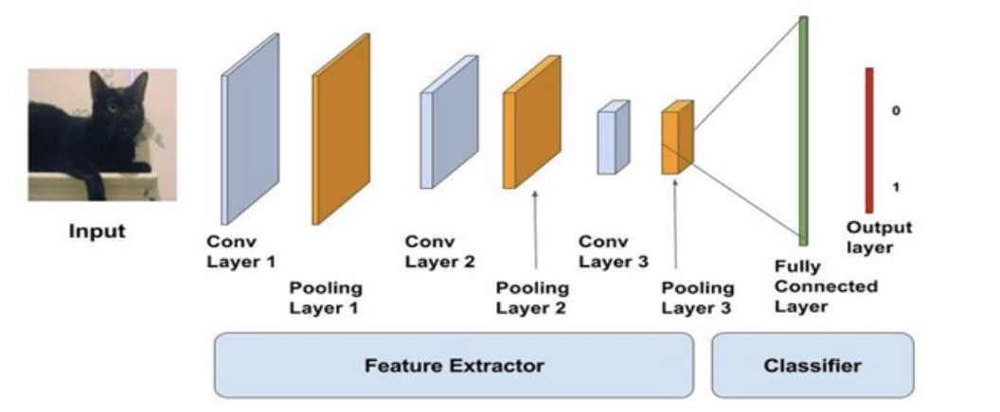
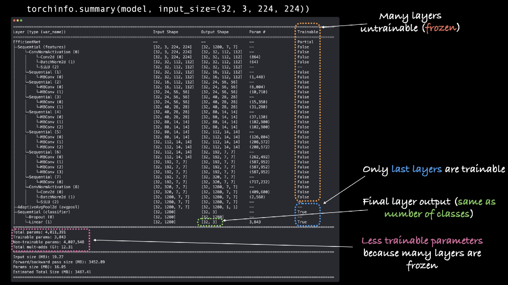
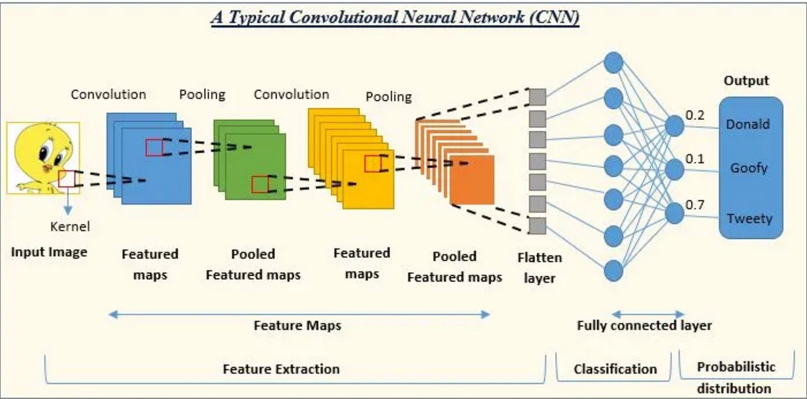

# Data Augmentation, APIs, & Transfer Learning

## SQL and Relational Databases

  

> Relational Database Management System

## Postman App APIs

  

> Deploy a model as a service via an API

## Intro to Transfer Learning

  

> Training Models: these models can be saved and deployed for the world to use. Training these models require a large amount of computing resources and dollars. Let's rather use models that have already been created and build our apps by piggy backing.

 

  

> Transfer Learning: These models are robust, and have been tested in detail and perform extremely well. We can take the patterns (also called weights) that another model has learned from a different use case and use it solve our own problem. We could also take the patterns from a language model (a model that's been through large amounts of text to learn a representation of language) and use them as the basis of a model to classify different text samples.

 

  

> We can leverage an existing model (a neural network architecture) proven to work on problems like our own. We can leverage a working model which has already learned patterns on similar data to our own. This often results in achieving great results with less custom data from available small datasets.

 

  

> A study into the effects of whether training from scratch or using transfer learning was better from a practitioner's point of view found transfer learning to be far more beneficial in terms of cost and time. Suddenly lots more people can do world-class work with less resources and less data

 

  

> Finetuning: the first way to use pretrained models in CNN applications. Instead of random initialization, we initialize the network with a pretrained network. However, we unfreeze some or all pre-trained layers to update their weights on new data. Thus, the rest of the training looks as usual.

 

  

> Feature Extraction: the second way to use pretrained models in ConvNet applications. Here, we will freeze the weights for all the Convolution layers. The last or last few fully connected layers are replaced with a new one with random weights and trained.

 

  

> Feature Extraction with EfficientNetB0: the backbone pretrained on ImageNet stays the same (frozen), and only the final linear classifier layer (`torch.nn.Linear`) changes. Its output shape matches the number of new classes.

  

> In the picture above, we freeze all the layers or parameters in the features section of this `efficientnet_b0` model. Freeze means the weights are not trainable OR as we know it `require_grad = False`. When using a pretrained model, it's important that your custom data going into the model is pre-processed and normalized in the same way as the original training data that went into the model.

 

  

> Convolutional Neural Network (CNN): the input image passes through repeated convolution and pooling layers that build up feature maps (feature extraction). The final feature maps are flattened into a fully connected layer that outputs a probability distribution over the classes (here Tweety at 0.7). In transfer learning, the feature extraction part is what we reuse.

 

## Worked Examples

### Cost Function (Mean Squared Error)

The cost function measures how far a model's predictions are from the true values:

$$
J(\theta) = \frac{1}{2m} \sum_{i=1}^{m} \left( h_\theta(x_i) - y_i \right)^2
$$

- $h_\theta(x_i)$ is the model's prediction for sample $i$, and $y_i$ is the true value
- Squaring removes negative errors so they can't cancel out positive ones
- Dividing by $m$ takes the mean, so the cost doesn't grow just because there are more samples
- The $\frac{1}{2}$ is there to make the math cleaner when taking the derivative during training

**Example:** 3 samples with predictions $(2, 4, 6)$ and true values $(3, 4, 8)$

| Sample | Prediction | True value | Error | Error² |
|---|---|---|---|---|
| 1 | 2 | 3 | −1 | 1 |
| 2 | 4 | 4 | 0 | 0 |
| 3 | 6 | 8 | −2 | 4 |

$$
J = \frac{1}{2 \times 3}(1 + 0 + 4) = \frac{5}{6} \approx 0.833
$$

### Scaling Features: Standardization and Normalization

**Standardization** rescales a feature to have a mean of 0 and a standard deviation of 1:

$$
z = \frac{x - \mu}{\sigma}
$$

**Normalization (min max scaling)** rescales a feature to the range $[0, 1]$:

$$
x' = \frac{x - x_{min}}{x_{max} - x_{min}}
$$

**Example:** the feature values $10, 20, 30$ have $\mu = 20$ and $\sigma = \sqrt{\frac{(10-20)^2 + (20-20)^2 + (30-20)^2}{3}} \approx 8.165$

| $x$ | Standardized $z$ | Normalized $x'$ |
|---|---|---|
| 10 | $(10 - 20) / 8.165 \approx -1.225$ | $(10 - 10) / 20 = 0$ |
| 20 | $0$ | $0.5$ |
| 30 | $\approx 1.225$ | $1$ |

**Log transformation** shrinks large values much more than small ones, which reduces skew and the pull of outliers. With $\log_{10}$, the values $10, 100, 1000$ become $1, 2, 3$.

### ImageNet Input Normalization

Torchvision's pretrained models expect mini batches of 3 channel RGB images shaped $(3 \times H \times W)$, where $H$ and $W$ are at least 224. Each pixel is first scaled from $[0, 255]$ to $[0, 1]$, then normalized per channel with ImageNet's mean and standard deviation:

$$
x_{norm} = \frac{x - \text{mean}_c}{\text{std}_c}
$$

| Channel | Mean | Std |
|---|---|---|
| Red | 0.485 | 0.229 |
| Green | 0.456 | 0.224 |
| Blue | 0.406 | 0.225 |

**Example:** a red channel pixel with value 200

$$
\frac{200}{255} \approx 0.784 \quad \rightarrow \quad \frac{0.784 - 0.485}{0.229} \approx 1.307
$$

Your custom images must go through these exact steps, because the pretrained weights were learned on data prepared this way.
