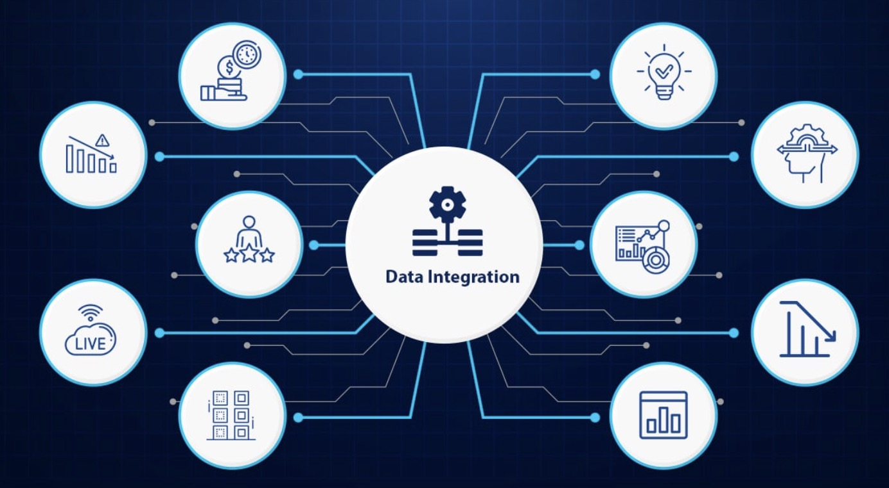
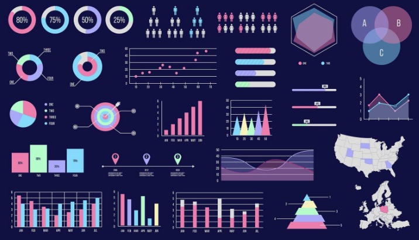
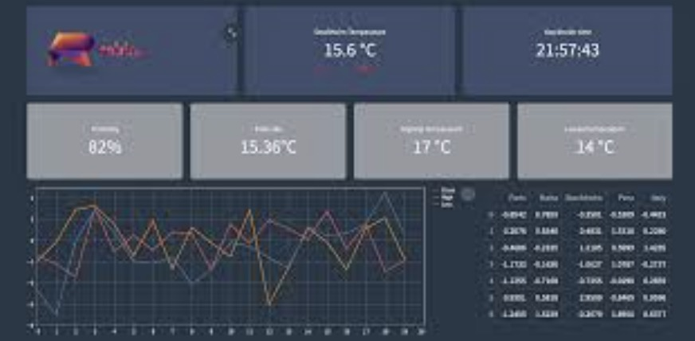
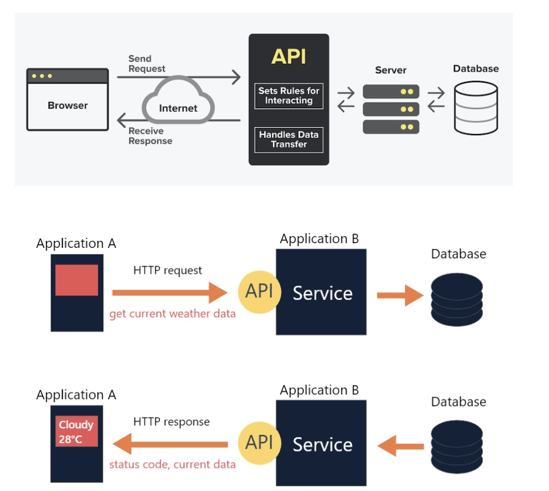
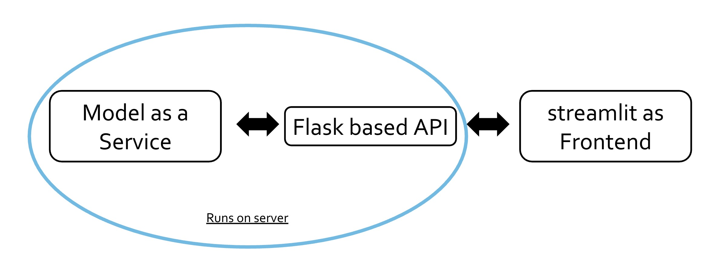
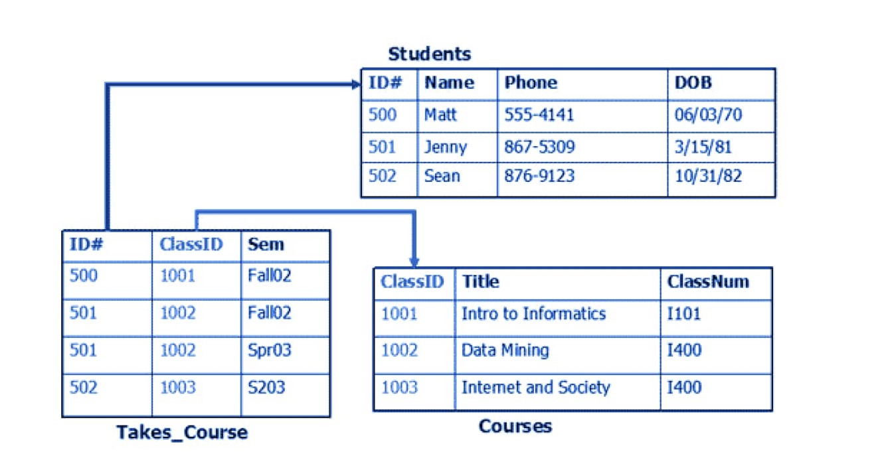

# Data Integration

## What Is Data Integration?

  

> Data integration: combining data from many sources, such as databases, websites, spreadsheets, live feeds, and APIs, into a single unified view dataset that can be analyzed together.

 

  

> Dashboarding: once data is integrated, it can be presented in dashboards of charts, gauges, and maps that summarize key metrics at a glance. In this course, dashboards are built with Streamlit.

 

  

> Visualization systems: applications that present integrated data visually, like this weather dashboard showing live temperature, humidity, and wind readings next to a trend chart and a data table.

## APIs

  

> How APIs work: a browser or application sends a request over the internet to an API, which sets the rules for interacting and handles the data transfer with the server and its database. In the lower example, Application A sends an HTTP request for current weather data, and Application B's API responds with a status code and the data ("Cloudy, 28°C").

### Postman App APIs

  

> Deploy a model as a service via an API

## SQL and Relational Databases

  

> Relational Database Management System
