# Transformers

## Recap

  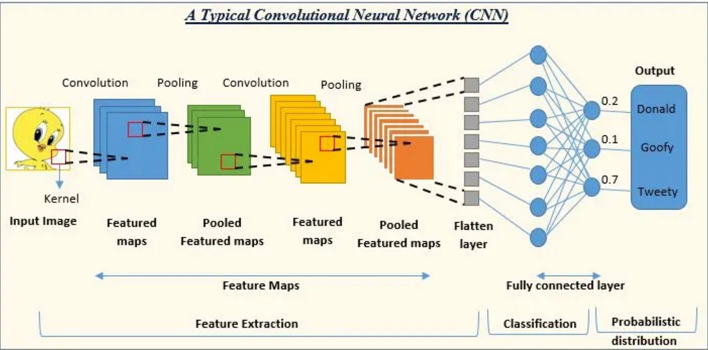

> Convolutional Neural Network (CNN): the input image passes through repeated convolution and pooling layers that build up feature maps (feature extraction). The final feature maps are flattened into a fully connected layer that outputs a probability distribution over the classes (here Tweety at 0.7). In transfer learning, the feature extraction part is what we reuse.

 

  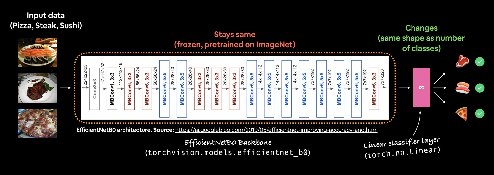

> Feature Extraction with EfficientNetB0: the backbone pretrained on ImageNet stays the same (frozen), and only the final linear classifier layer (`torch.nn.Linear`) changes. Its output shape matches the number of new classes.

## Transformer Architecture

  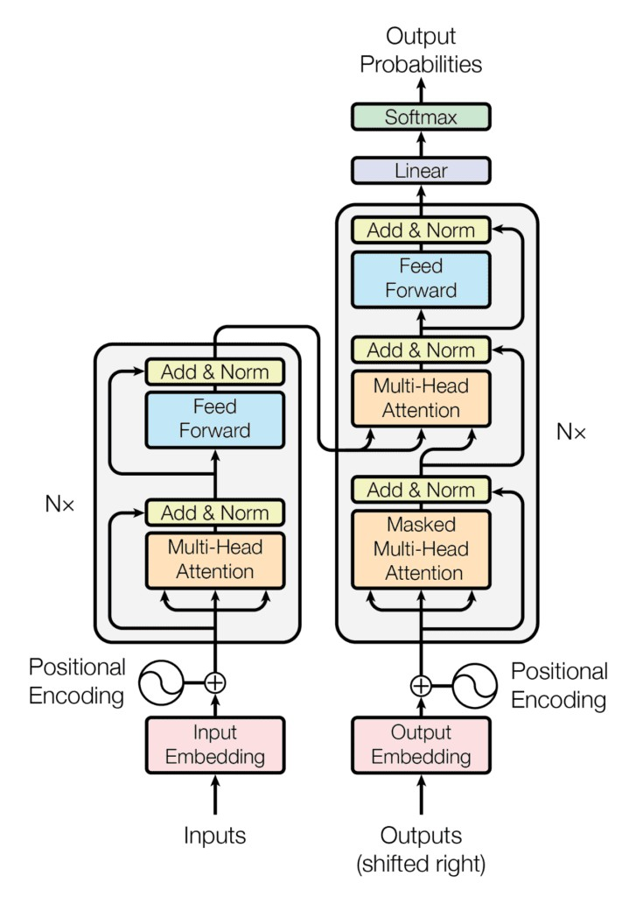

> Transformer architecture: the encoder (left) turns input embeddings plus positional encodings into continuous representations through multi-head attention and feed forward layers, each followed by Add & Norm, repeated N times. The decoder (right) takes the outputs shifted right, applies masked multi-head attention, then attends to the encoder's output. A final linear layer and softmax produce output probabilities. Unlike RNNs and CNNs, there is no recurrence or convolution.

## Hugging Face

  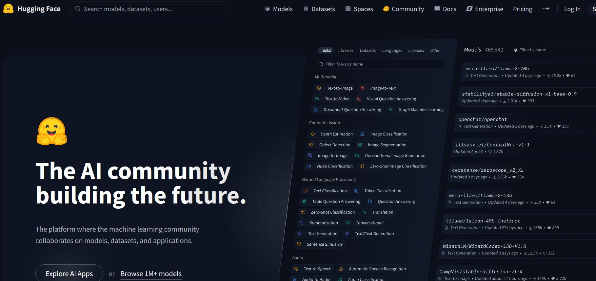

> Hugging Face Hub: an open source community with over a million pretrained models (text, image, audio, multimodal), tens of thousands of datasets, and the libraries used to work with them (`transformers`, `datasets`, `diffusers`, `accelerate`).

 

  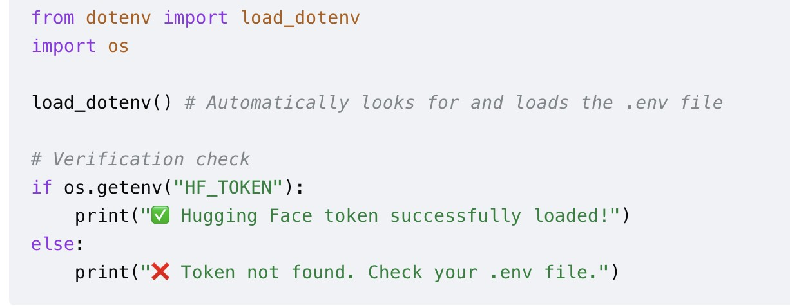

> Loading the Hugging Face token securely: `load_dotenv()` reads the `.env` file in the project folder into environment variables, and `os.getenv("HF_TOKEN")` checks the token loaded. This keeps the token out of the code itself.

## NLP With Pretrained Transformer Models

  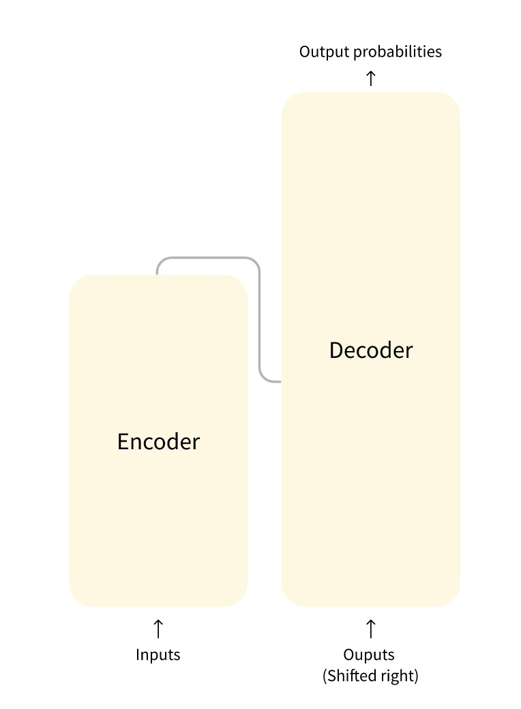

> Encoder and decoder in the NLP context: the encoder builds a representation (features) of the input, so it is optimized for understanding. The decoder uses those features plus the outputs generated so far (shifted right) to produce a target sequence, so it is optimized for generation. Each part can be used on its own.

 

  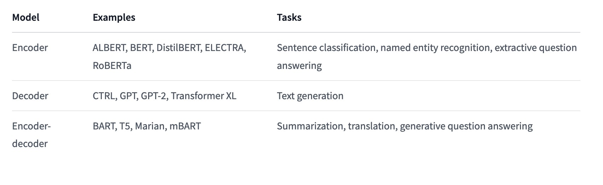

> Model families by type: encoder only models (ALBERT, BERT, DistilBERT, ELECTRA, RoBERTa) handle sentence classification, named entity recognition, and extractive question answering. Decoder only models (CTRL, GPT, GPT-2, Transformer XL) handle text generation. Encoder decoder models (BART, T5, Marian, mBART) handle summarization, translation, and generative question answering.

 

  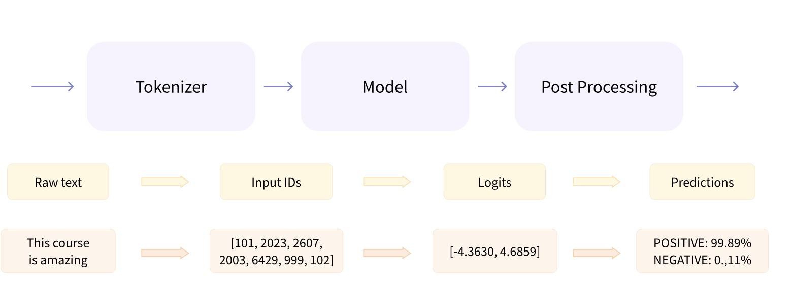

> The 3 step process for NLP apps: raw text ("This course is amazing") goes into the tokenizer, which turns it into input IDs (101 and 102 mark the start and end). The model outputs logits ([-4.3630, 4.6859]), and post processing converts them into predictions (POSITIVE 99.89%).

 

  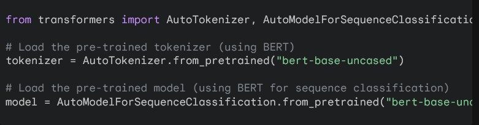

> Starter template for any NLP task: load the tokenizer with `AutoTokenizer` and the model with `AutoModelForSequenceClassification`, both from the same checkpoint (`bert-base-uncased`). Swap the checkpoint name to use a different model from the Hub.

## Inferencing With the Pipeline Class

  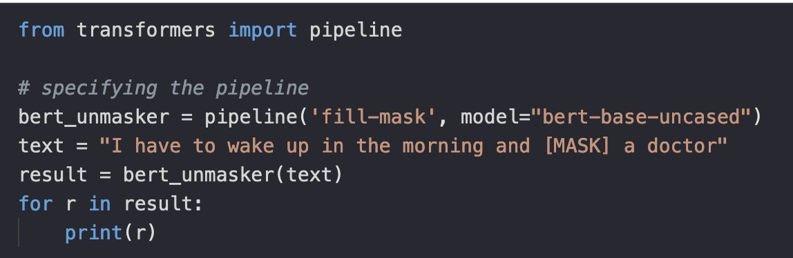

> Fill mask pipeline: `pipeline('fill-mask')` with `bert-base-uncased` predicts the word hidden by `[MASK]` in "I have to wake up in the morning and [MASK] a doctor" and prints each candidate word with its score.

 

  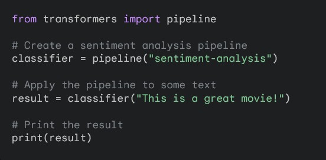

> Sentiment analysis pipeline: given only the task name, the pipeline downloads a default model, tokenizes the text, runs the model, and returns a label with a score for "This is a great movie!" in about 3 lines of code.

## Inside the Pipeline: Model Inputs and Outputs

  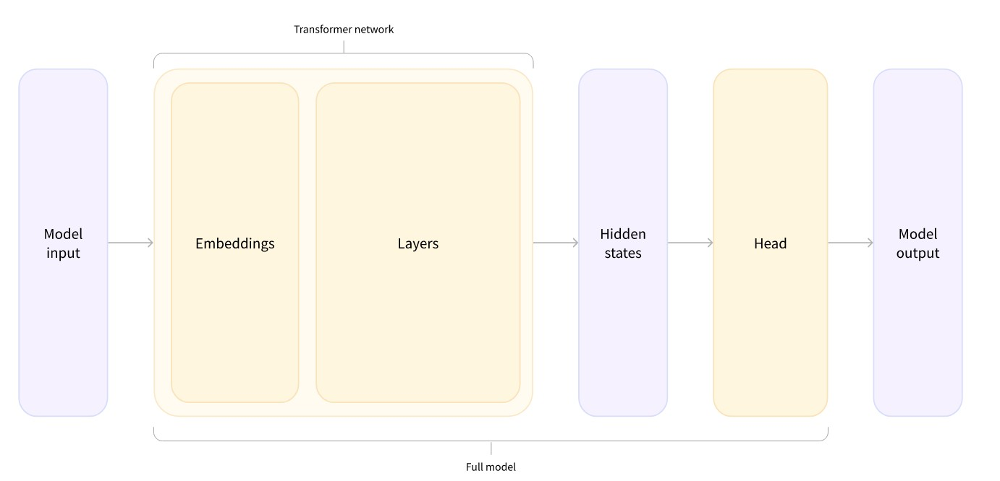

> Full model: the model input goes through the transformer network (embeddings, then layers), which outputs hidden states. The head turns the hidden states into the final model output.

 

  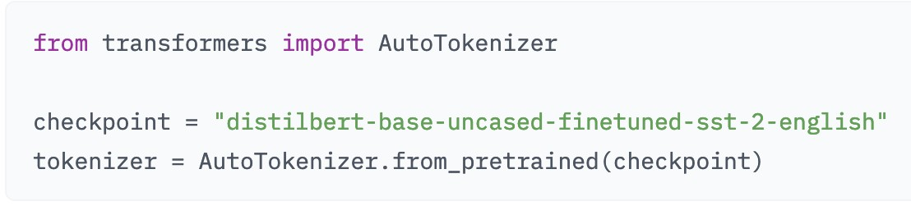

  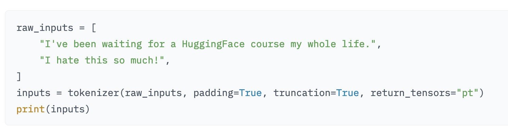

  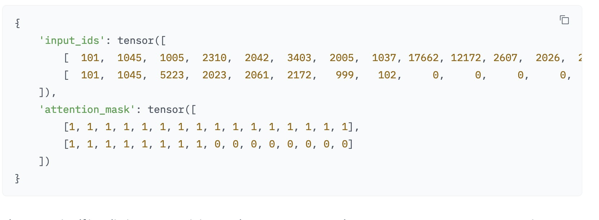

> Preparing the inputs: the tokenizer comes from the `distilbert-base-uncased-finetuned-sst-2-english` checkpoint. Two sentences are tokenized together with `padding=True` and `truncation=True`, and `return_tensors="pt"` returns PyTorch tensors. In the output, each row of `input_ids` starts with 101 ([CLS]). The shorter second sentence is padded with 0s, and its `attention_mask` uses 0 to tell the model to ignore those padding tokens.

 

  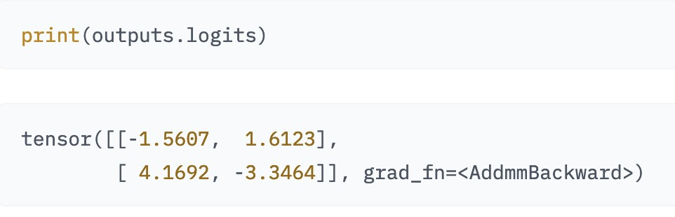

  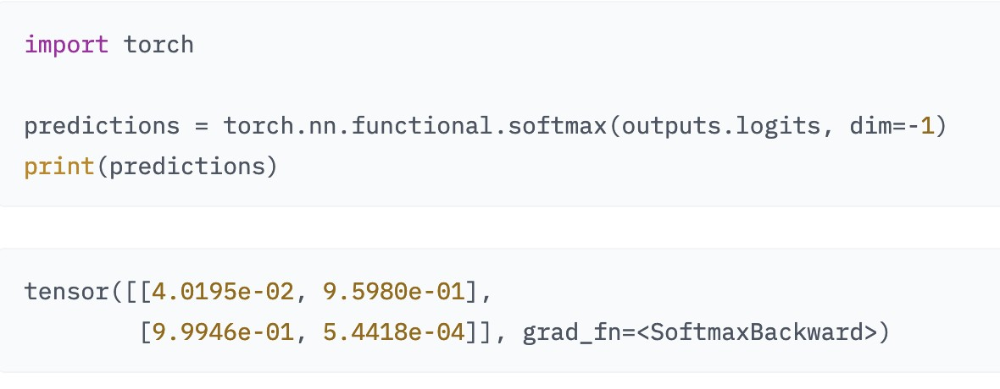

  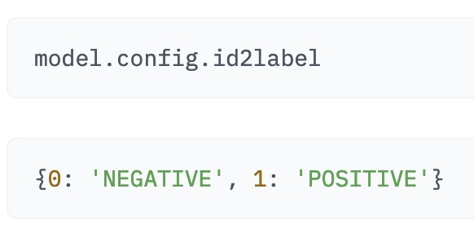

> Post processing: the model outputs raw logits, which are not probabilities. `softmax` with `dim=-1` turns each row into probabilities that add up to 1. `model.config.id2label` maps index 0 to NEGATIVE and 1 to POSITIVE, so the first sentence is 96% positive and the second is 99.95% negative.

## Model Configuration, Loading, and Saving

  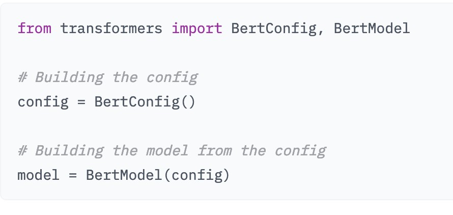

  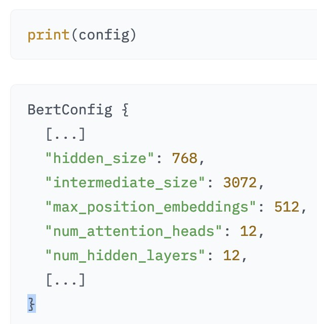

> Building a model from a config: `BertModel(BertConfig())` creates the BERT architecture with random weights, so it is useless for predictions until trained. The config holds attributes like `hidden_size` 768, `num_attention_heads` 12, and `num_hidden_layers` 12.

 

  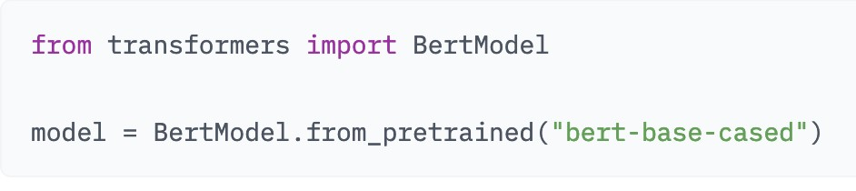

  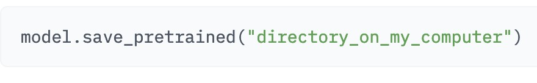

> Loading and saving: `from_pretrained("bert-base-cased")` loads the checkpoint trained by BERT's authors, ready for inference or fine tuning. `save_pretrained()` writes the config (`config.json`) and the weights file to a folder so the model can be reloaded later.

## Fine Tuning With the Trainer Class

  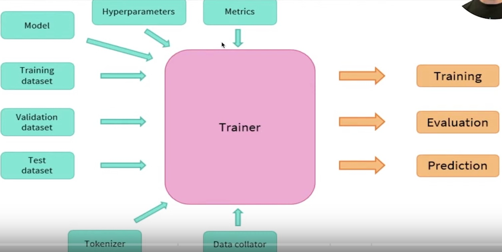

> Trainer: it takes the model, hyperparameters, metrics, training, validation, and test datasets, tokenizer, and data collator, and handles training, evaluation, and prediction without writing a training loop by hand.

 

  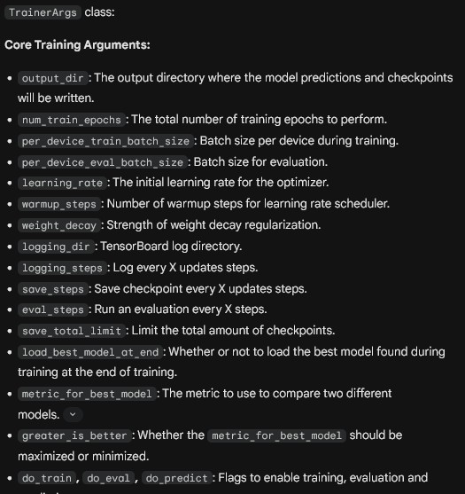

  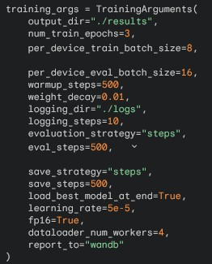

> TrainingArguments: defines every training setting, including the output directory, number of epochs, batch sizes, learning rate, warmup steps, weight decay, logging, how often to evaluate and save, and whether to load the best model at the end. The example trains for 3 epochs with a learning rate of 5e-5 and mixed precision (`fp16=True`). Note: in recent versions of `transformers`, the `evaluation_strategy` argument shown in the screenshot is renamed `eval_strategy`.

 

  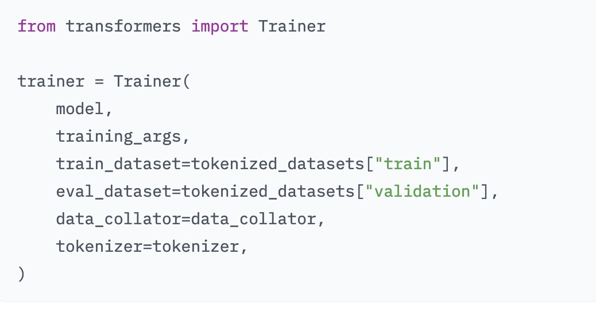

  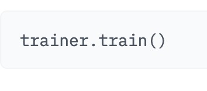

> Creating and running the Trainer: pass the model, training arguments, tokenized training and validation datasets, data collator, and tokenizer, then call `trainer.train()` to fine tune. Note: in recent versions of `transformers`, the `tokenizer=` argument shown in the screenshot is renamed `processing_class=`.

 

  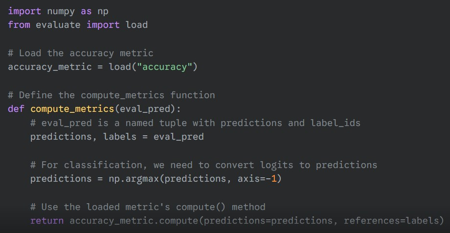

  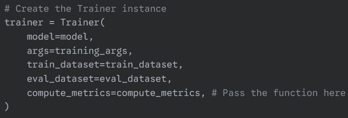

> Computing metrics: `compute_metrics` receives an EvalPrediction (logits and labels), converts the logits to predicted classes with `np.argmax`, and scores them with the accuracy metric loaded from `evaluate`. Pass it to the Trainer with `compute_metrics=compute_metrics`.

## Vision Transformers (ViT)

  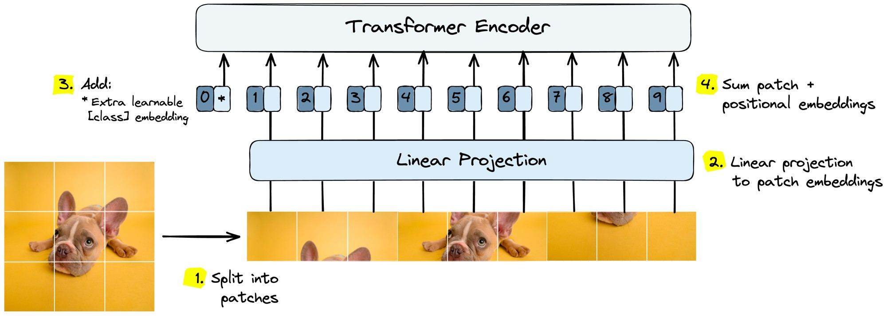

> Image to tokens: the image is split into patches (1), each patch is flattened and linearly projected into a patch embedding (2), a learnable [class] embedding is added at position 0 (3), and position embeddings are summed in (4) before everything enters the transformer encoder.

 

  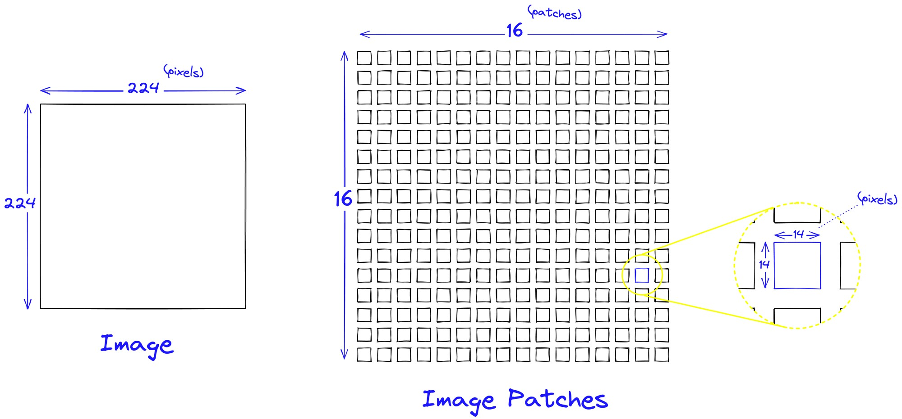

> Image patching: a 224 x 224 pixel image divided into a 16 x 16 grid of patches, where each patch is 14 x 14 pixels.

 

  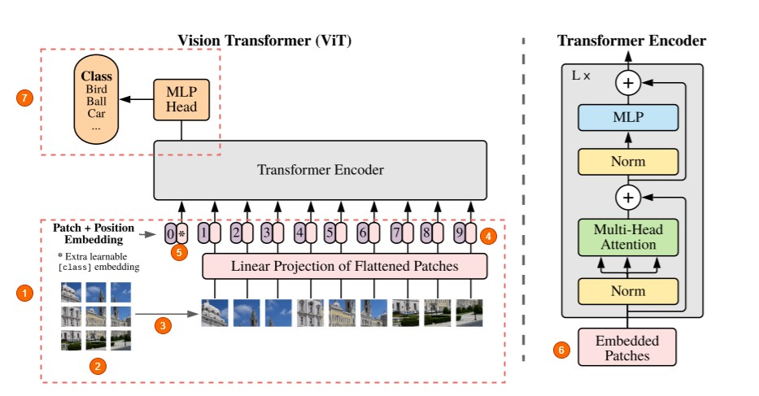

> Vision Transformer architecture: only the encoder is used. Flattened patches go through a linear projection, get position embeddings and an extra learnable class token, and pass through L encoder layers (norm, multi-head attention, norm, MLP, with skip connections). The class token's output goes to an MLP head that predicts the class (bird, ball, car, and so on).
