# Transformers

## Vision Transformers (ViT)

  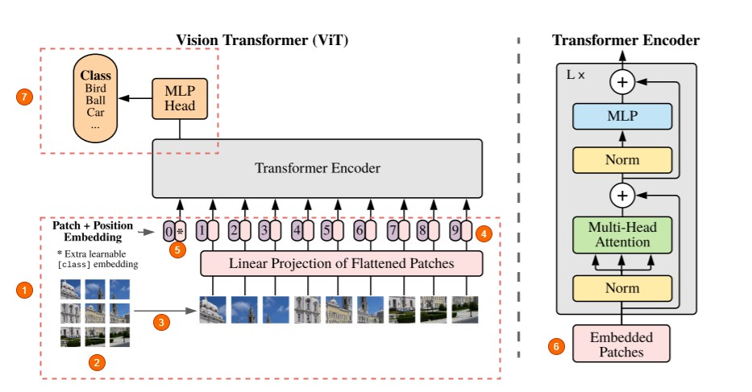

> Vision Transformer architecture: ViT is an encoder only model. The image is treated like a sentence and its patches like tokens. Instead of a decoder, the encoder's output for the class token goes straight into a feed forward network (the MLP head) to produce the classification output.

 

  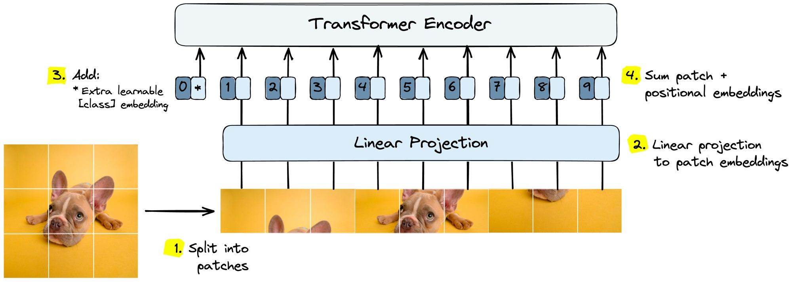

  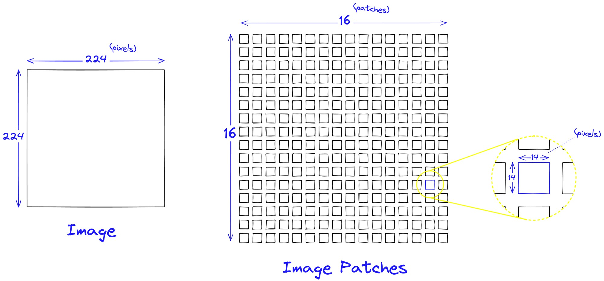

> Image patching and embedding: the model's `image_processor` (ViT's version of a tokenizer) resizes and normalizes each image to match what the pretrained model expects. The image is split into patches, and the first layer linearly projects each flattened patch into a 768 value embedding. For `google/vit-base-patch16-224`, a 224 x 224 image becomes 196 patches of 16 x 16 pixels, and the learnable class token in front makes it 197 tokens. Self attention then scores how related every pair of patches is (a dog's nose patch scores high with its eye or ear patches), which gives ViT global context instead of a CNN's local receptive field. The class token's final vector goes through the classifier and softmax to produce class probabilities.

## Chatbots & Information Retrieval

  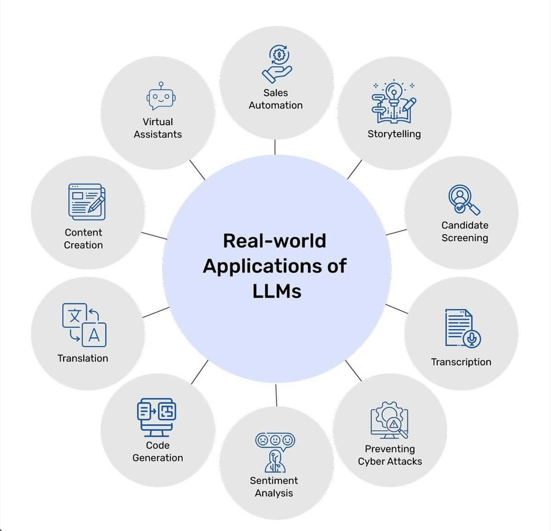

> Real world applications of LLMs: virtual assistants, sales automation, storytelling, candidate screening, transcription, preventing cyber attacks, sentiment analysis, code generation, translation, and content creation.

 

  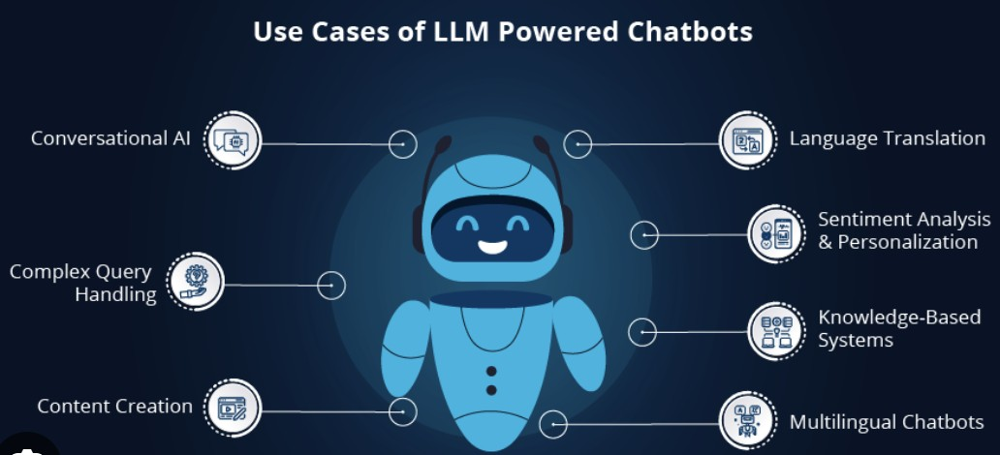

> Use cases of LLM powered chatbots: conversational AI, complex query handling, content creation, language translation, sentiment analysis and personalization, knowledge based systems, and multilingual chatbots. A chatbot is an LLM plus a conversation loop, usually connected to some external knowledge.

 

  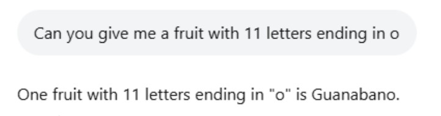

> The knowledge gap problem: asked for an 11 letter fruit ending in "o", the LLM confidently answers "Guanabano", which only has 9 letters. LLMs only know what they were trained on, so without outside info they can give confidently wrong outdated answers.

 

  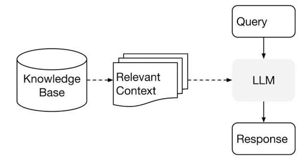

> Retrieval Augmented Generation (RAG): "look it up, then answer." Relevant context is pulled from a knowledge base and handed to the LLM along with the user's query, so the response is based on real information instead of the model's memory.

 

  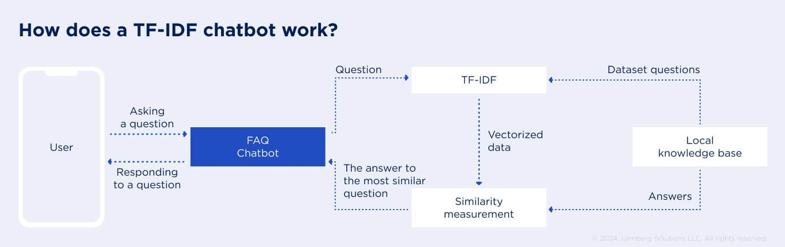

> How a TF-IDF chatbot works: the user asks the FAQ chatbot a question. TF-IDF vectorizes both the question and the stored questions from the local knowledge base, a similarity measurement finds the closest stored question, and the chatbot responds with that question's answer.

## Embeddings & Vector Databases

  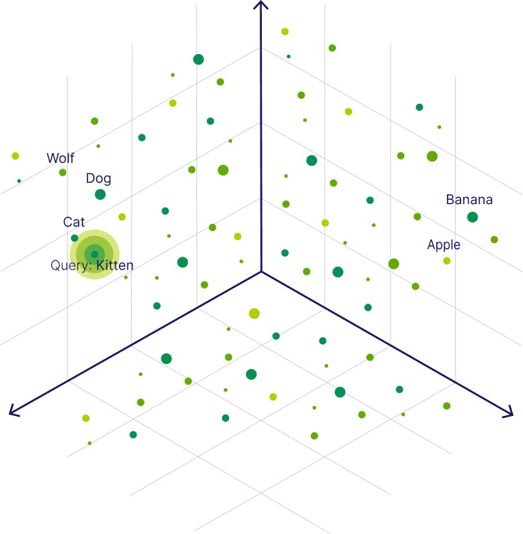

> Embeddings in vector space: similar items end up close together. The query "Kitten" lands right next to Cat, and near Dog and Wolf, while Banana and Apple sit far away. A vector database stores these embeddings so it can quickly find the ones closest to a query, usually by cosine similarity.

## The RAG Pipeline

  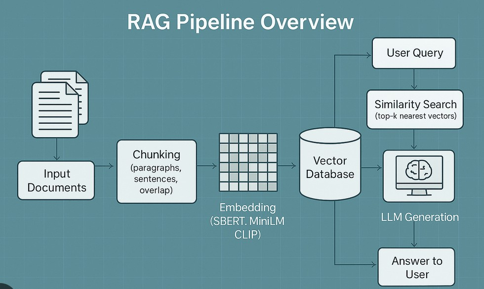

> RAG pipeline overview: input documents are chunked (by paragraphs or sentences, with overlap), embedded with a model such as SBERT, MiniLM, or CLIP, and stored in a vector database. A user query triggers a similarity search for the top k nearest vectors, and the LLM generates the answer from those chunks.

 

  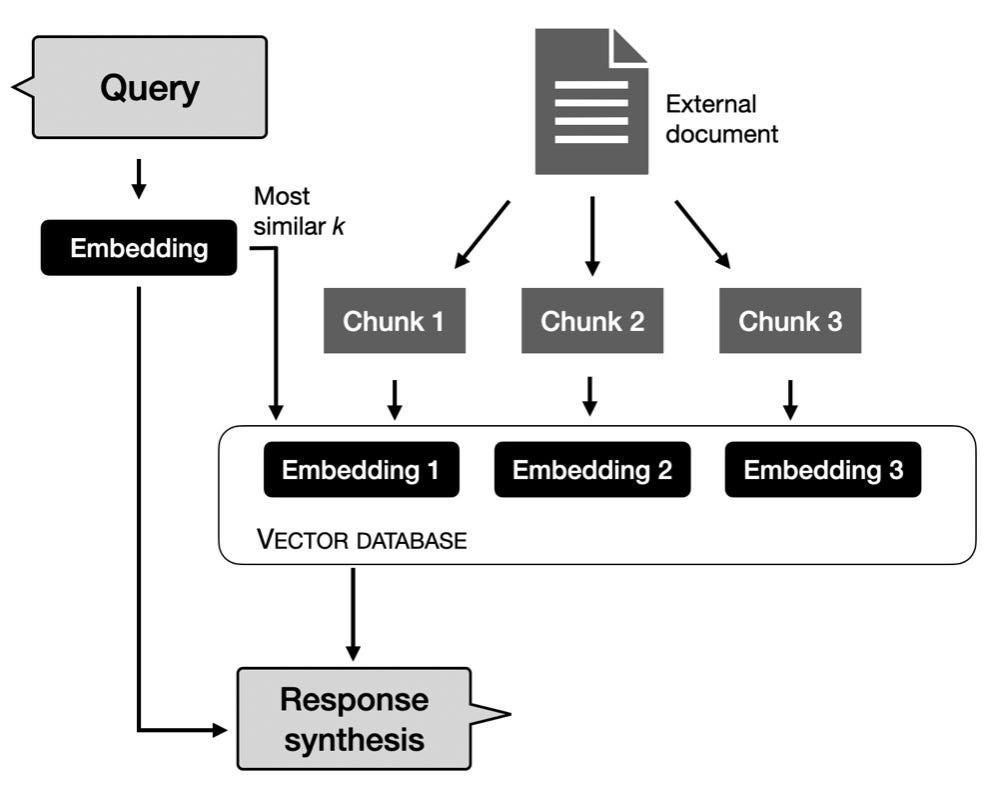

> Chunking and retrieval: an external document is split into chunks, and each chunk's embedding is stored in the vector database. The query is embedded with the same model, the k most similar chunks are retrieved, and they are combined with the query for response synthesis. Fixed size chunking is simple but can cut sentences awkwardly, while semantic chunking splits by meaning.

 

  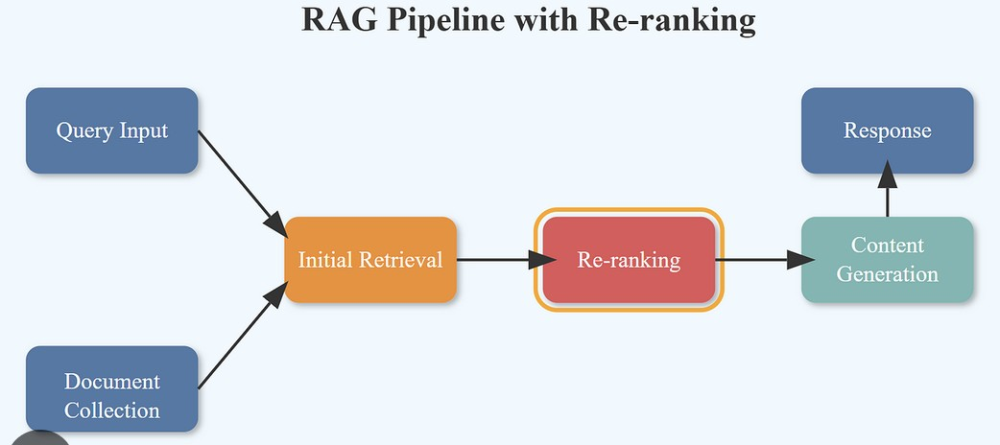

> RAG pipeline with re-ranking: initial retrieval pulls candidate chunks from the document collection, and an optional re-ranking pass reorders them more precisely before content generation. This trades some speed for better accuracy.

 

  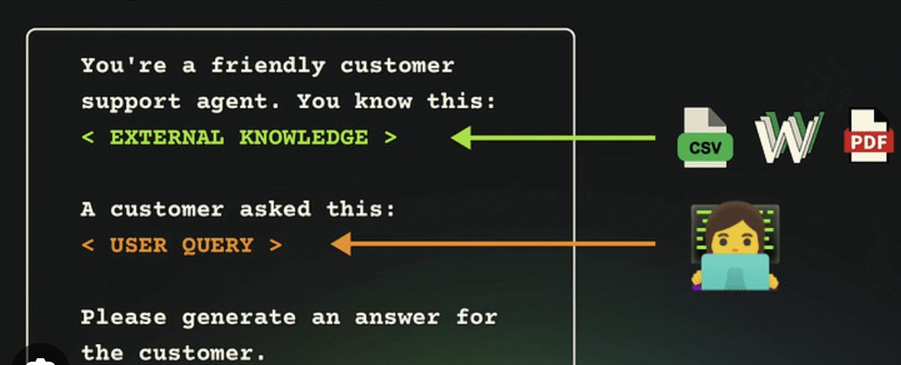

> Prompt augmentation: retrieved external knowledge (from CSV files, Wikipedia, or PDFs) and the user's query are inserted into a prompt template, such as "You're a friendly customer support agent. You know this: <EXTERNAL KNOWLEDGE>." The LLM's job shifts from recalling to reading and synthesizing.

 

  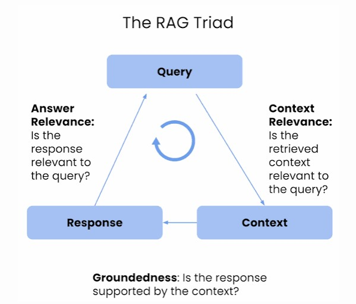

> The RAG triad for evaluation: context relevance (is the retrieved context relevant to the query?), groundedness (is the response supported by the context?), and answer relevance (is the response relevant to the query?). Testing these separately shows whether a bad answer came from bad retrieval or bad generation.

## Applications

  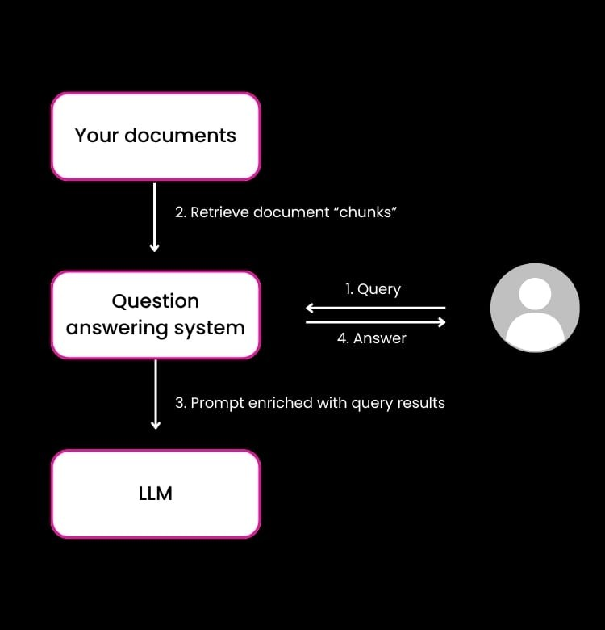

> Document question answering: (1) the user sends a query, (2) the system retrieves relevant chunks from your documents, (3) it sends the LLM a prompt enriched with those results, and (4) it returns the answer. This is the basis for customer support bots and internal document Q&A for HR policies and engineering docs.

## Local LLM Hands-On

  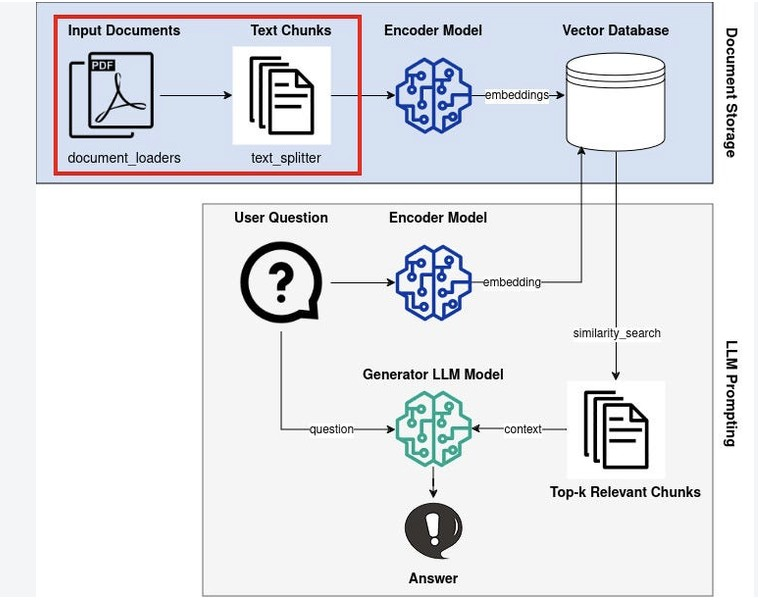

> Local RAG stack: in document storage, input documents are loaded (`document_loaders`), split into text chunks (`text_splitter`), embedded by an encoder model, and saved in a vector database. In LLM prompting, the user's question is embedded by the same encoder model, `similarity_search` returns the top k relevant chunks, and a generator LLM (such as Llama 3.2 through Ollama) answers using both the question and that context. Running it locally keeps data private and avoids API costs and rate limits.

## Worked Examples

### TF-IDF

TF-IDF scores how important a term $t$ is to a document $d$ compared with the whole collection of $N$ documents:

$$
\text{TF-IDF}(t, d) = \text{TF}(t, d) \times \text{IDF}(t)
$$

$$
\text{TF}(t, d) = \frac{\text{count of } t \text{ in } d}{\text{number of words in } d}
\qquad
\text{IDF}(t) = \ln\left(\frac{N}{\text{df}(t)}\right)
$$

where $\text{df}(t)$ is the number of documents that contain $t$.

**Example:** $N = 3$ documents

- D1: "the router reset button"
- D2: "the coffee maker"
- D3: "the thermostat reset"

Scoring three words in D1 (4 words long, so each word's TF is $\frac{1}{4} = 0.25$):

| Word | df | IDF | TF-IDF in D1 |
|---|---|---|---|
| the | 3 | $\ln(3/3) = 0$ | $0.25 \times 0 = 0$ |
| reset | 2 | $\ln(3/2) \approx 0.405$ | $0.25 \times 0.405 \approx 0.101$ |
| router | 1 | $\ln(3/1) \approx 1.099$ | $0.25 \times 1.099 \approx 0.275$ |

"The" appears in every document, so it scores 0 and is useless for finding the right one. "Router" appears only in D1, so it scores highest and points straight to that document.

Note: scikit-learn's `TfidfVectorizer` uses a smoothed version, $\ln\left(\frac{1 + N}{1 + \text{df}(t)}\right) + 1$, and normalizes each document's vector, so its exact numbers differ from this hand calculation. The ranking idea is the same.

### Cosine Similarity

Cosine similarity compares two vectors by the angle between them, not their length:

$$
\cos\theta = \frac{A \cdot B}{\lVert A \rVert \, \lVert B \rVert}
= \frac{\sum_i A_i B_i}{\sqrt{\sum_i A_i^2} \, \sqrt{\sum_i B_i^2}}
$$

**Example:** comparing $A = (3, 4)$ with $B = (4, 3)$

$$
A \cdot B = (3)(4) + (4)(3) = 24
\qquad
\lVert A \rVert = \sqrt{3^2 + 4^2} = 5
\qquad
\lVert B \rVert = 5
$$

$$
\cos\theta = \frac{24}{5 \times 5} = 0.96
$$

The vectors point in almost the same direction, so they are very similar. Other cases with $A = (1, 2)$:

| $B$ | Cosine similarity | Meaning |
|---|---|---|
| $(2, 4)$ | $1$ | Same direction (identical meaning), even though $B$ is twice as long |
| $(2, -1)$ | $0$ | Perpendicular (unrelated) |
| $(-1, -2)$ | $-1$ | Opposite direction |

In a RAG system, the question's embedding is compared with every chunk's embedding this way.  
The chunks with the highest scores are retrieved.
