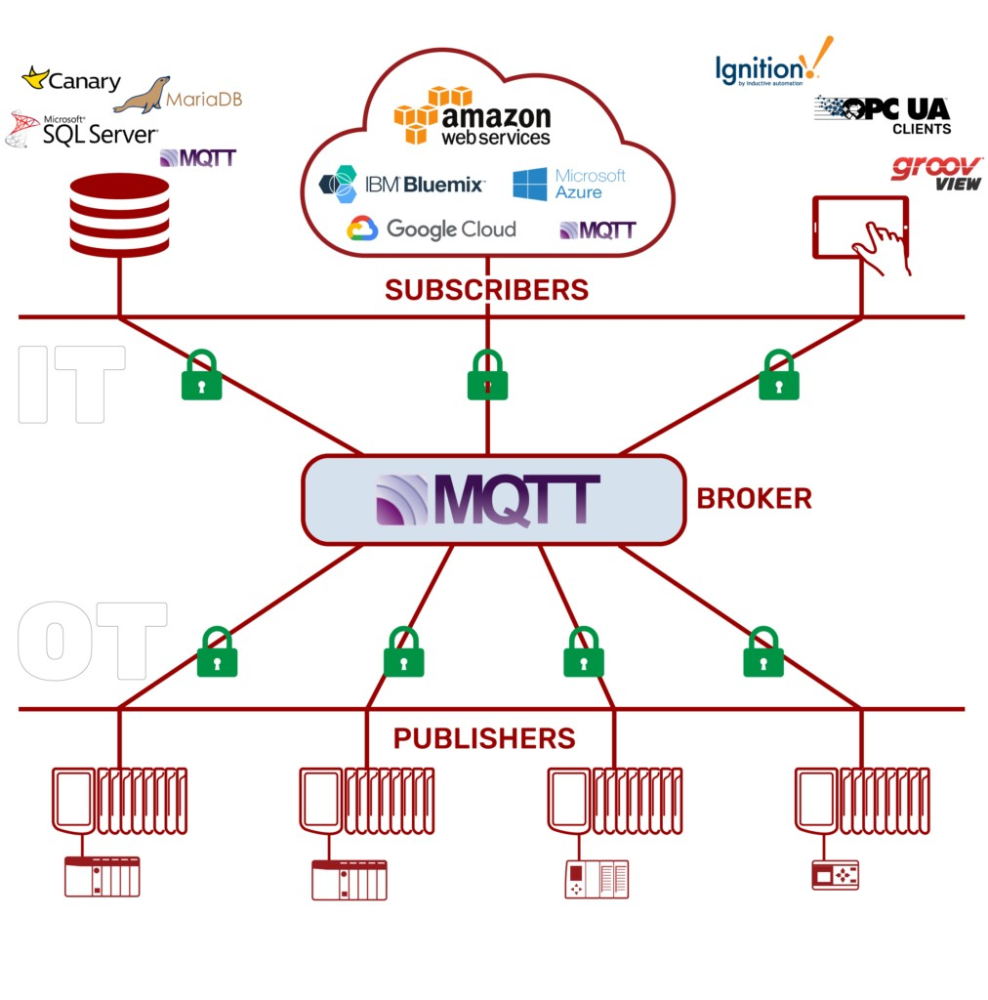
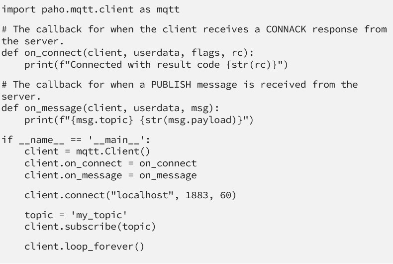
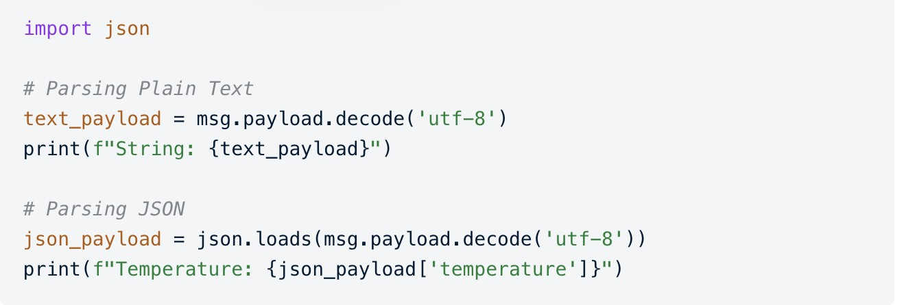

# MQTT

## MQTT

  

> Broker, publish, and subscribe: clients never talk to each other directly. A client publishes a message to the MQTT broker, and the broker forwards it to every client subscribed to that topic. Any client can be a publisher, a subscriber, or both.

 

  

> Connectivity between OT and IT: on the operational technology (OT) side, factory devices and sensors publish data. The MQTT broker sits in the middle, and on the IT side, subscribers such as databases, dashboards, and cloud platforms (AWS, Azure, Google Cloud, IBM Bluemix) receive it. The padlocks show the connections can be secured.

 

  

> Publish and subscribe in action: a temperature sensor publishes "24°C" to the topic `temperature`. Both a mobile device and a backend system subscribed to that topic, so the broker sends the reading to both at once. MQTT is lightweight, bidirectional, scalable to millions of devices, and works on unreliable networks, which makes it the standard for IoT messaging.

## Python and MQTT

  

> Publisher with Paho MQTT: create a client, connect to the broker (`localhost` on port 1883, with a 60 second keepalive), and publish the payload `'on'` to the topic `my_topic`. The broker used in class is Mosquitto, and `test.mosquitto.org` is a free public broker.

 

  

> Subscriber with callbacks: `on_connect` runs when the broker confirms the connection (the CONNACK response), and `on_message` runs whenever a PUBLISH message arrives, printing its topic and payload. The client registers both callbacks, connects, subscribes to `my_topic`, and calls `loop_forever()`, which blocks and waits for messages. Note: this is the Paho 1.x style. With `paho-mqtt` 2.x, create the client with `mqtt.Client(mqtt.CallbackAPIVersion.VERSION1)` to keep these callback signatures, or use `VERSION2`, where `on_connect` takes `(client, userdata, flags, reason_code, properties)`.

 

  

> Retained messages: if nobody is subscribed when a message is published, the broker discards it, which keeps old sensor readings from piling up. Setting `retain=True` tells the broker to keep the last message on the topic and send it immediately to any new subscriber, so a device that reconnects can restore the latest state.

 

  

> Reading the payload: payloads arrive as bytes. For plain text, `msg.payload.decode('utf-8')` turns them into a string. For JSON, decode the bytes first and then `json.loads()` converts the string into a Python dictionary, so values are read like `json_payload['temperature']`. Binary payloads such as images can be sent as raw bytes without decoding, but MQTT is the wrong choice for large payloads or video streaming.
