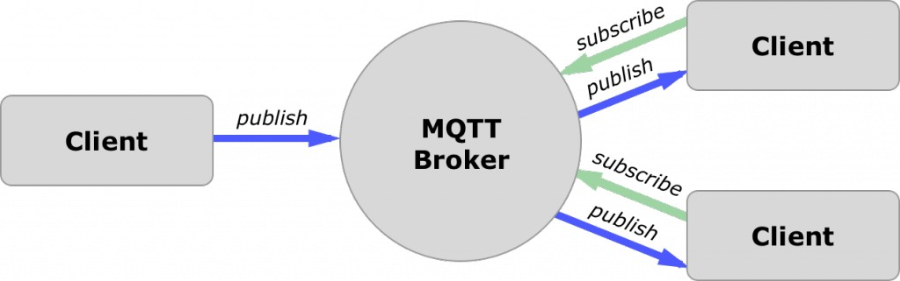
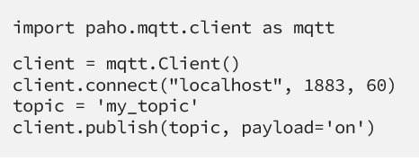
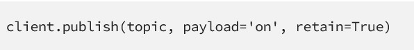
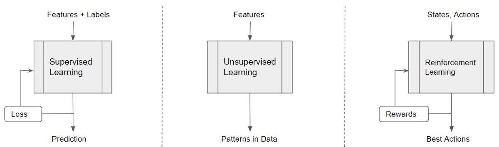
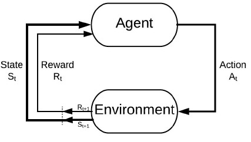
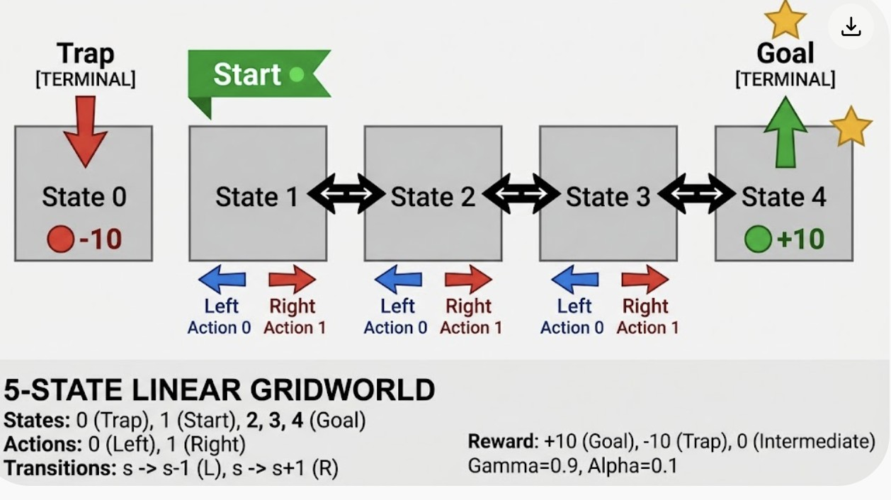

# MQTT & Reinforcement Learning (RL)

## MQTT

<p align="left">
  
</p>

> Broker, publish, and subscribe: clients never talk to each other directly. A client publishes a message to the MQTT broker, and the broker forwards it to every client subscribed to that topic. Any client can be a publisher, a subscriber, or both.

<br>

<p align="left">
  
</p>

> Connectivity between OT and IT: on the operational technology (OT) side, factory devices and sensors publish data. The MQTT broker sits in the middle, and on the IT side, subscribers such as databases, dashboards, and cloud platforms (AWS, Azure, Google Cloud, IBM Bluemix) receive it. The padlocks show the connections can be secured.

<br>

<p align="left">
  
</p>

> Publish and subscribe in action: a temperature sensor publishes "24°C" to the topic `temperature`. Both a mobile device and a backend system subscribed to that topic, so the broker sends the reading to both at once. MQTT is lightweight, bidirectional, scalable to millions of devices, and works on unreliable networks, which makes it the standard for IoT messaging.

## Python and MQTT

<p align="left">
  
</p>

> Publisher with Paho MQTT: create a client, connect to the broker (`localhost` on port 1883, with a 60 second keepalive), and publish the payload `'on'` to the topic `my_topic`. The broker used in class is Mosquitto, and `test.mosquitto.org` is a free public broker.

<br>

<p align="left">
  
</p>

> Subscriber with callbacks: `on_connect` runs when the broker confirms the connection (the CONNACK response), and `on_message` runs whenever a PUBLISH message arrives, printing its topic and payload. The client registers both callbacks, connects, subscribes to `my_topic`, and calls `loop_forever()`, which blocks and waits for messages. Note: this is the Paho 1.x style. With `paho-mqtt` 2.x, create the client with `mqtt.Client(mqtt.CallbackAPIVersion.VERSION1)` to keep these callback signatures, or use `VERSION2`, where `on_connect` takes `(client, userdata, flags, reason_code, properties)`.

<br>

<p align="left">
  
</p>

> Retained messages: if nobody is subscribed when a message is published, the broker discards it, which keeps old sensor readings from piling up. Setting `retain=True` tells the broker to keep the last message on the topic and send it immediately to any new subscriber, so a device that reconnects can restore the latest state.

<br>

<p align="left">
  
</p>

> Reading the payload: payloads arrive as bytes. For plain text, `msg.payload.decode('utf-8')` turns them into a string. For JSON, decode the bytes first and then `json.loads()` converts the string into a Python dictionary, so values are read like `json_payload['temperature']`. Binary payloads such as images can be sent as raw bytes without decoding, but MQTT is the wrong choice for large payloads or video streaming.

## Intro to Reinforcement Learning

<p align="left">
  
</p>

> Where RL fits in: supervised learning takes features and labels and learns from a loss to make predictions. Unsupervised learning takes only features and finds patterns in data. Reinforcement learning takes states and actions and learns from rewards to find the best actions. It is used for control and decision tasks such as driving, robotics, trading, and games.

<br>

<p align="left">
  
</p>

> The RL loop: the agent takes an action in the environment, and the environment responds with a new state and a reward. Like training a dog with treats, the agent learns by trial and error over repeated trials until it knows the policy.

<br>

<p align="left">
  
</p>

> Tic tac toe as RL: (1) the opponent's move sets the initial state, (2) the agent uses only the current state to decide where to place its token, (3) that action is passed to the environment, (4) the environment outputs the next state and a reward (+10 win, −10 loss, 0 in between), and (5) these become the agent's input for the next time step. The agent's goal is to maximize the cumulative reward, not just the immediate one.

## Solving the RL Problem

<p align="left">
  
</p>

> Structuring the problem as an MDP: define the states, actions, and rewards (a Markov Decision Process), apply a reinforcement learning algorithm, and the result is a trained agent with the optimal policy. Finding the optimal policy solves the RL problem.

<br>

<p align="left">
  
</p>

> Agent and environment at each time step: the agent sees state $S_t$ and reward $R_t$ and picks action $A_t$. The environment returns the next reward $R_{t+1}$ and state $S_{t+1}$. Q-learning is a model free algorithm, so it treats the environment as a black box and learns only by acting and seeing what happens, instead of predicting the outcome beforehand like a model based (planning) algorithm.

## Q-Learning

<p align="left">
  
</p>

<p align="left">
  
</p>

> Q-learning on a 3 x 3 grid: the player starts at the bottom and wants to reach the Goal (+5) while avoiding Danger (−10). Clear squares give 0. In each square the player can move left, right, up, or down, so there are 9 states and 4 actions. The Q-table has a row for each state and a column for each action, and every Q value starts at 0. Q-learning fills it in with the optimal Q values over training.

<br>

<p align="left">
  
</p>

> The Q-learning loop: (1) initialize all Q values to zero and pick the initial state, (2) choose an action using an ε-greedy policy, (3) take the action and observe the reward and next state $(S_1, a_1, R_1, S_2)$, and (4) update the current Q value toward the target Q value using $Q(S,A) = Q(S,A) + \alpha(R + \gamma \max Q(S',a) - Q(S,A))$. The next state becomes the current state and the loop repeats. Q values carry over between episodes so the policy can converge.

## Exercise 5

<p align="left">
  
</p>

> 5 state linear gridworld: State 0 is a trap (−10) and State 4 is the goal (+10), and both are terminal. The agent starts in State 1, 2, or 3 and can move left (action 0) or right (action 1). Intermediate states give a reward of 0. The exercise uses $\gamma = 0.9$ and $\alpha = 0.1$, runs episodes until the Q values stop changing, and should be built as a reusable Python class for any 1D world with n states.

## Gymnasium

Gymnasium provides ready made simulated environments for training RL agents. Each environment is an `Env` object with an `observation_space` (what the agent can see) and an `action_space` (which actions are valid). Install it with `uv add gymnasium`, or `uv add "gymnasium[box2d]"` for the Box2D environments.

```python
import gymnasium as gym

env = gym.make("FrozenLake-v1")
observation, info = env.reset()

terminated = truncated = False
while not (terminated or truncated):
    action = env.action_space.sample()  # random action
    observation, reward, terminated, truncated, info = env.step(action)

env.close()
```

> Note: the slides say `step()` returns four values ending in `done`. Current Gymnasium returns five: `terminated` means the episode really ended (for example, reaching a goal or trap), and `truncated` means it was cut off early, such as by a time limit. `reset()` returns `(observation, info)`.

A Q-table only works for discrete state spaces, such as a grid, a maze, or Blackjack. In MountainCar, the state is the car's position and velocity, which are continuous, so there are infinitely many states and similar states should behave similarly. There, a neural network is used as a function approximator that takes a state as input and outputs Q values.

## Worked Examples

### The Mineral Explorer

The agent is in a row of 6 states and can move left or right. States 1 and 6 are terminal, and the episode ends when the agent reaches one.

| State | 1 | 2 | 3 | 4 | 5 | 6 |
|---|---|---|---|---|---|---|
| Reward | 100 (terminal) | 0 | 0 | 0 | 0 | 40 (terminal) |

### Reward vs. Return

The **reward** is what the agent gets immediately in one state. The **return** is the long term gain: the sum of all the rewards, with each later one shrunk by the discount factor $\gamma$:

$$
G = R_1 + \gamma R_2 + \gamma^2 R_3 + \gamma^3 R_4 + \dots
$$

This works like money: \$100 today is worth more than \$100 in three years, so future rewards count for less.

**Going left from state 4 with $\gamma = 0.9$:** the agent passes states 4, 3, 2, 1

$$
G = 0 + (0.9)(0) + (0.9)^2(0) + (0.9)^3(100) = 72.9
$$

**The same path with $\gamma = 0.5$:**

$$
G = 0 + (0.5)(0) + (0.5)^2(0) + (0.5)^3(100) = 12.5
$$

A smaller $\gamma$ makes the agent more impatient, because distant rewards shrink much faster.

### Comparing Policies ($\gamma = 0.5$)

Return from each state if the agent **always goes left**:

| State | 1 | 2 | 3 | 4 | 5 | 6 |
|---|---|---|---|---|---|---|
| Return | 100 | 50 | 25 | 12.5 | 6.25 | 40 |

Return from each state if the agent **always goes right**:

| State | 1 | 2 | 3 | 4 | 5 | 6 |
|---|---|---|---|---|---|---|
| Return | 100 | 2.5 | 5 | 10 | 20 | 40 |

For example, going right from state 4: $0 + (0.5)(0) + (0.5)^2(40) = 10$

Neither is best everywhere. Picking the better direction in each state gives the optimal policy $\pi(s) = a$:

| State | 2 | 3 | 4 | 5 |
|---|---|---|---|---|
| Best action $\pi(s)$ | Left | Left | Left | Right |
| Return | 50 | 25 | 12.5 | 20 |

For negative rewards, discounting has the opposite effect: pushing a penalty into the future makes it smaller, like postponing a payment you owe.

### The Q-Function

$Q(s, a)$ is the return you get if you start in state $s$, take action $a$ once, and then behave optimally after that.

**Example: $Q(2, \text{right})$.** Go right once to state 3, then act optimally (go left all the way):

$$
Q(2, \text{right}) = 0 + (0.5)(0) + (0.5)^2(0) + (0.5)^3(100) = 12.5
$$

**Example: $Q(4, \text{right})$.** Go right once to state 5, then act optimally (keep going right):

$$
Q(4, \text{right}) = 0 + (0.5)(0) + (0.5)^2(40) = 10
$$

Doing this for every state and action fills in the full Q-function:

| State | 2 | 3 | 4 | 5 |
|---|---|---|---|---|
| $Q(s, \text{left})$ | **50** | **25** | **12.5** | 6.25 |
| $Q(s, \text{right})$ | 12.5 | 6.25 | 10 | **20** |

The larger value in each column (in bold) matches the optimal policy above. That means once the agent knows $Q(s, a)$, the best action in any state is simply the one with $\max_a Q(s, a)$.

### The Bellman Equation

Computing every return by hand doesn't scale, so the Bellman equation defines $Q$ in terms of itself:

$$
Q(s, a) = R(s) + \gamma \max_{a'} Q(s', a')
$$

- $s$ is the current state and $a$ the current action
- $s'$ is the state you reach after taking $a$, and $a'$ is the action you take there
- $R(s)$ is the immediate reward, and $\gamma \max_{a'} Q(s', a')$ is the discounted return from acting optimally after that

**Check: $Q(2, \text{right})$.** Going right lands in state 3, where the best Q value is $Q(3, \text{left}) = 25$:

$$
Q(2, \text{right}) = 0 + 0.5 \times 25 = 12.5
$$

This matches the long calculation above.

### The Q-Learning Update Rule

Plugging in the Bellman equation directly would overwrite each Q value with a new estimate every time, throwing away what the agent has already learned. The update rule moves the old value only part of the way toward the new estimate:

$$
Q(s, a) \leftarrow Q(s, a) + \alpha \Big( \underbrace{R + \gamma \max_{a'} Q(s', a')}_{\text{target}} - Q(s, a) \Big)
$$

- $\alpha$ is the learning rate, usually around 0.1
- The part in parentheses is the gap between the target and the current estimate (the temporal difference error)

**Example: the 5 state gridworld from Exercise 5** ($\alpha = 0.1$, $\gamma = 0.9$, all Q values start at 0, and terminal states have Q values of 0)

**Step 1.** The agent is in state 3, moves right, and reaches the goal (state 4), getting +10:

$$
Q(3, \text{right}) = 0 + 0.1 \big( 10 + 0.9 \times 0 - 0 \big) = 1.0
$$

**Step 2.** In a later episode, the agent is in state 2 and moves right to state 3, getting 0. The best Q value in state 3 is now 1.0:

$$
Q(2, \text{right}) = 0 + 0.1 \big( 0 + 0.9 \times 1.0 - 0 \big) = 0.09
$$

**Step 3.** The agent again moves right from state 3 to the goal:

$$
Q(3, \text{right}) = 1.0 + 0.1 \big( 10 + 0 - 1.0 \big) = 1.9
$$

The goal's reward spreads backward one state at a time, and each Q value creeps toward its true value instead of jumping there. After enough episodes, the values stop changing, which means they have converged.

### Choosing Actions: ε-Greedy

If the agent always picked the action with the highest Q value from the start, it would keep repeating whatever happened to work first and might never find something better. With an ε-greedy policy, the agent:

- **Explores** with probability $\varepsilon$, taking a random action
- **Exploits** with probability $1 - \varepsilon$, taking the action with $\max_a Q(s, a)$

For example, with $\varepsilon = 0.1$, the agent takes a random action about 1 in every 10 steps and otherwise follows its current best guess.
