# Reinforcement Learning

## Intro to Reinforcement Learning

<p align="left">
  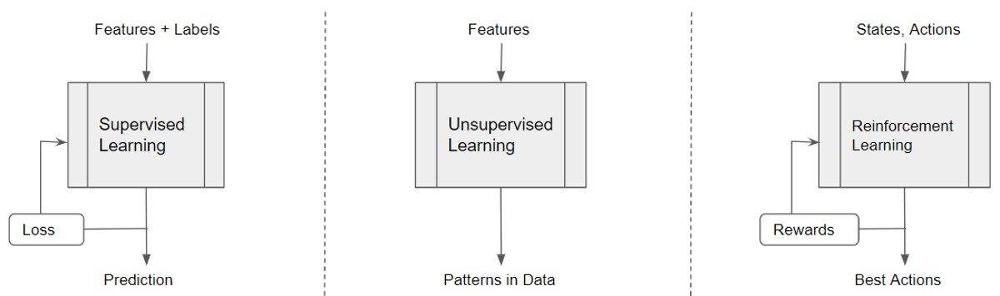
</p>

> Where RL fits in: supervised learning takes features and labels and learns from a loss to make predictions. Unsupervised learning takes only features and finds patterns in data. Reinforcement learning takes states and actions and learns from rewards to find the best actions. It is used for control and decision tasks such as driving, robotics, trading, and games.

<br>

<p align="left">
  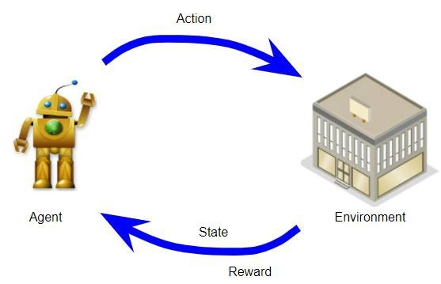
</p>

> The RL loop: the agent takes an action in the environment, and the environment responds with a new state and a reward. Like training a dog with treats, the agent learns by trial and error over repeated trials until it knows the policy.

<br>

<p align="left">
  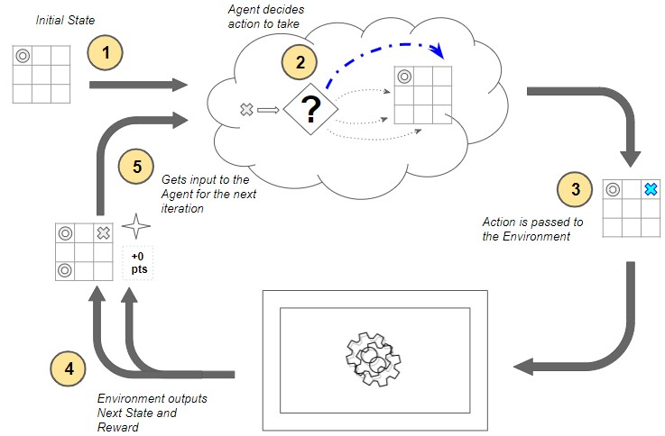
</p>

> Tic tac toe as RL: (1) the opponent's move sets the initial state, (2) the agent uses only the current state to decide where to place its token, (3) that action is passed to the environment, (4) the environment outputs the next state and a reward (+10 win, −10 loss, 0 in between), and (5) these become the agent's input for the next time step. The agent's goal is to maximize the cumulative reward, not just the immediate one.

## Solving the RL Problem

<p align="left">
  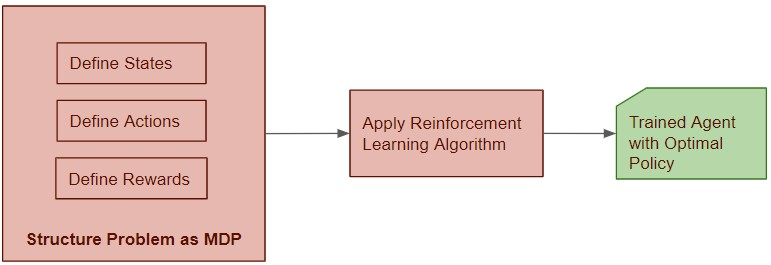
</p>

> Structuring the problem as an MDP: define the states, actions, and rewards (a Markov Decision Process), apply a reinforcement learning algorithm, and the result is a trained agent with the optimal policy. Finding the optimal policy solves the RL problem.

<br>

<p align="left">
  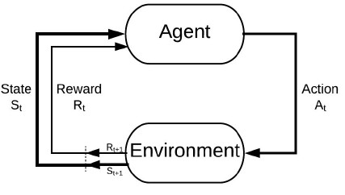
</p>

> Agent and environment at each time step: the agent sees state $S_t$ and reward $R_t$ and picks action $A_t$. The environment returns the next reward $R_{t+1}$ and state $S_{t+1}$. Q-learning is a model free algorithm, so it treats the environment as a black box and learns only by acting and seeing what happens, instead of predicting the outcome beforehand like a model based (planning) algorithm.

## Q-Learning

<p align="left">
  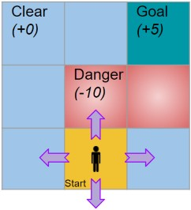
</p>

<p align="left">
  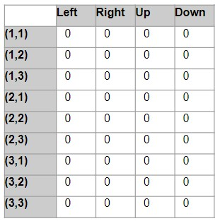
</p>

> Q-learning on a 3 x 3 grid: the player starts at the bottom and wants to reach the Goal (+5) while avoiding Danger (−10). Clear squares give 0. In each square the player can move left, right, up, or down, so there are 9 states and 4 actions. The Q-table has a row for each state and a column for each action, and every Q value starts at 0. Q-learning fills it in with the optimal Q values over training.

<br>

<p align="left">
  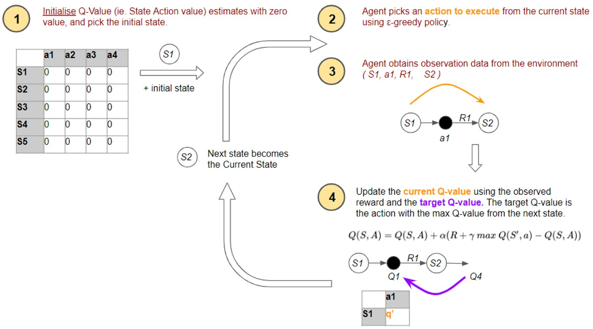
</p>

> The Q-learning loop: (1) initialize all Q values to zero and pick the initial state, (2) choose an action using an ε-greedy policy, (3) take the action and observe the reward and next state $(S_1, a_1, R_1, S_2)$, and (4) update the current Q value toward the target Q value using $Q(S,A) = Q(S,A) + \alpha(R + \gamma \max Q(S',a) - Q(S,A))$. The next state becomes the current state and the loop repeats. Q values carry over between episodes so the policy can converge.

## Exercise 5

<p align="left">
  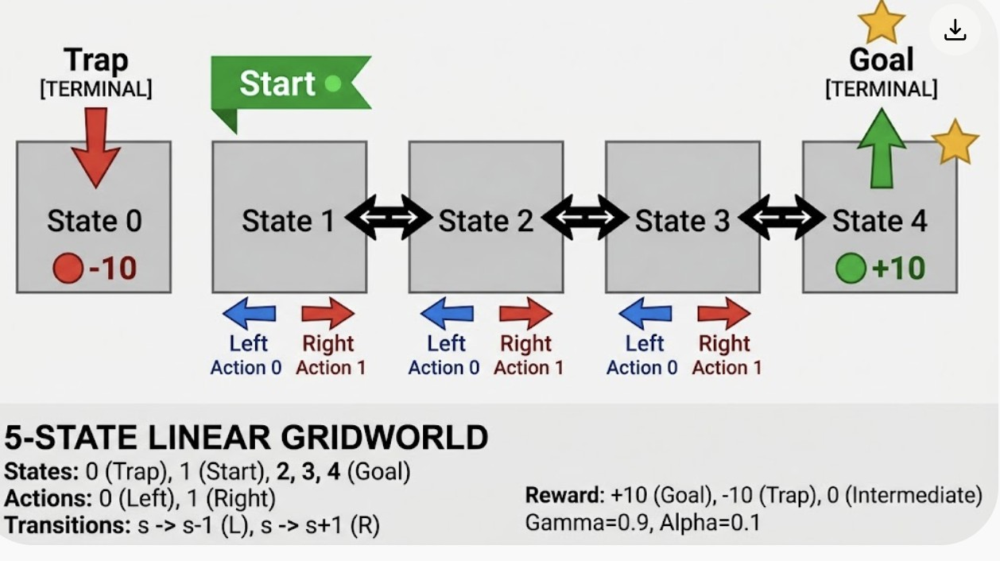
</p>

> 5 state linear gridworld: State 0 is a trap (−10) and State 4 is the goal (+10), and both are terminal. The agent starts in State 1, 2, or 3 and can move left (action 0) or right (action 1). Intermediate states give a reward of 0. The exercise uses $\gamma = 0.9$ and $\alpha = 0.1$, runs episodes until the Q values stop changing, and should be built as a reusable Python class for any 1D world with n states.

## Gymnasium

Gymnasium provides ready made simulated environments for training RL agents. Each environment is an `Env` object with an `observation_space` (what the agent can see) and an `action_space` (which actions are valid). Install it with `uv add gymnasium`, or `uv add "gymnasium[box2d]"` for the Box2D environments.

```python
import gymnasium as gym

env = gym.make("FrozenLake-v1")
observation, info = env.reset()

terminated = truncated = False
while not (terminated or truncated):
    action = env.action_space.sample()  # random action
    observation, reward, terminated, truncated, info = env.step(action)

env.close()
```

> Note: the slides say `step()` returns four values ending in `done`. Current Gymnasium returns five: `terminated` means the episode really ended (for example, reaching a goal or trap), and `truncated` means it was cut off early, such as by a time limit. `reset()` returns `(observation, info)`.

A Q-table only works for discrete state spaces, such as a grid, a maze, or Blackjack. In MountainCar, the state is the car's position and velocity, which are continuous, so there are infinitely many states and similar states should behave similarly. There, a neural network is used as a function approximator that takes a state as input and outputs Q values.

## Q-Learning by Hand

<p align="left">
  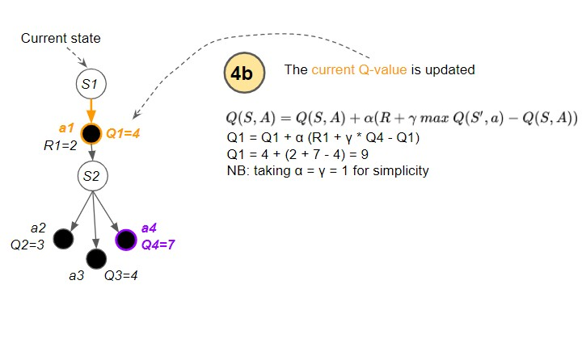
</p>

> One Q-value update: the agent is in state $S_1$, takes action $a_1$ (current $Q_1 = 4$), receives reward $R_1 = 2$, and lands in $S_2$. The best action in $S_2$ is $a_4$ with $Q_4 = 7$, so it becomes the target. With $\alpha = \gamma = 1$ for simplicity, $Q_1 = 4 + (2 + 7 - 4) = 9$.

<br>

<p align="left">
  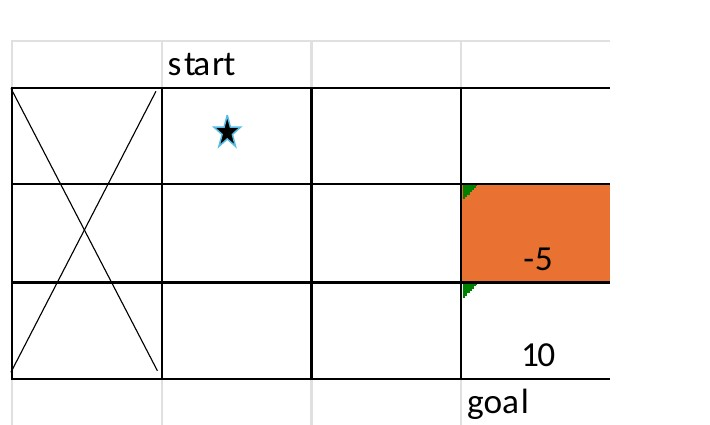
</p>

> Gridworld exercise: the agent starts at the star and can move up, down, left, or right. The crossed out column is off limits, and hitting a wall leaves the agent where it is. The orange square is dangerous (−5) and the square below it is the goal (+10). Every other square gives 0. An episode ends at the goal or after 10 moves, with $\gamma = 0.5$ and $\alpha = 0.5$. Both episodes are worked out step by step in the Worked Examples below.

## Deep Q-Networks (DQN)

<p align="left">
  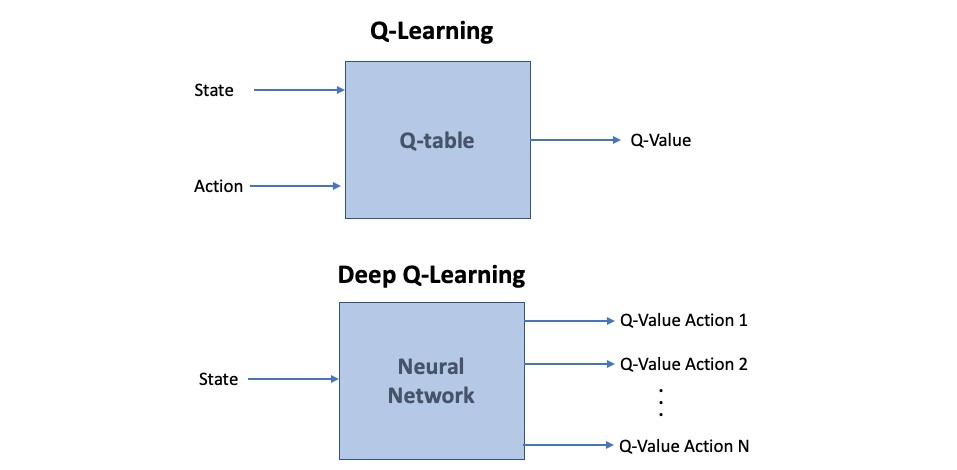
</p>

> Q-learning vs. deep Q-learning: Q-learning looks up a state and action in a Q-table to get one Q value. Deep Q-learning feeds only the state into a neural network, which outputs a Q value for every action in one forward pass. The agent then picks the action with the largest value. This works for continuous state spaces, where a table would need infinitely many rows.

<br>

<p align="left">
  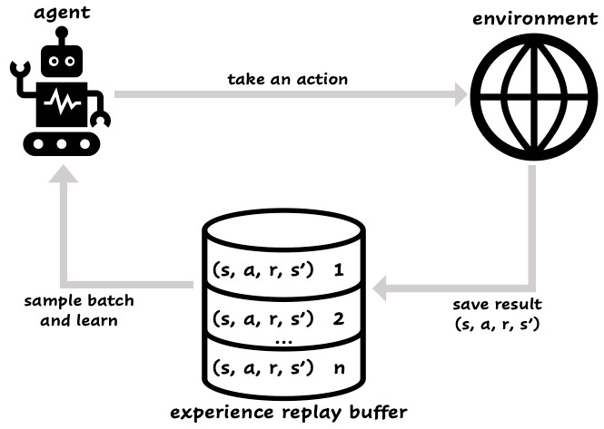
</p>

> Experience replay: as the agent acts, each result is saved as an $(s, a, r, s')$ tuple in the experience replay buffer. Training samples random batches from the buffer instead of learning only from the latest step, which breaks up the correlation between consecutive steps and reuses past experience. In Python, a `deque` with a maximum length works well, since it drops the oldest experience when it's full.

<br>

<p align="left">
  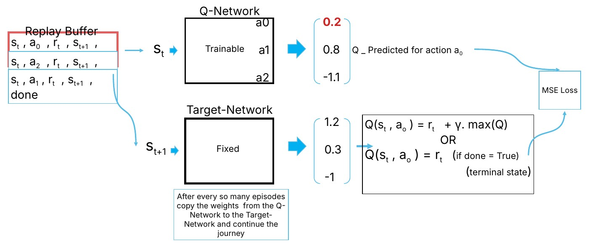
</p>

> DQN training step: a batch is sampled from the replay buffer. The trainable Q network takes $s_t$ and predicts a Q value for each action, and the value for the action actually taken (0.2 for $a_0$) is the prediction. The fixed target network takes $s_{t+1}$, and its largest output (1.2) builds the target $r_t + \gamma \max Q$, or just $r_t$ if the episode ended. The MSE loss between prediction and target updates the Q network, and every so many episodes its weights are copied into the target network.

<br>

<p align="left">
  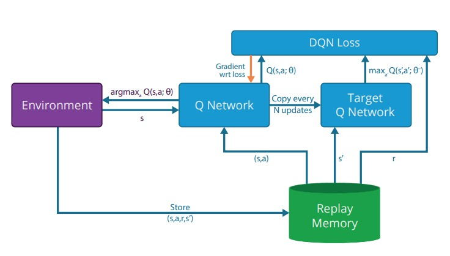
</p>

> Full DQN loop: the agent picks actions with $\text{argmax}_a Q(s, a; \theta)$, and every transition $(s, a, r, s')$ is stored in replay memory. The Q network's prediction $Q(s, a; \theta)$ and the target network's $\max_{a'} Q(s', a'; \theta^-)$ feed the DQN loss, and the gradient of that loss trains only the Q network. The target network is a copy that is refreshed every N updates, which keeps the target from moving with every training step.

## Continuous Action Spaces

<p align="left">
  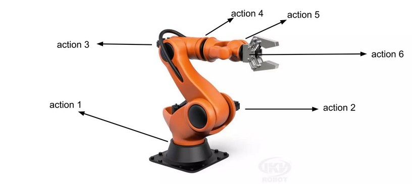
</p>

> Why continuous actions are hard: a pick and place robot arm has countless joint angles (a continuous state space) and can apply any amount of force to each motor (a continuous action space). It has to choose exact values, such as rotating a joint 32.5 degrees, so there is no way to list every action and pick the one with the highest Q value like DQN does.

<br>

<p align="left">
  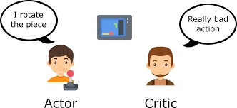
</p>

> Actor critic in a nutshell: the actor plays ("I rotate the piece") and the critic judges the move ("really bad action"). Policy gradient methods adjust the policy directly from feedback, and actor critic methods add a critic that estimates values so the actor learns more efficiently, like an athlete with a coach.

<br>

<p align="left">
  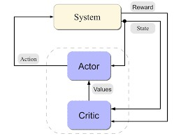
</p>

<p align="left">
  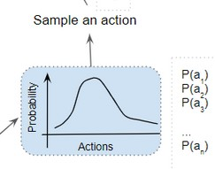
</p>

> How actor critic works: the actor network maps states to actions (unlike DQN, which maps states to Q values). For continuous actions, it outputs the mean and standard deviation of a Gaussian distribution, and the action is sampled from it. The critic network estimates the value of the state, meaning the expected cumulative reward, and sends that feedback to the actor so it can favor actions that lead to higher values.

<br>

<p align="left">
  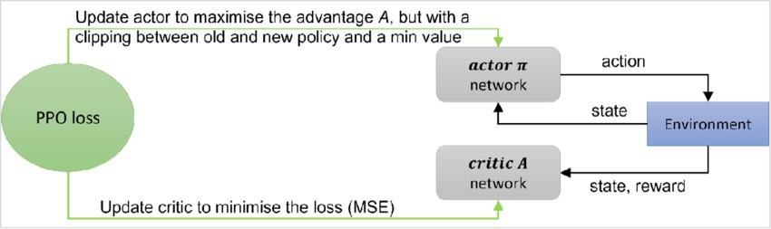
</p>

> Proximal Policy Optimization (PPO): the actor π network chooses actions and the critic A network sees the resulting state and reward. The critic is updated to minimize its MSE loss, and the actor is updated to maximize the advantage, but the change between the old and new policy is clipped to a small range. Like a driving instructor who only allows small, safe adjustments after each lesson, this keeps one lucky result from overhauling the whole policy. The math is worked out in the Worked Examples below.

## Stable Baselines3

Stable Baselines3 (SB3) is a PyTorch based library with reliable, ready to use versions of RL algorithms such as PPO, A2C, SAC, and TD3. It works directly with Gymnasium environments and comes with sensible default hyperparameters. Install it with `uv add "stable-baselines3[extra]"` (Python 3.12 works best).

```python
import gymnasium as gym
from stable_baselines3 import PPO
from stable_baselines3.common.evaluation import evaluate_policy

env = gym.make("CartPole-v1")
model = PPO("MlpPolicy", env, verbose=1)  # MlpPolicy = fully connected network
model.learn(total_timesteps=10_000)

mean_reward, std_reward = evaluate_policy(model, env, n_eval_episodes=10)
print(f"Mean reward: {mean_reward:.1f} +/- {std_reward:.1f}")

model.save("ppo_cartpole")
```

`evaluate_policy` runs the trained model for several episodes and reports its average reward. Training progress can be plotted with TensorBoard or Matplotlib.

## Building Your Own Environment

<p align="left">
  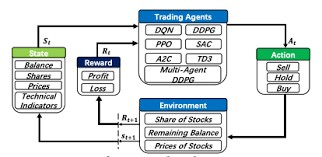
</p>

> A custom trading environment: the state is the account balance, shares held, prices, and technical indicators. The agent (which could use DQN, PPO, A2C, SAC, DDPG, and others) chooses to buy, hold, or sell, and the reward is profit or loss. No ready made environment exists for a problem like this, so you build one and define its state space, action space, reward function, and dynamics yourself.

<br>

<p align="left">
  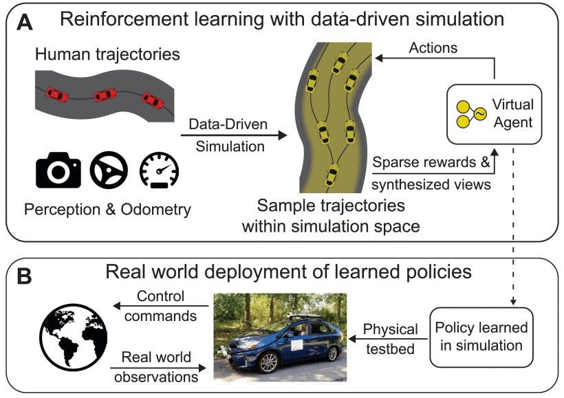
</p>

> Simulating the real world: (A) human driving data from cameras, steering, and speed sensors builds a data driven simulation, where a virtual agent learns by trying actions safely and cheaply. (B) The policy learned in simulation is then deployed on a real car, which sends control commands and receives real world observations. Custom environments make it possible to train for scenarios that would be dangerous, expensive, or slow to test in reality.

### Custom Environment Skeleton

A custom environment is a class that inherits from `gymnasium.Env`, defines its spaces in `__init__`, and implements `reset()` and `step()`. Here is the Mineral Explorer as an environment (states are numbered 0 to 5 here instead of 1 to 6):

```python
import gymnasium as gym
from gymnasium import spaces

class MineralExplorerEnv(gym.Env):
    def __init__(self):
        super().__init__()
        self.observation_space = spaces.Discrete(6)  # 6 states
        self.action_space = spaces.Discrete(2)       # 0 = left, 1 = right
        self.rewards = [100, 0, 0, 0, 0, 40]

    def reset(self, seed=None, options=None):
        super().reset(seed=seed)
        self.state = 3  # state 4 in the slides
        return self.state, {}

    def step(self, action):
        self.state += -1 if action == 0 else 1
        reward = self.rewards[self.state]
        terminated = self.state in (0, 5)  # either end of the row
        return self.state, reward, terminated, False, {}
```

Other useful spaces are `spaces.Box(low, high, shape)` for continuous values like position and velocity, and `spaces.Dict({...})` for states made of several named parts. An optional `render()` method can display the environment as text or graphics.

> Note: like the earlier slides, the custom environment slides say `step()` returns four values ending in `done`. Gymnasium environments should return five, `observation, reward, terminated, truncated, info`, and `reset()` should return `(observation, info)`, or tools like SB3 will raise errors.

## Worked Examples

### The Mineral Explorer

The agent is in a row of 6 states and can move left or right. States 1 and 6 are terminal, and the episode ends when the agent reaches one.

| State | 1 | 2 | 3 | 4 | 5 | 6 |
|---|---|---|---|---|---|---|
| Reward | 100 (terminal) | 0 | 0 | 0 | 0 | 40 (terminal) |

### Reward vs. Return

The **reward** is what the agent gets immediately in one state. The **return** is the long term gain: the sum of all the rewards, with each later one shrunk by the discount factor $\gamma$:

$$
G = R_1 + \gamma R_2 + \gamma^2 R_3 + \gamma^3 R_4 + \dots
$$

This works like money: \$100 today is worth more than \$100 in three years, so future rewards count for less.

**Going left from state 4 with $\gamma = 0.9$:** the agent passes states 4, 3, 2, 1

$$
G = 0 + (0.9)(0) + (0.9)^2(0) + (0.9)^3(100) = 72.9
$$

**The same path with $\gamma = 0.5$:**

$$
G = 0 + (0.5)(0) + (0.5)^2(0) + (0.5)^3(100) = 12.5
$$

A smaller $\gamma$ makes the agent more impatient, because distant rewards shrink much faster.

### Comparing Policies ($\gamma = 0.5$)

Return from each state if the agent **always goes left**:

| State | 1 | 2 | 3 | 4 | 5 | 6 |
|---|---|---|---|---|---|---|
| Return | 100 | 50 | 25 | 12.5 | 6.25 | 40 |

Return from each state if the agent **always goes right**:

| State | 1 | 2 | 3 | 4 | 5 | 6 |
|---|---|---|---|---|---|---|
| Return | 100 | 2.5 | 5 | 10 | 20 | 40 |

For example, going right from state 4: $0 + (0.5)(0) + (0.5)^2(40) = 10$

Neither is best everywhere. Picking the better direction in each state gives the optimal policy $\pi(s) = a$:

| State | 2 | 3 | 4 | 5 |
|---|---|---|---|---|
| Best action $\pi(s)$ | Left | Left | Left | Right |
| Return | 50 | 25 | 12.5 | 20 |

Discounting has the opposite effect for negative awards. Pushing a penalty into the future makes it smaller.

### The Q-Function

$Q(s, a)$ is the return you get if you start in state $s$, take action $a$ once, and then behave optimally after that.

**Example: $Q(2, \text{right})$.** Go right once to state 3, then act optimally (go left all the way):

$$
Q(2, \text{right}) = 0 + (0.5)(0) + (0.5)^2(0) + (0.5)^3(100) = 12.5
$$

**Example: $Q(4, \text{right})$.** Go right once to state 5, then act optimally (keep going right):

$$
Q(4, \text{right}) = 0 + (0.5)(0) + (0.5)^2(40) = 10
$$

Doing this for every state and action fills in the full Q-function:

| State | 2 | 3 | 4 | 5 |
|---|---|---|---|---|
| $Q(s, \text{left})$ | **50** | **25** | **12.5** | 6.25 |
| $Q(s, \text{right})$ | 12.5 | 6.25 | 10 | **20** |

The larger value in each column (in bold) matches the optimal policy above. That means once the agent knows $Q(s, a)$, the best action in any state is simply the one with $\max_a Q(s, a)$.

### The Bellman Equation

Computing every return by hand doesn't scale, so the Bellman equation defines $Q$ in terms of itself:

$$
Q(s, a) = R(s) + \gamma \max_{a'} Q(s', a')
$$

- $s$ is the current state and $a$ the current action
- $s'$ is the state you reach after taking $a$, and $a'$ is the action you take there
- $R(s)$ is the immediate reward, and $\gamma \max_{a'} Q(s', a')$ is the discounted return from acting optimally after that

**Check: $Q(2, \text{right})$.** Going right lands in state 3, where the best Q value is $Q(3, \text{left}) = 25$:

$$
Q(2, \text{right}) = 0 + 0.5 \times 25 = 12.5
$$

This matches the long calculation above.

### The Q-Learning Update Rule

Plugging in the Bellman equation directly would overwrite each Q value with a new estimate every time, throwing away what the agent has already learned. The update rule moves the old value only part of the way toward the new estimate:

$$
Q(s, a) \leftarrow Q(s, a) + \alpha \Big( \underbrace{R + \gamma \max_{a'} Q(s', a')}_{\text{target}} - Q(s, a) \Big)
$$

- $\alpha$ is the learning rate, usually around 0.1
- The part in parentheses is the gap between the target and the current estimate (the temporal difference error)

**Example: the 5 state gridworld from Exercise 5** ($\alpha = 0.1$, $\gamma = 0.9$, all Q values start at 0, and terminal states have Q values of 0)

**Step 1.** The agent is in state 3, moves right, and reaches the goal (state 4), getting +10:

$$
Q(3, \text{right}) = 0 + 0.1 \big( 10 + 0.9 \times 0 - 0 \big) = 1.0
$$

**Step 2.** In a later episode, the agent is in state 2 and moves right to state 3, getting 0. The best Q value in state 3 is now 1.0:

$$
Q(2, \text{right}) = 0 + 0.1 \big( 0 + 0.9 \times 1.0 - 0 \big) = 0.09
$$

**Step 3.** The agent again moves right from state 3 to the goal:

$$
Q(3, \text{right}) = 1.0 + 0.1 \big( 10 + 0 - 1.0 \big) = 1.9
$$

The goal's reward spreads backward one state at a time, and each Q value creeps toward its true value instead of jumping there. After enough episodes, the values stop changing, which means they have converged.

### Choosing Actions: ε-Greedy

If the agent always picked the action with the highest Q value from the start, it would keep repeating whatever happened to work first and might never find something better. With an ε-greedy policy, the agent:

- **Explores** with probability $\varepsilon$, taking a random action
- **Exploits** with probability $1 - \varepsilon$, taking the action with $\max_a Q(s, a)$

For example, with $\varepsilon = 0.1$, the agent takes a random action about 1 in every 10 steps and otherwise follows its current best guess.

### Gridworld: Two Episodes by Hand

This works through the gridworld exercise above with $\gamma = 0.5$ and $\alpha = 0.5$. Squares are written as (row, column), with the start at (0, 1), danger at (1, 3), and the goal at (2, 3). All Q values start at 0. Here the reward comes from the square the agent moves into, and the goal is terminal, so its Q values stay 0.

$$
Q(s, a) \leftarrow Q(s, a) + 0.5 \big( R + 0.5 \max_{a'} Q(s', a') - Q(s, a) \big)
$$

**Episode 1: Right, Right, Down, Down**

| Move | From → To | $R$ | $\max Q(s')$ | Update | New Q |
|---|---|---|---|---|---|
| Right | (0,1) → (0,2) | 0 | 0 | $0 + 0.5(0 + 0 - 0)$ | 0 |
| Right | (0,2) → (0,3) | 0 | 0 | $0 + 0.5(0 + 0 - 0)$ | 0 |
| Down | (0,3) → (1,3) | −5 | 0 | $0 + 0.5(-5 + 0 - 0)$ | **−2.5** |
| Down | (1,3) → (2,3) | +10 | 0 (goal) | $0 + 0.5(10 + 0 - 0)$ | **5.0** |

**Episode 2: Down, Right, Down, Right**

| Move | From → To | $R$ | $\max Q(s')$ | Update | New Q |
|---|---|---|---|---|---|
| Down | (0,1) → (1,1) | 0 | 0 | $0 + 0.5(0 + 0 - 0)$ | 0 |
| Right | (1,1) → (1,2) | 0 | 0 | $0 + 0.5(0 + 0 - 0)$ | 0 |
| Down | (1,2) → (2,2) | 0 | 0 | $0 + 0.5(0 + 0 - 0)$ | 0 |
| Right | (2,2) → (2,3) | +10 | 0 (goal) | $0 + 0.5(10 + 0 - 0)$ | **5.0** |

After two episodes, only the moves right next to the danger and the goal have learned anything. Moving down into the danger square is now −2.5, while moving into the goal from either side is 5.0.

**What a third episode would add:** repeating Episode 2, the move Down from (1,2) to (2,2) now sees $\max Q(2,2) = 5.0$:

$$
Q\big((1,2), \text{Down}\big) = 0 + 0.5 \big( 0 + 0.5 \times 5.0 - 0 \big) = 1.25
$$

The goal's value spreads backward one square per episode, which is why Q-learning needs many episodes to converge.

### DQN: One Training Step

From the class example: there are 4 actions, $\gamma = 0.95$, and one experience from the replay buffer is (state 100, action 0, reward 5, next state 102).

| | Action 0 | Action 1 | Action 2 | Action 3 |
|---|---|---|---|---|
| Q network output for the current state | **2.3** | −1.5 | 0.8 | 0.1 |
| Target network output for the next state | **3.1** | 0.5 | 2.2 | −0.3 |

**1. Prediction:** the action taken was 0, so the Q network's prediction is 2.3. The other three outputs aren't used in this step.

**2. Target:** the largest target network value for the next state is 3.1:

$$
y = R + \gamma \max_{a'} Q_{target}(s', a') = 5 + 0.95 \times 3.1 = 7.945
$$

If the next state were terminal (done = True), the target would just be the reward, $y = 5$.

**3. Loss:**

$$
L = \frac{1}{2} (y - Q(s, a))^2 = \frac{1}{2} (7.945 - 2.3)^2 = \frac{1}{2} (5.645)^2 \approx 15.93
$$

Backpropagation uses this loss to push the Q network's prediction for action 0 up toward 7.945. The target network isn't trained. It only gets a fresh copy of the Q network's weights every so many episodes.

### PPO: The Critic, the Advantage, and Clipping

**Critic target and TD error.** The critic $V_\phi$ estimates how good a state is. After taking an action and seeing reward $r_t$ and the next state:

$$
Q(s_t, a) = r_t + \gamma V_\phi(s_{t+1})
\qquad
\delta_t = Q(s_t, a) - V_\phi(s_t)
$$

The critic is trained to make $V_\phi(s_t)$ closer to $Q(s_t, a)$ by minimizing $\delta_t^2$.

**Example:** $r_t = 1$, $\gamma = 0.9$, $V_\phi(s_t) = 5$, $V_\phi(s_{t+1}) = 6$

$$
Q(s_t, a) = 1 + 0.9 \times 6 = 6.4
\qquad
\delta_t = 6.4 - 5 = 1.4
\qquad
\text{critic loss} = 1.4^2 = 1.96
$$

**Advantage.** The TD error doubles as an estimate of the advantage, $\hat{A}_t \approx \delta_t$: how much better the action turned out than the critic expected. Here $\hat{A}_t = 1.4 > 0$, so the action helped more than expected. If $\hat{A}_t < 0$, it hurt. This is like asking whether a student scored above or below the class average, instead of just looking at the raw score, which can be high or low by luck.

**Clipping the actor update.** The probability ratio compares the new and old policies for the action taken:

$$
r_t = \frac{\pi_{new}(a_t \mid s_t)}{\pi_{old}(a_t \mid s_t)}
$$

A ratio of 1 means no change, 1.5 means the action became 50% more likely, and 0.5 means it became half as likely. PPO maximizes

$$
\min\Big( r_t \hat{A}_t, \ \text{clip}(r_t, 1 - \epsilon, 1 + \epsilon) \, \hat{A}_t \Big)
$$

which stops rewarding changes beyond $\pm\epsilon$. With $\epsilon = 0.2$, the allowed range is 0.8 to 1.2:

| $\hat{A}_t$ | $r_t$ | Unclipped $r_t \hat{A}_t$ | Clipped | PPO uses (the min) | Meaning |
|---|---|---|---|---|---|
| +2 | 1.1 | 2.2 | $1.1 \times 2 = 2.2$ | 2.2 | Good action, small increase, fully counted |
| +2 | 2.5 | 5.0 | $1.2 \times 2 = 2.4$ | 2.4 | Overreacting, so the benefit is capped |
| −2 | 0.9 | −1.8 | $0.9 \times -2 = -1.8$ | −1.8 | Bad action, made a bit rarer, fully counted |
| −2 | 0.2 | −0.4 | $0.8 \times -2 = -1.6$ | −1.6 | Cut too far, so there's no extra credit past 0.8 |

In every case, pushing the ratio past the guardrail earns nothing more, so each update stays small and learning stays steady.

> Note: the slide's intuition examples list ratios of −0.4 and −0.8 for bad actions. A probability ratio can't be negative, since it's one probability divided by another, so the table above uses ratios below 1 to show the same idea.
