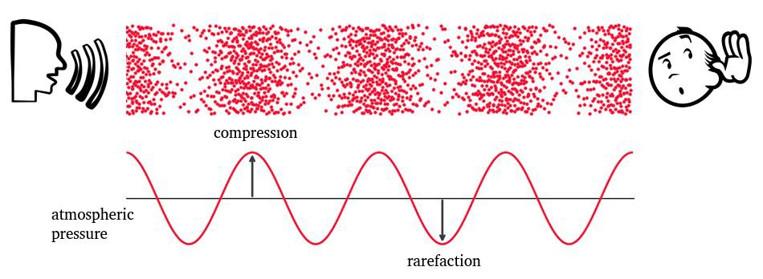
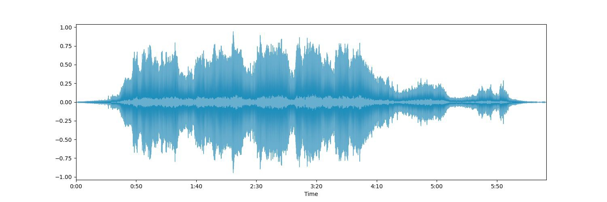
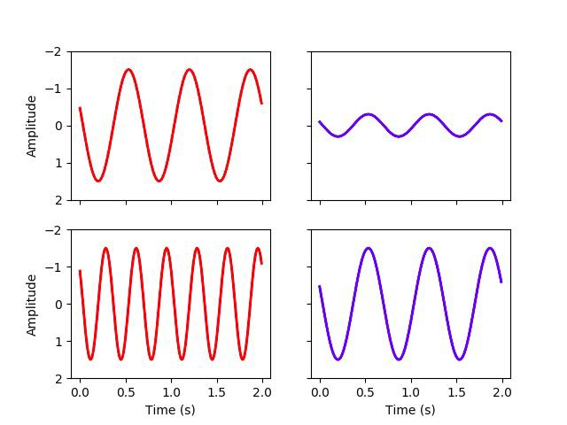

# Audio Analytics

## What Is Audio?

  

> Sound as a wave: a speaker pushes air molecules together (compression) and pulls them apart (rarefaction). The red curve shows the air pressure rising above and falling below normal atmospheric pressure over time, and our ears hear these vibrations as sound. This natural, continuous form is the analog representation, like a song recorded on vinyl.

 

  

> A digital audio waveform: in a computer, audio is just a long, ordered sequence of numbers. Each number is the amplitude (how far the air pressure moved, which we hear as loudness) at one instant, scaled here between −1 and 1. This plot covers about 6 minutes of a song, like an MP3 recorded on your phone. Where an image is a grid of pixels, audio is a line of samples over time.

## Sampling

  

> Sample rate: sampling turns the continuous wave into discrete numbers by measuring its height at regular intervals, like taking snapshots. On the left, a low sample rate uses a few wide bars that only roughly follow the curve. On the right, a higher sample rate uses many thin bars that trace it closely. More samples capture more detail but take more storage.

 

  

> Too few samples: the top left is the original wave. Sampled densely (top right), the points trace its shape. Sampled at only 6 points (bottom left), the shape becomes jagged, and at 2 points (bottom right), it no longer looks like the original wave at all. The Nyquist Shannon sampling theorem says a signal must be sampled at least twice as fast as its highest frequency, or information is lost.

## Audio Signal Characteristics

  

> Frequency and amplitude: the left column shows the same height with a higher frequency below (more cycles per second), which sounds higher in pitch. Frequency is measured in hertz (Hz). The right column shows the same frequency with a larger amplitude below, which sounds louder. Loudness is often measured with root mean square (RMS) energy. Real sounds like speech and music mix many frequencies, so a Fourier transform is used to break them apart and show which frequencies are present.

### Sound Power and Intensity

- **Power** is the energy a sound source gives off per unit of time in all directions, measured in watts (W)
- **Intensity** is sound power per unit area, measured in W/m²
- Human hearing covers a huge range, from the threshold of hearing at $10^{-12}$ W/m² to the threshold of pain at about 10 W/m², so intensity is put on a logarithmic scale and measured in decibels (dB)

### Music Characteristics

- **Beat:** the rhythm of the music
- **Pitch:** how high or low a sound is, set by its frequency
- **Timbre:** the quality or color of a sound, which comes from the mix of frequencies playing at once; it's why a piano and a guitar playing the same note sound different
- **Harmony:** frequencies that are whole number multiples of a base (fundamental) frequency

## Applications

- **Speech recognition:** voice assistants like Siri and Google Assistant turn spoken words into text
- **Music genre classification:** services like Spotify and Apple Music analyze audio features to categorize and recommend songs
- **Sound event detection:** smart home systems recognize sounds like a doorbell or smoke alarm
- **Sound classification:** recognizing everyday urban sounds or identifying birds from their calls
- **Automatic lyrics alignment:** matching lyrics to the sung audio for karaoke or music learning
- **Bioacoustic monitoring:** identifying bird calls or monitoring rainforest sounds to study biodiversity
- **Audio based health diagnostics:** analyzing sounds like coughs to detect respiratory diseases

## Worked Examples

### Nyquist Shannon Sampling Theorem

To capture a signal without losing information, the sampling rate must be at least twice its highest frequency:

$$
f_{sample} \geq 2 f_{max}
$$

**Example:** human hearing tops out around 20 kHz, so audio needs at least $2 \times 20{,}000 = 40{,}000$ samples per second (40 kHz). That's why CDs use 44.1 kHz, which leaves a little room above the minimum.

If you sample a 5 kHz tone at only 8 kHz (below the required 10 kHz), the samples can't keep up with the wave, and it gets recorded as a false lower tone. This is called aliasing, and it's what the 2 point sample in the picture above shows.

### Samples and Storage

The number of samples is the sample rate times the duration:

$$
\text{samples} = f_{sample} \times \text{seconds}
$$

**Example:** a 3 second clip at 44.1 kHz has $44{,}100 \times 3 = 132{,}300$ samples.

If each sample is stored with 16 bits (2 bytes) in mono, each second takes

$$
44{,}100 \times 2 \text{ bytes} = 88{,}200 \text{ bytes} \approx 88 \text{ KB}
$$

so the 3 second clip is about 265 KB uncompressed, and stereo doubles it. Lowering the sample rate to 22.05 kHz halves the size but can only capture frequencies up to 11 kHz.

### Frequency and Period

Frequency is the number of cycles per second, and the period is the time one cycle takes:

$$
T = \frac{1}{f}
$$

**Example:** the A note musicians tune to is 440 Hz, so one cycle lasts $\frac{1}{440} \approx 0.00227$ seconds (2.27 milliseconds). The A one octave higher is 880 Hz, double the frequency, which is the harmony idea of whole number multiples.

### RMS Energy (Loudness)

Root mean square measures the average strength of a signal, ignoring whether samples are positive or negative:

$$
\text{RMS} = \sqrt{\frac{1}{N} \sum_{i=1}^{N} x_i^2}
$$

**Example:** the samples $0.5, -0.5, 0.5, -0.5$

$$
\text{RMS} = \sqrt{\frac{0.25 + 0.25 + 0.25 + 0.25}{4}} = \sqrt{0.25} = 0.5
$$

A plain average of these samples would be 0, even though the sound clearly isn't silent, which is why squaring comes first. For a pure sine wave with peak amplitude $A$, the RMS is $\frac{A}{\sqrt{2}} \approx 0.707A$.

### Decibels

Intensity is converted to decibels relative to the threshold of hearing, $I_0 = 10^{-12}$ W/m²:

$$
L = 10 \log_{10} \left( \frac{I}{I_0} \right) \text{ dB}
$$

**Threshold of hearing:** $L = 10 \log_{10}(1) = 0$ dB

**Threshold of pain** ($I = 10$ W/m²):

$$
L = 10 \log_{10} \left( \frac{10}{10^{-12}} \right) = 10 \log_{10} (10^{13}) = 10 \times 13 = 130 \text{ dB}
$$

Because the scale is logarithmic, doubling the intensity only adds about 3 dB ($10 \log_{10} 2 \approx 3.01$), and every increase of 10 dB means 10 times the intensity.
