# Audio Analytics

## What Is Audio?

<p align="left">
  
</p>

> Sound as a wave: a speaker pushes air molecules together (compression) and pulls them apart (rarefaction). The red curve shows the air pressure rising above and falling below normal atmospheric pressure over time, and our ears hear these vibrations as sound. This natural, continuous form is the analog representation, like a song recorded on vinyl.

<br>

<p align="left">
  
</p>

> A digital audio waveform: in a computer, audio is just a long, ordered sequence of numbers. Each number is the amplitude (how far the air pressure moved, which we hear as loudness) at one instant, scaled here between −1 and 1. This plot covers about 6 minutes of a song, like an MP3 recorded on your phone. Where an image is a grid of pixels, audio is a line of samples over time.

## Sampling

<p align="left">
  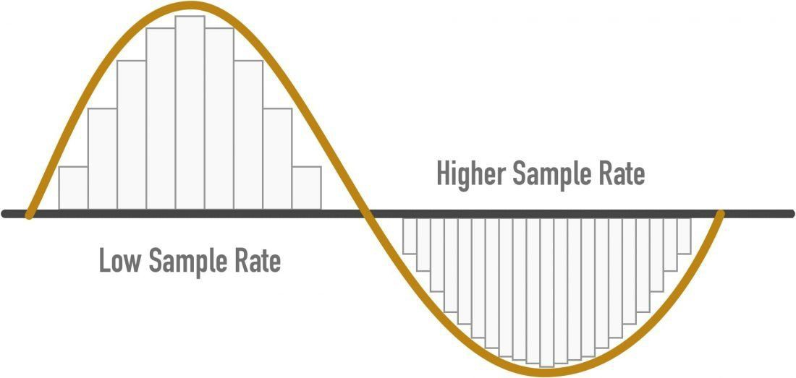
</p>

> Sample rate: sampling turns the continuous wave into discrete numbers by measuring its height at regular intervals, like taking snapshots. On the left, a low sample rate uses a few wide bars that only roughly follow the curve. On the right, a higher sample rate uses many thin bars that trace it closely. More samples capture more detail but take more storage.

<br>

<p align="left">
  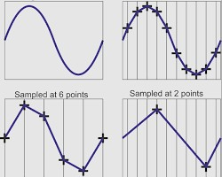
</p>

> Too few samples: the top left is the original wave. Sampled densely (top right), the points trace its shape. Sampled at only 6 points (bottom left), the shape becomes jagged, and at 2 points (bottom right), it no longer looks like the original wave at all. The Nyquist Shannon sampling theorem says a signal must be sampled at least twice as fast as its highest frequency, or information is lost.

## Audio Signal Characteristics

<p align="left">
  
</p>

> Frequency and amplitude: the left column shows the same height with a higher frequency below (more cycles per second), which sounds higher in pitch. Frequency is measured in hertz (Hz). The right column shows the same frequency with a larger amplitude below, which sounds louder. Loudness is often measured with root mean square (RMS) energy. Real sounds like speech and music mix many frequencies, so a Fourier transform is used to break them apart and show which frequencies are present over time.

### Sound Power and Intensity

- **Power** is the energy a sound source gives off per unit of time in all directions, measured in watts (W)
- **Intensity** is sound power per unit area, measured in W/m²
- Human hearing covers a huge range, from the threshold of hearing at $10^{-12}$ W/m² to the threshold of pain at about 10 W/m², so intensity is put on a logarithmic scale and measured in decibels (dB)

### Music Characteristics

- **Beat:** the rhythm of the music
- **Pitch:** how high or low a sound is, set by its frequency
- **Timbre:** the quality or color of a sound that comes from the mix of frequencies playing at once
- **Harmony:** frequencies that are whole number multiples of a base (fundamental) frequency

## Audio Features: Time and Frequency Domains

<p align="left">
  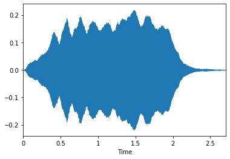
</p>

<p align="left">
  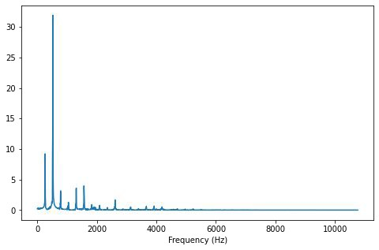
</p>

> The same sound in two domains: the time domain (top) shows amplitude changing over time, which is the raw waveform. The frequency domain (bottom) shows which frequencies the sound contains and how strong each one is, with one tall peak for the main frequency and smaller peaks for its harmonics. Time domain features include the zero crossing rate (how often the signal crosses zero) and RMS energy (average loudness over a short period). Frequency domain features include the spectral centroid (the center of mass of the spectrum), spectral spread (how widely the spectrum is spread around the centroid), and spectral roll off (the frequency below which a set percentage of the energy sits).

## Types of Waveforms

<p align="left">
  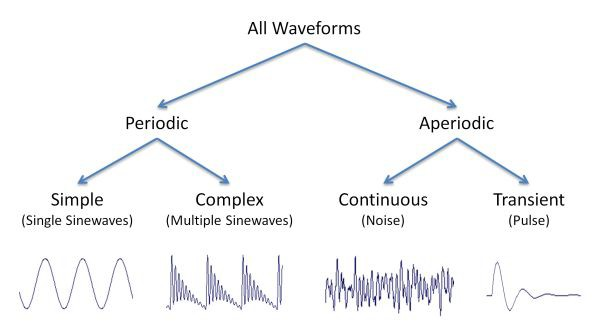
</p>

> All waveforms are either periodic (repeating) or aperiodic (not repeating). Periodic waves are simple, a single sine wave, or complex, several sine waves combined like a musical note. Aperiodic waves are continuous, like noise, or transient, a short pulse like a click.

## The Mel Scale

<p align="left">
  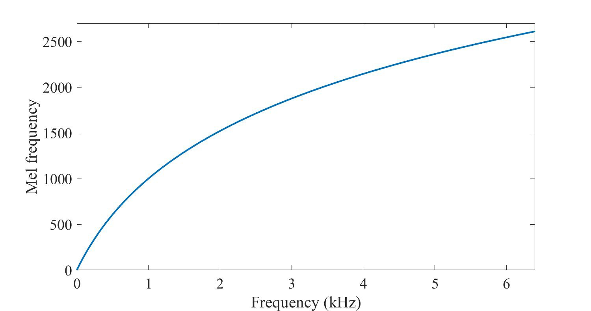
</p>

> Hertz to mels: people hear differences between low frequencies much better than between high ones. 500 Hz and 1000 Hz sound clearly different, but 10,000 Hz and 10,500 Hz are hard to tell apart even though both gaps are 500 Hz. The mel scale, proposed by Stevens, Volkmann, and Newman in 1937, bends frequency so that equal distances sound equally far apart. The curve rises steeply at low frequencies and flattens at high ones, following $m = 2595 \log_{10}\left(1 + \frac{f}{700}\right)$, which makes 1000 Hz equal about 1000 mels.

## Mel-Frequency Cepstral Coefficients (MFCCs)

<p align="left">
  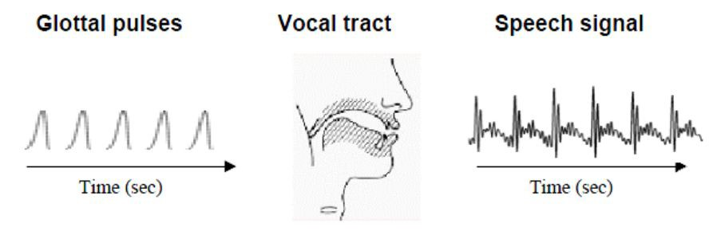
</p>

> How speech is made: the vocal cords produce glottal pulses (the source), and the vocal tract (throat, mouth, and nose) shapes them into the final speech signal (the filter). MFCCs were developed in the 1960s while studying echoes in seismic signals, became the feature of choice for speech recognition in the 1970s, and spread to music processing in the 2000s.

<br>

<p align="left">
  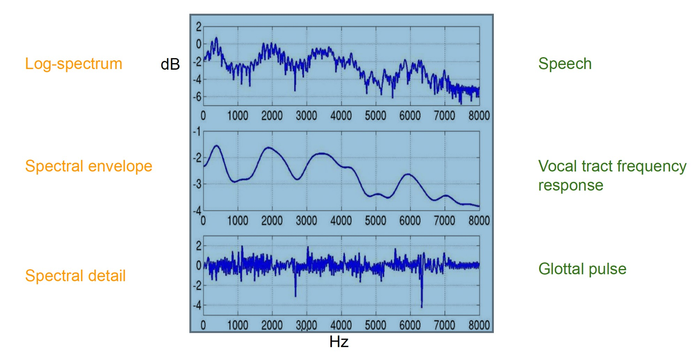
</p>

> Separating source and filter: the log spectrum of speech (top) is the sum of a smooth spectral envelope (middle), which is the vocal tract's frequency response, and fine spectral detail (bottom), which comes from the glottal pulses. MFCCs capture the envelope, which carries the phonemes (the sounds that make up words) and the sound's timbre. Because they are built on the mel scale, they also match how people hear.

<br>

<p align="left">
  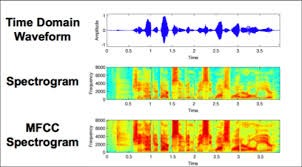
</p>

> Waveform, spectrogram, and MFCCs for the same clip: the time domain waveform shows loudness over time, the spectrogram shows every frequency over time, and the MFCCs compress each moment into a small set of coefficients that act as a fingerprint of the sound's quality. MFCCs are the standard baseline feature for speech recognition, environmental sound classification, and music genre classification.

## Mel Spectrogram

<p align="left">
  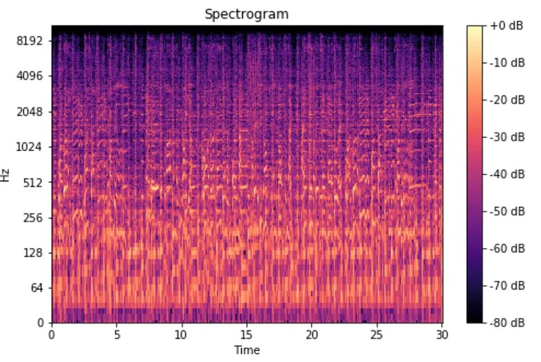
</p>

<p align="left">
  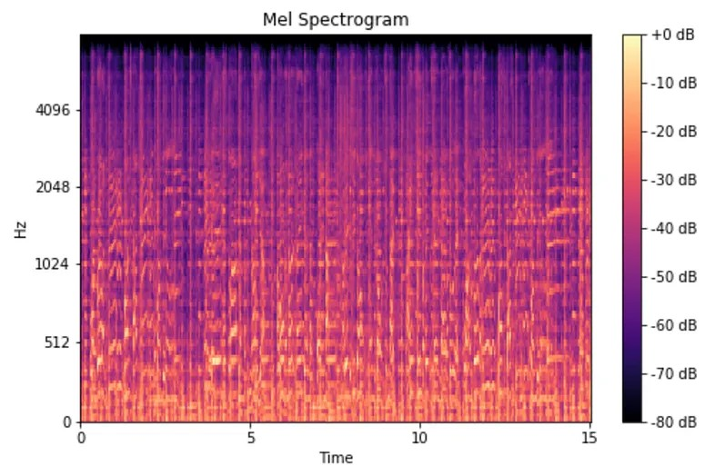
</p>

> Spectrogram vs. mel spectrogram: to build either one, the audio is split into short, overlapping frames, and a Fourier transform is applied to each frame. Loudness is converted to decibels, shown by color, with time on the x axis. In the regular spectrogram (top), frequency runs evenly in hertz. In the mel spectrogram (bottom), frequencies are converted to the mel scale, so low frequencies get more room and high frequencies are grouped into fewer, wider bands. For ML, this means fewer input values, more focus on the frequencies people actually hear well, and a better signal to noise ratio for tasks like speech recognition.

## Feature Extraction

<p align="left">
  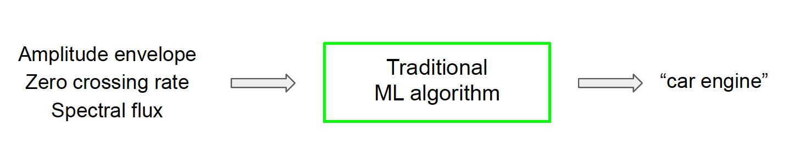
</p>

<p align="left">
  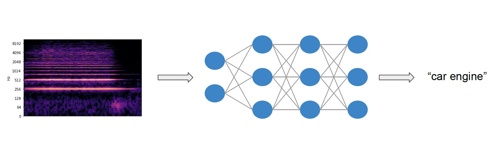
</p>

> Two ways to classify a sound: with traditional ML (top), you compute low level features like the amplitude envelope, zero crossing rate, and spectral flux yourself, then feed them to an algorithm that predicts "car engine". With deep learning (bottom), you feed the whole spectrogram to a neural network, which learns its own features.

<br>

<p align="left">
  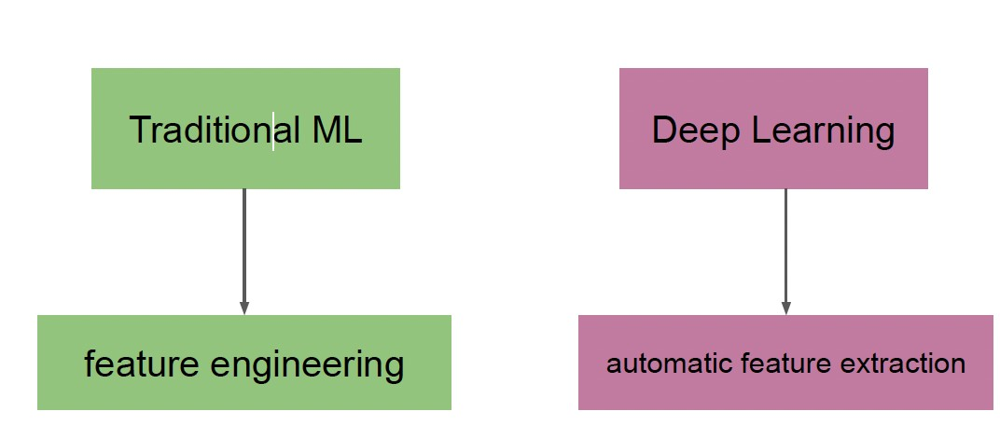
</p>

> Feature engineering vs. automatic feature extraction: traditional ML depends on choosing and computing features by hand. Deep learning extracts features automatically, but it needs much more data and computing power. Other low level features for traditional ML include RMS energy, band energy ratio, spectral centroid, spectral spread, and spectral roll off.

<br>

<p align="left">
  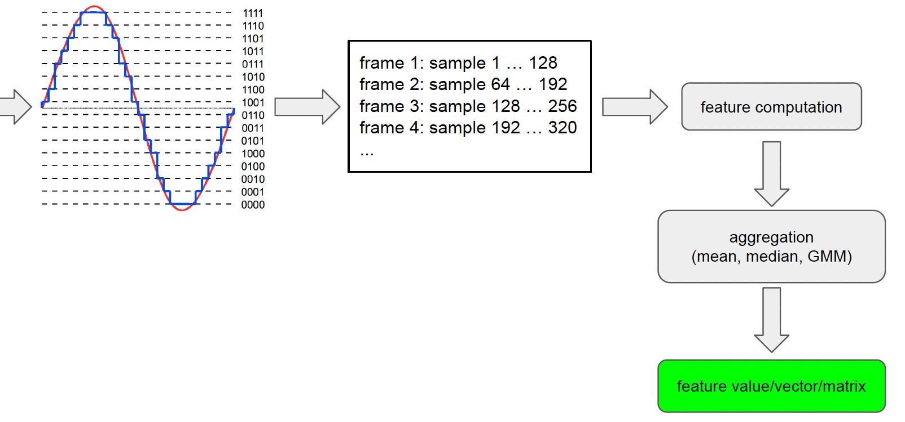
</p>

> Time domain feature pipeline: the analog signal is sampled and quantized into digital values (the 4 bit codes on the right), then split into overlapping frames (frame 1 is samples 1 to 128, frame 2 is samples 64 to 192, and so on). A feature is computed for each frame, and the values are aggregated (with the mean, median, or a Gaussian mixture model) into a single feature value, vector, or matrix for the model.

<br>

<p align="left">
  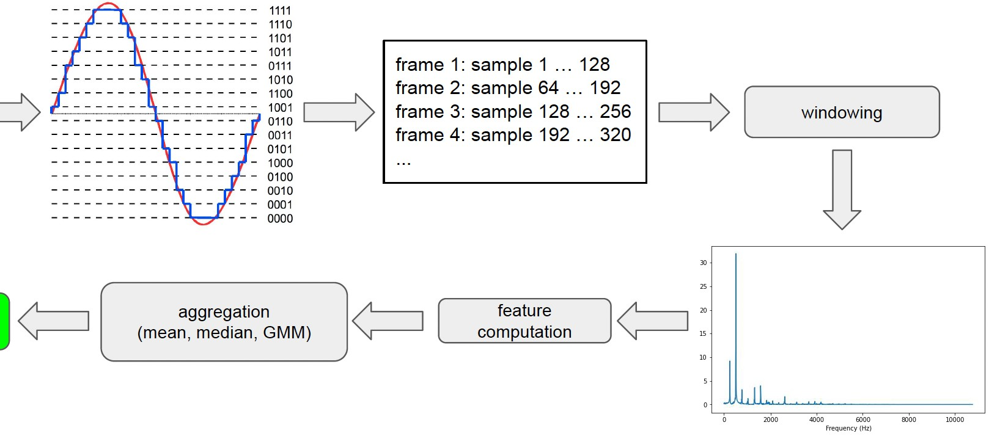
</p>

> Frequency domain feature pipeline: the same framing happens first, but each frame is windowed and converted into a spectrum with a Fourier transform before the features are computed and aggregated.

<br>

<p align="left">
  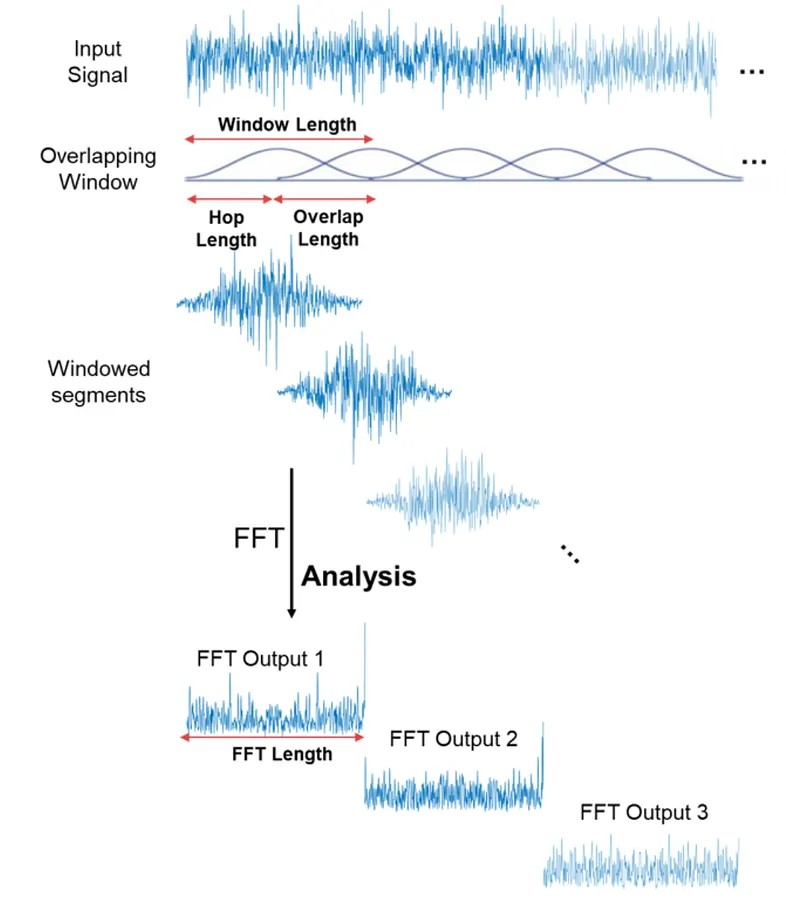
</p>

> Short time Fourier transform (STFT): a window slides across the input signal with a set window length, moving forward by the hop length so neighboring windows overlap. Each windowed segment goes through an FFT, producing one spectrum per segment. Stacking those spectra side by side over time is exactly what a spectrogram is.

## Python Packages

- **librosa:** Python package for music and audio analysis, used for loading audio and extracting features like MFCCs, spectral centroid, and zero crossing rate. Install with `uv add librosa soundfile` (the slides show `pip install`).
- **torchaudio:** PyTorch library for audio processing in deep learning, with functions for loading, preprocessing, and saving audio, plus datasets and pretrained models for classification, segmentation, and separation. Its `torchaudio.transforms` module includes `Spectrogram` and `MelSpectrogram`.

```python
import librosa
import numpy as np

y, sr = librosa.load("dog_bark.wav")  # samples and sampling rate (22,050 Hz by default)

zcr = librosa.feature.zero_crossing_rate(y)                     # time domain
centroid = librosa.feature.spectral_centroid(y=y, sr=sr)        # frequency domain
mfccs = librosa.feature.mfcc(y=y, sr=sr, n_mfcc=13)             # cepstral domain

# Aggregate each feature across frames into one fixed length vector for a classical ML model
features = np.hstack([zcr.mean(), centroid.mean(), mfccs.mean(axis=1)])
```

```python
import torchaudio
import torchaudio.transforms as T

waveform, sr = torchaudio.load("dog_bark.wav")
mel_spec = T.MelSpectrogram(sample_rate=sr, n_mels=64)(waveform)  # input for a CNN
```

## ML for Audio

1. **Data loading and preprocessing:** convert raw audio into a suitable format, such as spectrograms or MFCCs
2. **Feature engineering:** extract useful features for the model
3. **Model building:** learn patterns from the audio features, either from scratch or (recommended) by fine tuning a pretrained model
4. **Training and evaluation:** train on labeled audio and measure performance

## Exercise 8: Audio Classification

The dataset has audio files of three sounds (dog bark, street music, and drilling) and a CSV with each file's name and class ID. The task is to extract features from the audio files, train a classical ML classifier, save the model, and deploy it with Streamlit to predict the three provided samples. The write up answers which features were extracted, what other preprocessing was done, and how good the predictions were.

## Applications

- **Speech recognition:** voice assistants like Siri and Google Assistant turn spoken words into text
- **Music genre classification:** services like Spotify and Apple Music analyze audio features to categorize and recommend songs
- **Sound event detection:** smart home systems recognize sounds like a doorbell or smoke alarm
- **Sound classification:** recognizing everyday urban sounds or identifying birds from their calls
- **Automatic lyrics alignment:** matching lyrics to the sung audio for karaoke or music learning
- **Bioacoustic monitoring:** identifying bird calls or monitoring rainforest sounds to study biodiversity
- **Audio based health diagnostics:** analyzing sounds like coughs to detect respiratory diseases

### MFCC Based Applications

- **Speech processing:** speech recognition, speaker recognition
- **Music processing:** music genre classification, mood classification, automatic tagging
- **Healthcare and diagnostics:** respiratory disease detection, Parkinson's disease screening
- **Environmental sound classification:** urban noise monitoring, bioacoustic wildlife monitoring

### Deep Learning Audio Projects

- **Speech recognition:** transcribing meetings or lectures in real time with models like DeepSpeech or Wav2Vec 2.0
- **Speaker identification:** recognizing who is speaking, such as for voice biometric security
- **Emotion recognition:** detecting a speaker's emotion, such as in customer service
- **Sound event detection:** recognizing events like glass breaking or sirens for security, or giving alerts to people who are hard of hearing
- **Audio denoising:** removing background noise from recordings
- **Speech synthesis (text to speech):** generating natural speech with models like Tacotron or WaveNet, such as for audiobook generators
- **Language translation:** combining speech recognition, machine translation, and text to speech into a real time audio translator
- **Audio tagging:** labeling podcasts or lectures by content for easier searching
- **Voice conversion:** making a speaker sound like someone else while keeping the same words
- **Music separation and instrument recognition:** splitting a track into instruments or identifying which ones are playing
- **Astrophysical research:** analyzing data from radio telescopes or gravitational wave detectors

For these projects, the slides recommend fine tuning pretrained models from the PyTorch and Hugging Face ecosystems instead of training from scratch.

## Worked Examples

### Nyquist Shannon Sampling Theorem

To capture a signal without losing information, the sampling rate must be at least twice its highest frequency:

$$
f_{sample} \geq 2 f_{max}
$$

**Example:** human hearing tops out around 20 kHz, so audio needs at least $2 \times 20{,}000 = 40{,}000$ samples per second (40 kHz). That's why CDs use 44.1 kHz, which leaves a little room above the minimum.

If you sample a 5 kHz tone at only 8 kHz (below the required 10 kHz), the samples can't keep up with the wave, and it gets recorded as a false lower tone. This is called aliasing, and it's what the 2 point sample in the picture above shows.

### Samples and Storage

The number of samples is the sample rate times the duration:

$$
\text{samples} = f_{sample} \times \text{seconds}
$$

**Example:** a 3 second clip at 44.1 kHz has $44{,}100 \times 3 = 132{,}300$ samples.

If each sample is stored with 16 bits (2 bytes) in mono, each second takes

$$
44{,}100 \times 2 \text{ bytes} = 88{,}200 \text{ bytes} \approx 88 \text{ KB}
$$

so the 3 second clip is about 265 KB uncompressed, and stereo doubles it. Lowering the sample rate to 22.05 kHz halves the size but can only capture frequencies up to 11 kHz.

### Frequency and Period

Frequency is the number of cycles per second, and the period is the time one cycle takes:

$$
T = \frac{1}{f}
$$

**Example:** the A note musicians tune to is 440 Hz, so one cycle lasts $\frac{1}{440} \approx 0.00227$ seconds (2.27 milliseconds). The A one octave higher is 880 Hz, double the frequency, which is the harmony idea of whole number multiples.

### RMS Energy (Loudness)

Root mean square measures the average strength of a signal, ignoring whether samples are positive or negative:

$$
\text{RMS} = \sqrt{\frac{1}{N} \sum_{i=1}^{N} x_i^2}
$$

**Example:** the samples $0.5, -0.5, 0.5, -0.5$

$$
\text{RMS} = \sqrt{\frac{0.25 + 0.25 + 0.25 + 0.25}{4}} = \sqrt{0.25} = 0.5
$$

A plain average of these samples would be 0, even though the sound clearly isn't silent, which is why squaring comes first. For a pure sine wave with peak amplitude $A$, the RMS is $\frac{A}{\sqrt{2}} \approx 0.707A$.

### Decibels

Intensity is converted to decibels relative to the threshold of hearing, $I_0 = 10^{-12}$ W/m²:

$$
L = 10 \log_{10} \left( \frac{I}{I_0} \right) \text{ dB}
$$

**Threshold of hearing:** $L = 10 \log_{10}(1) = 0$ dB

**Threshold of pain** ($I = 10$ W/m²):

$$
L = 10 \log_{10} \left( \frac{10}{10^{-12}} \right) = 10 \log_{10} (10^{13}) = 10 \times 13 = 130 \text{ dB}
$$

Scale is logarithmic means doubling the intensity only adds about 3 dB ($10 \log_{10} 2 \approx 3.01$), and every increase of 10 dB means 10x intensity.

### Converting Hertz to Mels

$$
m = 2595 \log_{10} \left( 1 + \frac{f}{700} \right)
$$

| Frequency (Hz) | Calculation | Mels |
|---|---|---|
| 500 | $2595 \log_{10}(1.714)$ | ≈ 607 |
| 1000 | $2595 \log_{10}(2.429)$ | ≈ 1000 |
| 10,000 | $2595 \log_{10}(15.286)$ | ≈ 3073 |
| 10,500 | $2595 \log_{10}(16.000)$ | ≈ 3125 |

Both pairs are 500 Hz apart, but 500 Hz to 1000 Hz is about **393 mels** apart, while 10,000 Hz to 10,500 Hz is only about **52 mels** apart. That's the mel scale matching how much easier it is to hear the difference between low frequencies.

### Zero Crossing Rate

Count how many times the signal changes sign between neighboring samples.

**Example frame:** $0.5, \ 0.3, \ -0.2, \ -0.4, \ 0.1, \ 0.6, \ -0.3, \ 0.2$

The sign changes from 0.3 to −0.2, from −0.4 to 0.1, from 0.6 to −0.3, and from −0.3 to 0.2, which makes **4 crossings** across 7 pairs of neighboring samples:

$$
\text{ZCR} = \frac{4}{7} \approx 0.57
$$

Noisy sounds like drilling or hissing cross zero constantly and score high. Smooth, low pitched sounds like a hum score low.

### Spectral Centroid, Spread, and Roll Off

Take a simple spectrum with four frequencies:

| Frequency $f$ (Hz) | 100 | 200 | 300 | 400 |
|---|---|---|---|---|
| Magnitude $M$ | 4 | 3 | 2 | 1 |

**Spectral centroid** (the magnitude weighted average frequency):

$$
C = \frac{\sum f \cdot M}{\sum M} = \frac{(100)(4) + (200)(3) + (300)(2) + (400)(1)}{4 + 3 + 2 + 1} = \frac{2000}{10} = 200 \text{ Hz}
$$

If the magnitudes were reversed to $1, 2, 3, 4$, the centroid would be 300 Hz. More energy at high frequencies means a higher centroid and a "brighter" sound.

**Spectral spread** (how far the energy sits from the centroid, like a standard deviation):

$$
S = \sqrt{\frac{\sum M (f - C)^2}{\sum M}} = \sqrt{\frac{4(100)^2 + 3(0)^2 + 2(100)^2 + 1(200)^2}{10}} = \sqrt{10{,}000} = 100 \text{ Hz}
$$

**Spectral roll off at 85%** (the frequency where the running total first reaches 85% of the energy). Using the magnitudes as energy, the running total is 4 (40%), 7 (70%), then 9 (90%), so the roll off is **300 Hz**.

### Framing and Aggregation

The pipeline slides use frames of 128 samples with a hop length of 64 (frame 1 is samples 1 to 128, frame 2 is samples 64 to 192), so neighboring frames overlap by half.

**Number of frames** in 1 second of audio at 22,050 Hz:

$$
\text{frames} = 1 + \left\lfloor \frac{22{,}050 - 128}{64} \right\rfloor = 1 + 342 = 343
$$

A feature like the zero crossing rate is computed once per frame, giving 343 values. Aggregating them (for example, taking the mean) turns them into a single number, so every clip, whatever its length, ends up with the same size feature vector for a classical ML model.

Note: librosa pads the signal by default (`center=True`), so its frame counts come out slightly higher than this formula.

### Why Mel Bands Shrink the Input

With librosa's defaults, each STFT frame uses 2048 samples, which gives $\frac{2048}{2} + 1 = 1025$ frequency bins. A mel spectrogram with 128 mel bands groups those into 128 rows, about **8 times fewer** values per frame, while keeping the detail where people hear best (the low frequencies).
