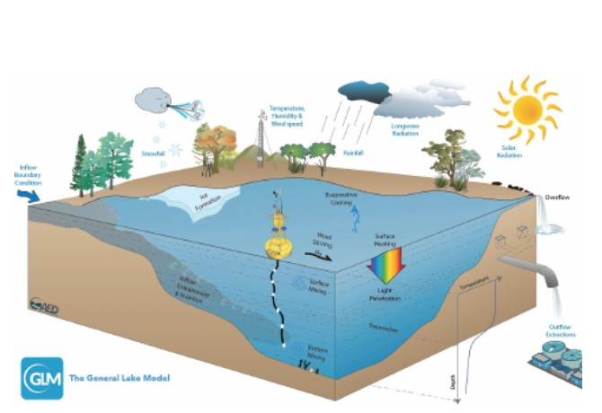
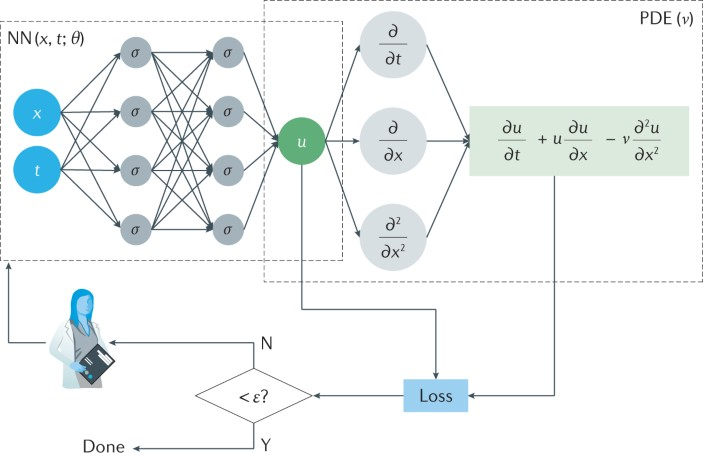
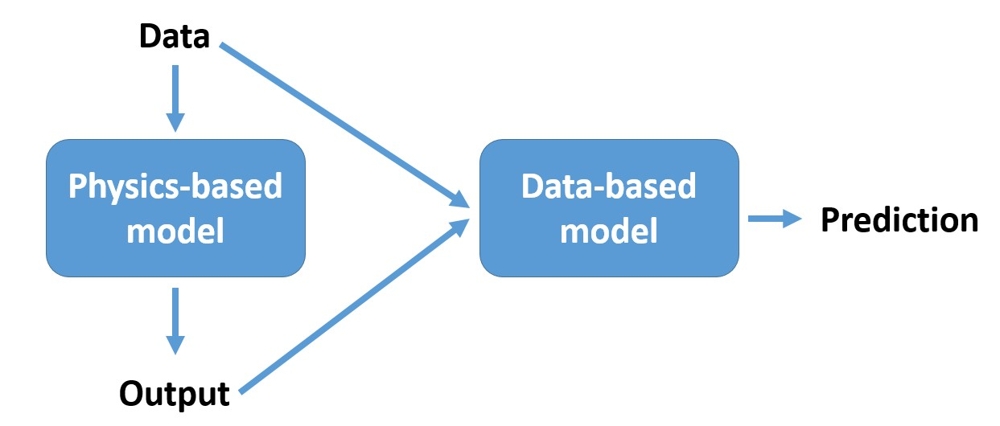

# Physics Informed Neural Networks (PINNs)

## What Are PINNs?

Imagine two students predicting the path of a thrown ball:

- **The standard student (a regular neural network)** has seen some examples and finds a pattern in them. Ask about a throw from a new spot and it can only guess, because it doesn't understand the physics behind the pattern.
- **The smart student (a physics informed neural network)** has seen a few examples and also studied the laws of gravity and motion. Even with limited data, its answers have to follow those laws, so its predictions are much more accurate.

A PINN is a neural network trained to respect the laws of physics. The broader idea, building any known scientific theory into training, is sometimes called a theory informed neural network (TINN).

### Why It Works

A standard neural network's test has one question: how well did you match the data? A PINN's test has two: how well did you match the data, and how well did you follow the laws of physics? It tries to score well on both.

**Applications:**

- **Weather forecasting:** using the equations of atmospheric fluid dynamics along with past weather data
- **Engineering and design:** simulating airflow over a new airplane wing faster than traditional methods
- **Healthcare:** modeling blood flow in arteries or how a drug spreads through the body
- **Ball trajectories:** predicting where a ball will go from only a few data points, because the model understands gravity

### Strengths and Challenges

| Strengths | Challenges |
|---|---|
| Need less data, since they already "know" the physics | Training can take a lot of computing power |
| Handle problems that are hard for traditional methods, like complex shapes or incomplete information | The physics has to be known, and if our understanding is wrong, the predictions will be too |
| Can run some simulations much faster than traditional physics simulators | Very complex physics can be too hard to write into the loss |

## Example: Lake Temperature

<p align="left">
  
</p>

> The General Lake Model: lake water temperature depends on many physical processes, including heating of the surface by incoming shortwave radiation from the sun, that radiation weakening (attenuating) as it goes deeper, mixing between layers at different depths, and heat leaving the surface through evaporation and longwave radiation. The task is to predict water temperature as a function of depth and time, which matters for understanding how climate change affects lakes and for managing water resources. One known law: the relationship between temperature and density is known, and deeper water should be denser. If the model predicts higher density for a point closer to the surface than for a deeper point, that prediction is physically inconsistent, so the model is penalized through its cost function.

## The Loss Function

<p align="left">
  
</p>

> How a PINN trains: a neural network takes position $x$ and time $t$ as inputs and outputs $u$. Automatic differentiation then computes the derivatives $\frac{\partial u}{\partial t}$, $\frac{\partial u}{\partial x}$, and $\frac{\partial^2 u}{\partial x^2}$, and plugs them into the governing PDE, here $\frac{\partial u}{\partial t} + u \frac{\partial u}{\partial x} - \nu \frac{\partial^2 u}{\partial x^2} = 0$ (Burgers' equation, where $\nu$ is viscosity). Anything other than zero is a physics error. The data loss (MSE against known data points) and the physics loss are combined into the total loss. If it is below a tolerance $\varepsilon$, training is done, and if not, the network's weights are updated and the loop repeats.

## Building a PINN

<p align="left">
  
</p>

> Physics based vs. data based models: a physics based model turns data into output by following known equations, while a data based model learns from data to make predictions. A PINN feeds both the data and the physics based model's knowledge into the data based model, so its predictions match observations and obey the physics.

**Example: the heat equation.** For heat spreading along a metal rod, the temperature $u(x, t)$ at position $x$ and time $t$ follows

$$
\frac{\partial u(x, t)}{\partial t} = \alpha \frac{\partial^2 u(x, t)}{\partial x^2}
$$

where $\alpha$ is the thermal diffusivity, a constant for the material. This is also called the diffusion equation. To build a PINN for it:

1. Create a neural network with inputs $x$ and $t$ and output $u(x, t)$
2. Train it to match any known temperatures, such as the initial condition (the rod at $t = 0$) or the boundary conditions (the ends of the rod)
3. Add a physics term to the loss that forces the network to respect the heat equation, using the residual $\frac{\partial u}{\partial t} - \alpha \frac{\partial^2 u}{\partial x^2}$, which should be 0
4. Compute those derivatives with PyTorch's automatic differentiation
5. Minimize the total loss, data loss plus physics loss

## PyTorch Automatic Differentiation

PyTorch's `torch.autograd` module computes derivatives automatically for any tensor created with `requires_grad=True`. Neural networks already use it for backpropagation, and PINNs use it to get first and second order partial derivatives of the output with respect to the inputs.

```python
import torch

x = torch.tensor(2.0, requires_grad=True)
y = x ** 3

dy_dx = torch.autograd.grad(y, x, create_graph=True)[0]  # 3x^2 = 12
d2y_dx2 = torch.autograd.grad(dy_dx, x)[0]               # 6x = 12
```

`create_graph=True` keeps track of the first derivative's computation so it can be differentiated again for the second derivative.

**The physics loss for the heat equation:**

```python
def physics_loss(model, x, t, alpha):
    x.requires_grad_(True)
    t.requires_grad_(True)
    u = model(torch.cat([x, t], dim=1))

    ones = torch.ones_like(u)
    u_t = torch.autograd.grad(u, t, ones, create_graph=True)[0]
    u_x = torch.autograd.grad(u, x, ones, create_graph=True)[0]
    u_xx = torch.autograd.grad(u_x, x, torch.ones_like(u_x), create_graph=True)[0]

    residual = u_t - alpha * u_xx  # should be 0 if the physics is followed
    return (residual ** 2).mean()

# total_loss = data_loss + lam * physics_loss(model, x_points, t_points, alpha)
```

The `x` and `t` points for the physics loss don't need measured temperatures, since the equation itself is the target. They can be sampled anywhere in the rod and time range.

## Worked Examples

### Total Loss

$$
\text{Loss}_{total} = \text{Loss}_{data} + \lambda \cdot \text{Loss}_{physics}
$$

$\lambda$ sets how much the physics counts compared with the data. Suppose a model has $\text{Loss}_{data} = 0.04$ and $\text{Loss}_{physics} = 0.5$:

| $\lambda$ | Calculation | Total loss | Effect |
|---|---|---|---|
| 0.1 | $0.04 + 0.1 \times 0.5$ | 0.09 | Mostly about matching the data |
| 1 | $0.04 + 1 \times 0.5$ | 0.54 | Physics errors dominate, pushing the model to fix them |
| 0 | $0.04 + 0 \times 0.5$ | 0.04 | Physics ignored, so it's just a standard neural network |

### Checking the Heat Equation Residual

The residual is $r = \frac{\partial u}{\partial t} - \alpha \frac{\partial^2 u}{\partial x^2}$, and the physics loss is the average of $r^2$.

**A prediction that breaks the physics:** say the network outputs $u(x, t) = x^2 + t$ with $\alpha = 1$

$$
\frac{\partial u}{\partial t} = 1
\qquad
\frac{\partial u}{\partial x} = 2x
\qquad
\frac{\partial^2 u}{\partial x^2} = 2
$$

$$
r = 1 - 1 \times 2 = -1
\qquad
\text{physics loss} = (-1)^2 = 1
$$

The residual isn't 0 anywhere, so this function doesn't describe real heat flow, and training pushes the network away from it.

**A prediction that follows the physics:** $u(x, t) = e^{-\alpha \pi^2 t} \sin(\pi x)$, a sine shaped temperature profile that fades over time

$$
\frac{\partial u}{\partial t} = -\alpha \pi^2 u
\qquad
\frac{\partial^2 u}{\partial x^2} = -\pi^2 u
$$

$$
r = -\alpha \pi^2 u - \alpha(-\pi^2 u) = 0
$$

The residual is exactly 0 everywhere, so the physics loss is 0.

### Lake Density Penalty

Deeper water should be denser. For two points at depths $d_1 < d_2$, a simple penalty is

$$
\text{penalty} = \max\big(0, \ \rho(d_1) - \rho(d_2)\big)
$$

which is 0 when the deeper point is denser (physically consistent) and positive when it isn't.

| Shallow point (2 m) | Deep point (8 m) | Penalty | Consistent? |
|---|---|---|---|
| 999.5 kg/m³ | 999.8 kg/m³ | $\max(0, -0.3) = 0$ | Yes |
| 999.8 kg/m³ | 999.5 kg/m³ | $\max(0, 0.3) = 0.3$ | No, so the cost function is penalized |

Adding this penalty (often squared, $0.3^2 = 0.09$) to the loss steers the model away from predictions that break the known relationship, even where there's no measured data.
