# Digital Twins

## What Is a Digital Twin?

  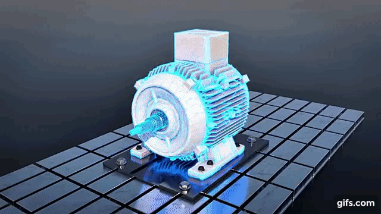

> A digital twin of an electric motor: a digital twin is a functional model of a real system, roughly 3D modeling plus a physics model. It can simulate the system's complete operation, so you can get insights and test operating conditions in software instead of on the real hardware.

 

  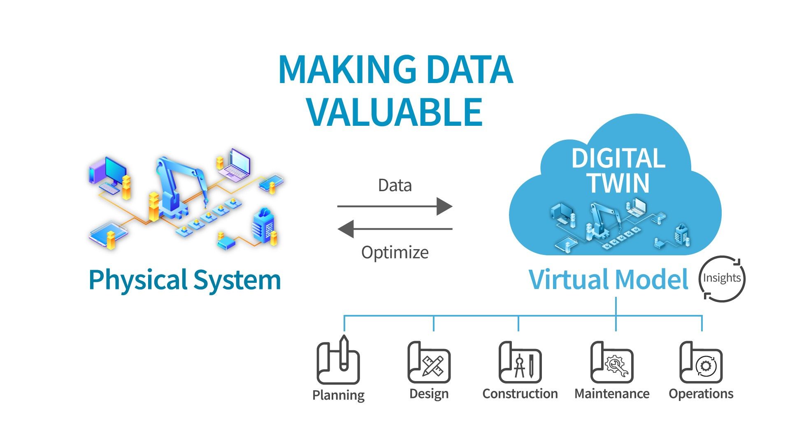

> Making data valuable: data flows from the physical system to its virtual model (the digital twin), and the twin sends optimizations back. The same twin supports the whole life cycle, from planning, design, and construction to maintenance and operations.

 

  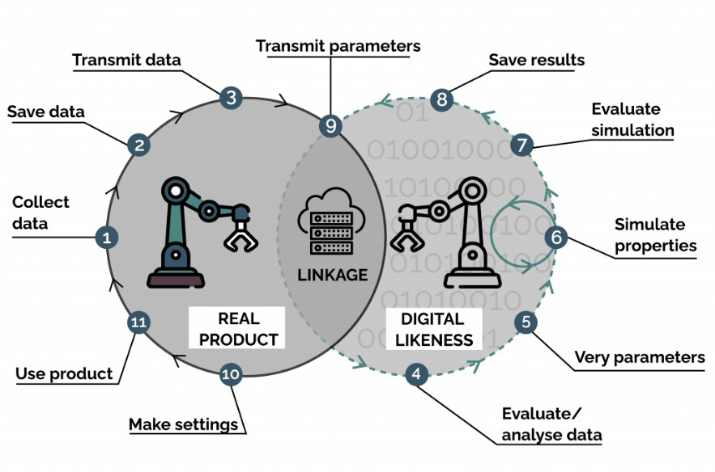

> The linkage between a real product and its digital likeness: the real product collects and saves data (1 to 2) and transmits it to the twin (3). The twin simulates properties and evaluates the simulation (5 to 7), and saves results (8). It then transmits parameters back (9), which become new settings on the real product as it's used (10 to 12). The cycle keeps the two in sync.

## Digital Twin Schematic

  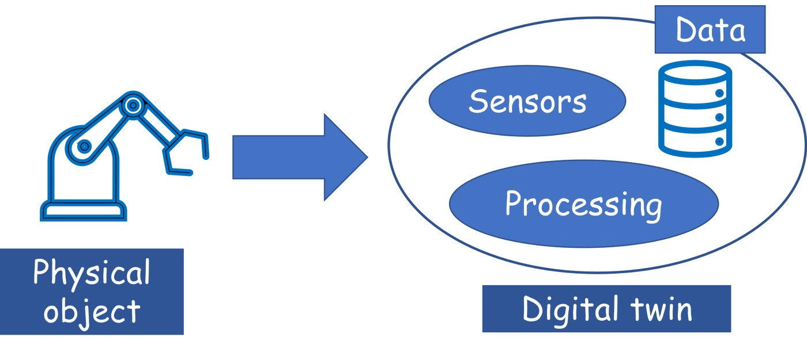

> From physical object to digital twin: the main enabling factors are sensors that gather data and a processing system that turns it into useful information. That data is fed into the digital copy, which can then run simulations, study performance issues, and suggest improvements.

 

  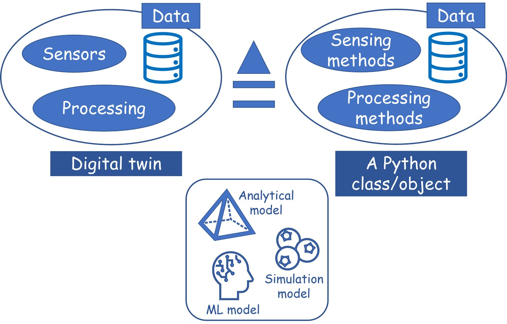

> Digital twin as a Python class: sensors and processing can be emulated with methods (sensing methods and processing methods), with data stored in a database or internal variables, all encapsulated in a Python class. The resulting object can be used in simulation programs, probed for data, and run through optimization routines, and its internals can be an analytical model, a simulation model, or an ML model. The course starts simple and adds sophistication over time.

## Example: Thermostat Digital Twin

  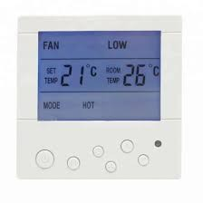

> A thermostat: the first twin in the course simulates a closed loop temperature control system. The thermostat twin compares the room's temperature with its set point and tells the HVAC system to heat, cool, or stay off.

The simulation has two classes:

- **`PhysicalRoom`** simulates the room's own thermal dynamics: heating, cooling, and natural drift toward the ambient (outside) temperature.
  - `__init__`: sets the initial and ambient temperatures and the heat and cool rates
  - `get_temperature`: returns the room's current temperature
  - `apply_dynamics`: raises or lowers the temperature based on the HVAC command, plus drift toward ambient
- **`ThermostatTwin`** simulates the thermostat.
  - `__init__`: sets the current temperature, set point, and time stamp
  - `get_control_command`: the core logic that decides what the HVAC system should do
  - `update_state`: receives feedback from the physical room and updates the twin

**Key ideas:**

- **Set point:** the desired target temperature
- **Hysteresis (dead band):** the twin only switches on below the band and off above it, which prevents rapid cycling
- **Feedback loop:** the twin's command changes the room, and the room's new temperature is fed back to the twin
- **Ambient temperature:** the outside temperature the room drifts toward. If the room is heated to 24°C on a 15°C day, it cools toward 15°C when the heater is off. On a 35°C day, an air conditioned room at 24°C warms toward 35°C when the A/C is off.

## Using ML in Digital Twins

  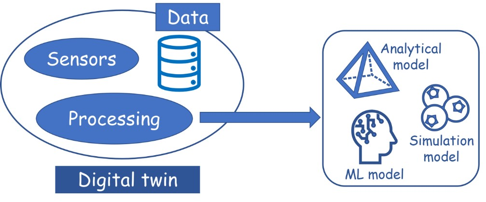

> Where ML fits in: the twin's sensors and processing pass data to an analytical model, a simulation model, or an ML model. Digital twins are mostly built from analytical models, but data driven models are worth using where they fit. In the thermostat, the heating rate, cooling rate, and drift toward ambient aren't known ahead of time and can only be measured. With enough sensor data, an ML model can predict these rates for different ambient and room temperatures. ML beats a fixed formula here because the measurements are noisy and the real values are stochastic, changing with the seasons.

## Digital Twin Framework: From Concept to Code

1. **Define the system and its goal.** What system are we modeling? What are its inputs, outputs, and states? Is the goal to predict, optimize, or alert? Examples: a motor twin that predicts torque at 500 RPM, an oven twin that predicts when food is done, or a banking twin that predicts fraud risk.
2. **Identify the physics or rules.** What laws govern the system, and can they be written as equations? If not, can ML or a PINN approximate them? Examples: DC motor torque $= K \cdot I$ (current) with a friction term, oven heat balance $\frac{dT}{dt} = \frac{\text{Power} - \text{Heat Loss}}{m \cdot c_p}$, and a bank fraud rule like (amount > 5 × average) + (transactions per second > 0.5) + (new device).
3. **Build the core model.** Define classes for the system, its inputs, states, and outputs, and its update rules (dynamics, equations, or ML logic).

  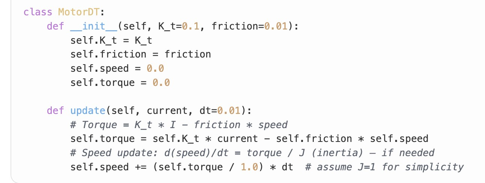

> A motor digital twin class: `MotorDT` stores its torque constant, friction, speed, and torque. Each `update` computes torque as $K_t \times \text{current} - \text{friction} \times \text{speed}$, then updates speed from torque over the time step `dt`, assuming an inertia of 1 for simplicity.

4. **Ingest data and close the feedback loop.** Data can come from sensors, logs, APIs, or user input, read from files, streams, databases, MQTT, or REST APIs.

  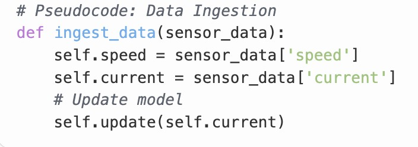

> Data ingestion: incoming sensor data updates the twin's speed and current, then triggers a model update, so the twin stays in step with the real motor.

5. **Add a PINN, if you have physics or data.** PINNs are most useful with real sensor data plus known equations, or with complex physics and plenty of data. For a motor, inputs could be current, speed, and time, outputs torque and next speed, trained with MSE against sensor data. The PINN can live inside the class or act as a black box predictor.
6. **Add visualization, even without 3D CAD.** Digital twins are meant to be understood, debugged, and trusted, so plot what's happening with Plotly (live graphs), Matplotlib (static plots), or Streamlit (web dashboards).

  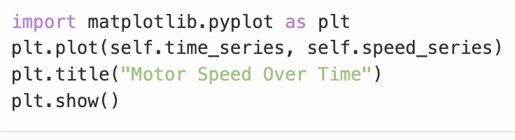

> Visualizing the twin: a Matplotlib plot of motor speed over time. For a banking twin, the equivalent would be the fraud risk score over time. Engineers and managers need to see the trend, not just a number in a log.

7. **Deploy and monitor.** A digital twin is a system that runs in real time, deployed to a Raspberry Pi, a local server, or the cloud (AWS, Azure, GCP). Monitor its accuracy, latency, and alerts (like "motor overheating" or "fraud detected"), and use its predictions to control the system, such as turning off an overheating motor.
8. **Iterate and improve.** Twins aren't static. Collect new data, retrain the PINN, update the rules, and improve the visualization.

### Commercial (Non Physics) Digital Twins

Systems without physical laws still have rules, logic, or statistical patterns. For example, fraudsters often test an account with small transactions before a sudden spike in transaction velocity. A **Hawkes process** models this by tracking the expected rate of transactions over time:

$$
\lambda(t) = \mu_0 + \sum_{t_j < t} \alpha e^{-\beta (t - t_j)}
$$

- $\lambda(t)$: the intensity, or expected frequency of transactions at time $t$
- $\mu_0$: the user's normal baseline transaction rate
- $\alpha, \beta$: how much each past transaction $t_j$ temporarily raises the rate, and how fast that boost fades

If $\lambda(t)$ spikes past a threshold based on the user's history, the twin flags the activity as anomalous.

### What a Digital Twin Needs

| Requirement | Purpose |
|---|---|
| Physical or business system | The real thing being twinned |
| Mathematical model | How it behaves, through ODEs, rules, or logic |
| Real time sensor data | Keeps the twin updated |
| Actuators or interfaces | Control or influence the real system |
| Visualization and feedback loop | Show state, predict, and guide decisions |
| Update mechanism | How often the model gets refreshed |

**Python class design:** state (variables like temperature, position, or inventory), behavior (methods like `update(dt)`, `apply_force()`, or `process_order()`), inputs (sensor data, control signals, events), outputs (predictions, diagnostics, visualizations), and interfaces (connections to real or simulated sensors and actuators). For example, a `TemperatureDT` class with `update(heat_rate, dt)` and `predict_next_temp()` methods.

## PID Controllers

  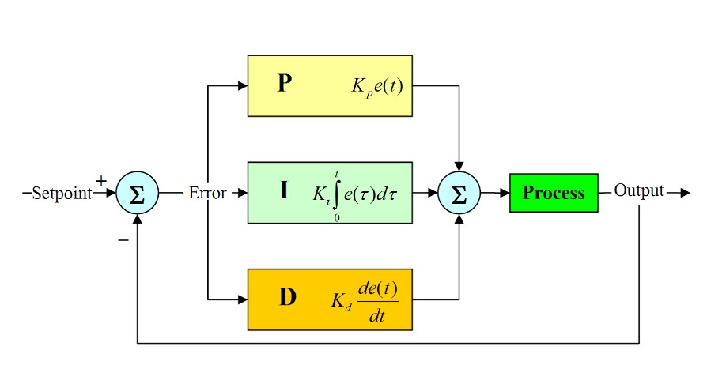

> PID control loop: the controller measures the error between the set point and the output, then adds three terms. The proportional term $K_p e(t)$ reacts to the current error, the integral term $K_i \int e(\tau) \, d\tau$ adds up past error to remove any leftover offset, and the derivative term $K_d \frac{de(t)}{dt}$ reacts to how fast the error is changing, which adds damping. Their sum drives the process, and the output is fed back to calculate the next error.

 

  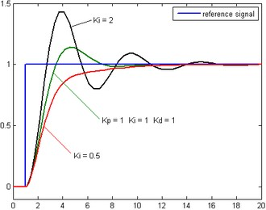

  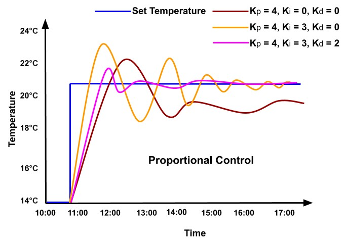

> How the gains change the response: in the first graph, a larger integral gain ($K_i = 2$) reaches the target faster but overshoots and oscillates, while a smaller one ($K_i = 0.5$) is slow but smooth. In the second, proportional control alone ($K_p = 4$) settles below the set temperature, adding integral gain ($K_i = 3$) removes that offset but oscillates more, and adding derivative gain ($K_d = 2$) damps the oscillation.

 

  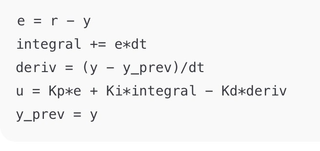

  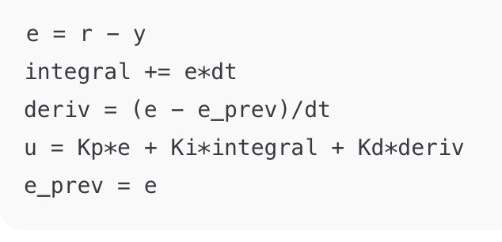

> PID in code: each step computes the error $e = r - y$, adds $e \cdot dt$ to the integral, and estimates the derivative. The first version takes the derivative of the measurement $y$ and subtracts it (derivative on measurement), which avoids a sudden jump when the set point changes. The second takes the derivative of the error and adds it. When the set point is constant, both give the same result, since the error changes exactly opposite to the measurement.

### Practical Additions

- **Integral clamping:** $I_k = \text{clip}(I_{k-1} + e \cdot dt, \ I_{min}, \ I_{max})$, so the integral can't grow without bound while the actuator is maxed out
- **Torque saturation:** when the controller asks for more than the motor can produce, the command is clipped to the motor's limit
- **The closed loop:** PID calculates a nudge $u$ from the current error, the plant simulation finds the new state $y$, the new error $r - y$ is computed, and the loop repeats every tick of the clock

## Simulating the Plant With RK4

Engineers rarely test a new PID controller on real, expensive hardware first. They simulate the plant (the physical system being controlled, like a drone, robotic arm, or chemical tank), which follows differential equations. RK4 (the 4th order Runge Kutta method) acts as the physics engine that steps the simulation forward.

If you know where a system is now ($x_k$) and how fast it's changing ($\dot{x} = f(x, u)$), RK4 predicts where it will be after a small time step $dt$. Instead of using only the starting slope, it checks four slopes within the step:

$$
k_1 = f(x_k, u_k)
\qquad
k_2 = f\left(x_k + \tfrac{dt}{2} k_1, u_k\right)
\qquad
k_3 = f\left(x_k + \tfrac{dt}{2} k_2, u_k\right)
\qquad
k_4 = f(x_k + dt \, k_3, u_k)
$$

$$
x_{k+1} = x_k + \frac{dt}{6} (k_1 + 2k_2 + 2k_3 + k_4)
$$

- $k_1$: the slope at the start of the step
- $k_2$ and $k_3$: slopes at the midpoint, each using the previous estimate
- $k_4$: the slope at the end of the step

In Python, `scipy.integrate.solve_ivp` handles this for you. Its default RK45 method adapts the step size automatically. PINNs are good for modeling and understanding a plant's complex physics, while classical solvers like RK4 and controllers like PID handle the fast, embedded control loops.

## The `@dataclass` Decorator

  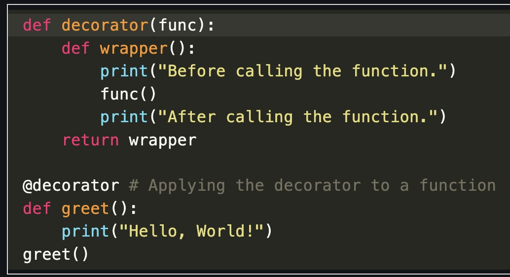

> Decorators: a decorator is a function that takes another function, adds functionality, and returns the modified version. Here, `@decorator` wraps `greet()` so it prints a message before and after the greeting. The `@` goes on the line before the definition.

 

  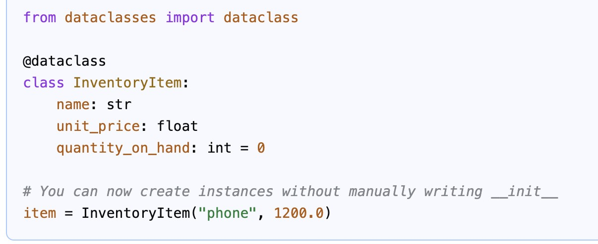

> `@dataclass`: a built in decorator for classes that mainly store data rather than define complex behavior, working like a typed dictionary. Declaring the fields with types (`name: str`, `unit_price: float`, `quantity_on_hand: int = 0`) is enough, and Python writes the `__init__` method automatically. It's handy for storing a digital twin's state and parameters.

## Use Case: The Oven

**Problem:** traditional ovens rely on physical thermocouples and simple control logic, which makes it hard to predict temperature across the whole oven or detect future failures.

**Goal:** a digital twin that predicts the oven's temperature dynamics by blending physics and machine learning. A twin with a PINN is fast, accurate, and physically consistent, and can replace the slower legacy physics simulation in the control loop.

**How it's built:**

- **Physics:** the oven follows the 1D heat equation $\frac{\partial T}{\partial t} = \alpha \frac{\partial^2 T}{\partial x^2}$. A simplified lumped capacitance model, which treats the oven as one volume (heater input versus heat loss), quickly generates the training data and a baseline for tuning the PID controller.
- **PINN training:** a data loss matches sensor (or synthetic) temperatures, a physics loss enforces the heat equation, and initial and boundary conditions pull the PINN toward the stable operating point. The final loss weights were $w_{data} = 10.0$ and $w_{pde} = 0.5$.
- **Core pieces:** `OvenPINN` (a PyTorch network taking normalized time and position and predicting normalized temperature), `pde_loss` (uses `torch.autograd.grad` to check the heat equation), `PIDController` (computes the heater power $Q_{in}$ from the error), and `simulate_physics_step` (the physics baseline, used only for training data and comparison).

**Two notebooks:**

| | Notebook 4a | Notebook 4b |
|---|---|---|
| Model inside the control loop | Analytical physics model (the lumped capacitance ODE) | The trained PINN, acting as the virtual plant |
| PINN's role | Shadow model, predicting alongside for comparison | System of record, whose prediction the PID reads as feedback |
| Physics model's role | Drives the loop | Runs in the background as a ground truth benchmark |

The takeaway: once tuned, the PINN tracked the target without wild oscillation or drift and replaced the traditional physics model in the loop, pointing toward faster, more adaptive control.

## Use Case: The Inverted Pendulum

An inverted pendulum is balanced upright above its pivot. Gravity pulls it down, so it's unstable and hard to control, which makes it the classic control problem. The twin uses a PINN to simulate the physics and a PID controller to keep it upright, all in code with no CAD.

**Physics:**

$$
u = m l^2 \ddot{\theta} + b \dot{\theta} + m g l \sin\theta
\qquad \text{or} \qquad
\ddot{\theta} = \frac{u - b\dot{\theta} - m g l \sin\theta}{m l^2}
$$

where $u$ is the applied torque, $m$ the mass, $l$ the length, $b$ the viscous friction (damping), and $g$ gravity. RK4 solves it numerically with step $dt$

**The two sides of the twin:**

- **Physical side (simulated plant):** the nonlinear ODE plus RK4 generates $\theta(t)$ and $\dot{\theta}(t)$, the PID computes the torque $u(t)$, and actuator limits apply torque saturation (a 5 N·m command clipped to the motor's 2.5 N·m) and anti windup
- **Virtual side (analytics):** a telemetry log records $(t, \theta, u)$ every step, visualizations show time series, animations, and KPIs (settling time, overshoot), and an artifact store saves the trained PINN's weights and normalization for reuse

**The PINN:** it takes time $t$ (with the control $u(t)$ and measured $\theta(t)$ available) and outputs $\theta(t)$ and the angular velocity $\omega(t) = \dot{\theta}(t)$, with no velocity labels needed. Its loss combines two physics residuals,

$$
r_1 = \dot{\theta} - \omega
\qquad
r_2 = m l^2 \dot{\omega} + b\omega + m g l \sin\theta - u
$$

$$
\text{Loss} = \lVert r_1 \rVert^2 + \lVert r_2 \rVert^2 + \text{small data fit } \lVert \theta - \theta_{meas} \rVert^2 + \text{initial conditions} + \text{weak prior on } b
$$

The pipeline runs the plant, logs telemetry, trains the PINN, and saves the artifact for later predictions and animations without retraining. The PINN reconstructs $\theta(t)$ and $\omega(t)$ from time alone, estimates unknown parameters like the damping $b$ from normal operation (parameter identification), and stays robust because the light data term and initial conditions prevent degenerate fits.

**The controller:** the error is wrapped, $e = \text{wrap}(\theta^* - \theta)$, so the controller turns the shortest way to upright ($\pi$), and the control law is $u = K_p e + K_i \int e \, dt - K_d \dot{\theta}$ (derivative on measurement). A small initial kick helps the swing up.

**Why it matters:** the PINN learns the physics, so the equations don't have to be hand coded, and the PID provides real world control. Physics informed AI plus classical control is the state of the art for digital twins.

## Worked Examples

### Thermostat Hysteresis

Set point 22°C with a dead band of ±1°C: the heater turns **on below 21°C** and **off above 23°C**. Inside the band, it keeps doing whatever it was already doing.

| Reading | Heater before | Rule | Heater after |
|---|---|---|---|
| 20.5°C | Off | Below 21 | **On** |
| 21.5°C | On | In the band | On |
| 22.5°C | On | In the band | On |
| 23.2°C | On | Above 23 | **Off** |
| 22.4°C | Off | In the band | Off |
| 21.8°C | Off | In the band | Off |
| 20.9°C | Off | Below 21 | **On** |

Without the band, a heater switching exactly at 22°C would flip on and off with every tiny change, which is rapid cycling.

### Oven Heat Balance (Lumped Capacitance)

$$
\frac{dT}{dt} = \frac{P - h(T - T_{amb})}{m \, c_p}
$$

Heater power $P = 2000$ W, heat loss coefficient $h = 20$ W/°C, $m \, c_p = 5000$ J/°C, ambient temperature 20°C, and the oven at 100°C.

$$
\text{heat loss} = 20 \times (100 - 20) = 1600 \text{ W}
\qquad
\frac{dT}{dt} = \frac{2000 - 1600}{5000} = 0.08 \text{ °C per second}
$$

**Steady state:** the temperature stops changing when heat in equals heat lost, $P = h(T - T_{amb})$:

$$
T = 20 + \frac{2000}{20} = 120 \text{°C}
$$

With the heater at full power, this oven can never get past 120°C. The PID controller's job is to adjust $P$ to hold the set point below that.

### One PID Step

Set point $r = 22$°C, measurement $y = 18$°C, previous measurement 17.5°C, previous integral 3, $dt = 1$ s, and gains $K_p = 2$, $K_i = 0.5$, $K_d = 1$.

$$
e = 22 - 18 = 4
\qquad
I = 3 + 4 \times 1 = 7
\qquad
\frac{dy}{dt} = \frac{18 - 17.5}{1} = 0.5
$$

$$
u = K_p e + K_i I - K_d \frac{dy}{dt} = 2(4) + 0.5(7) - 1(0.5) = 8 + 3.5 - 0.5 = 11
$$

The proportional term does most of the work because the error is large. The integral term adds a push from the error building up over time. The derivative term slightly brakes the output because the temperature is already rising.

**With saturation and anti windup:** if the heater can only accept $u \leq 10$, the command is clipped to 10. Clamping the integral to, say, $[-5, 5]$ would store $I = 5$ instead of 7, so it can't keep growing while the heater is maxed out.

### RK4 vs. Euler: One Step

Solve $y' = -2y$ with $y_0 = 1$ and $dt = 0.1$. The exact answer is $y(0.1) = e^{-0.2} \approx 0.818731$.

**RK4:**

$$
k_1 = -2(1) = -2
\qquad
k_2 = -2\big(1 + 0.05 \times (-2)\big) = -1.8
$$

$$
k_3 = -2\big(1 + 0.05 \times (-1.8)\big) = -1.82
\qquad
k_4 = -2\big(1 + 0.1 \times (-1.82)\big) = -1.636
$$

$$
y_1 = 1 + \frac{0.1}{6}\big(-2 + 2(-1.8) + 2(-1.82) - 1.636\big) \approx 0.818733
$$

**Euler (using only the starting slope):** $y_1 = 1 + 0.1 \times (-2) = 0.8$

| Method | Result | Error |
|---|---|---|
| Exact | 0.818731 | — |
| RK4 | 0.818733 | ≈ 0.000002 |
| Euler | 0.8 | ≈ 0.0187 |

Peeking at four slopes makes RK4 about 10,000 times more accurate than Euler here, for the same step size.

### Hawkes Process Fraud Score

A user normally makes $\mu_0 = 0.5$ transactions per hour, with $\alpha = 1$ and $\beta = 0.5$. They made transactions at hours 1 and 2.

**At hour 3:**

$$
\lambda(3) = 0.5 + e^{-0.5(3 - 1)} + e^{-0.5(3 - 2)} = 0.5 + 0.368 + 0.607 \approx 1.47
$$

**At hour 10:**

$$
\lambda(10) = 0.5 + e^{-0.5(9)} + e^{-0.5(8)} = 0.5 + 0.011 + 0.018 \approx 0.53
$$

Right after the burst, the expected rate is nearly 3 times the baseline, so with a threshold of, say, 1.2, the twin flags hour 3. By hour 10, the boost has faded and the rate is back near normal.

### Pendulum Torque and Wrapped Error

Take $m = 1$ kg, $l = 1$ m, and $g = 9.81$ m/s², with $\theta$ measured from hanging straight down, so upright is $\theta = \pi$.

**Holding still, perfectly upright:** $\sin\pi = 0$, so $u = 0$. It balances, but any tiny push makes it fall.

**Holding still, tilted 0.1 rad from upright:** with no motion, the torque needed is

$$
u = m g l \sin(\pi - 0.1) = 9.81 \times 0.0998 \approx 0.98 \text{ N·m}
$$

**Wrapped error:** if the target is $\pi$ and the measured angle is $-3.0$ rad (the same position as $+3.28$ rad), the raw error is $\pi - (-3.0) \approx 6.14$ rad, almost a full turn. Wrapping it into the range $-\pi$ to $\pi$ gives $6.14 - 2\pi \approx -0.14$ rad, so the controller makes a small correction instead of spinning the pendulum all the way around.
