# Anomaly Detection

## What Is Anomaly Detection?

Fighting fraud, defending networks, finding outliers, and flagging faulty equipment seem like different problems, but they share one trait: there are no clear labels or definitions of what counts as an anomaly. Anomaly detection is the problem of identifying data points that don't conform to expected (normal) behavior.

**Why not just train a predictive model?** You could collect past fraudulent transactions and train a classifier on features like amount, time, location, and merchant type. The problem is it only catches fraud similar to what you've already seen. Fraudsters change strategies, machines fail in unexpected ways, new cyberattacks keep appearing, and rare health issues hide among normal test results. That's why unsupervised methods are often used instead. They compare all the data and flag points with unusual feature values, with no labeling needed beforehand.

**The four algorithms in this unit:**

1. **Gaussian methods:** model what's normal with probability distributions
2. **DBSCAN:** a density based clustering algorithm
3. **Isolation Forests:** a tree based algorithm
4. **Autoencoders:** a neural network based algorithm

## 1. Gaussian Methods

<p align="left">
  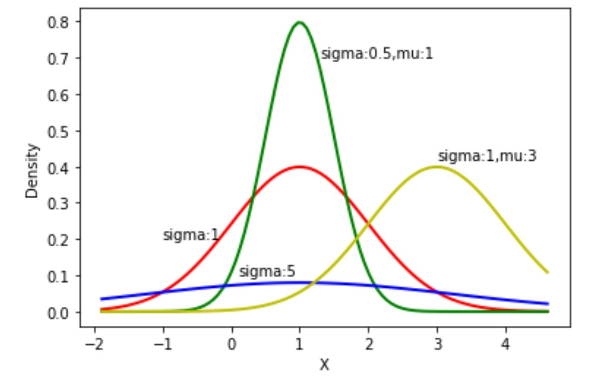
</p>

> Univariate Gaussian (normal) distributions: each curve is a probability distribution defined by its mean $\mu$ (the center) and variance $\sigma^2$ ($\sigma$ is the standard deviation). A small $\sigma$ gives a tall, narrow curve and a large one gives a short, wide curve. The total area under each curve is 1, and every point on it is a probability density, given by $f(x) = \frac{1}{\sqrt{2\pi\sigma^2}} \exp\left(-\frac{(x - \mu)^2}{2\sigma^2}\right)$.

<br>

<p align="left">
  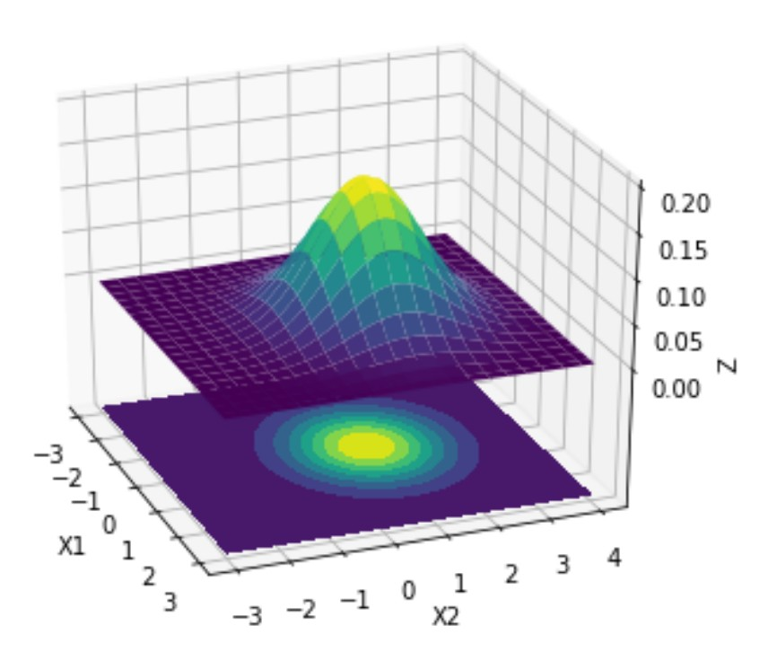
</p>

> Multivariate Gaussian distribution: models data with more than one variable ($X_1$ on one axis, $X_2$ on another, and so on for $n$ dimensions). $X$, $\mu$, and $\Sigma$ are vectors and matrices, with $\Sigma$ called the covariance matrix. The 3D surface shows the density, and its projection below shows the contours. Unlike the univariate version, which is a special case of it, its orientation can change to fit the data.

<br>

<p align="left">
  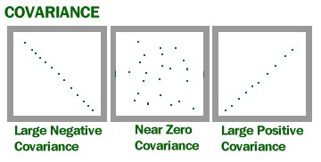
</p>

> Covariance: large negative covariance means one variable falls as the other rises, near zero covariance means no relationship, and large positive covariance means they rise together. Correlation gives both the direction and the strength, on a scale from −1 to 1. The covariance matrix is always square (2 × 2 for two features), its diagonal holds each feature's variance, and if its off diagonal entries are zero, the features are independent.

<br>

<p align="left">
  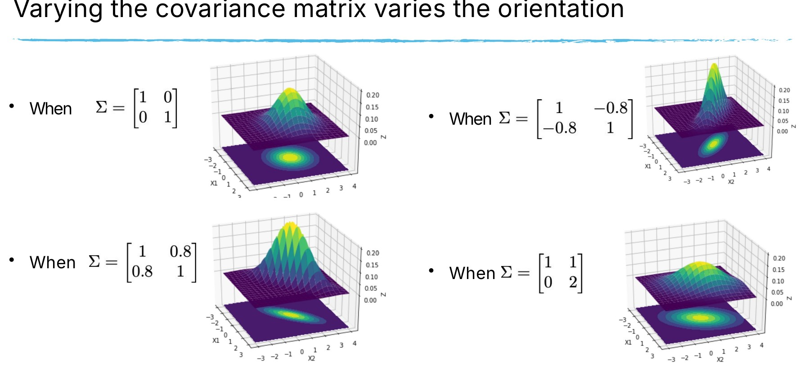
</p>

> Varying the covariance matrix changes the orientation: with $\Sigma = \begin{bmatrix} 1 & 0 \\ 0 & 1 \end{bmatrix}$ the contours are circles. A negative off diagonal (−0.8) tilts the shape one way, a positive one (0.8) tilts it the other way, and unequal diagonal values (1 and 2) stretch it along one axis.

<br>

<p align="left">
  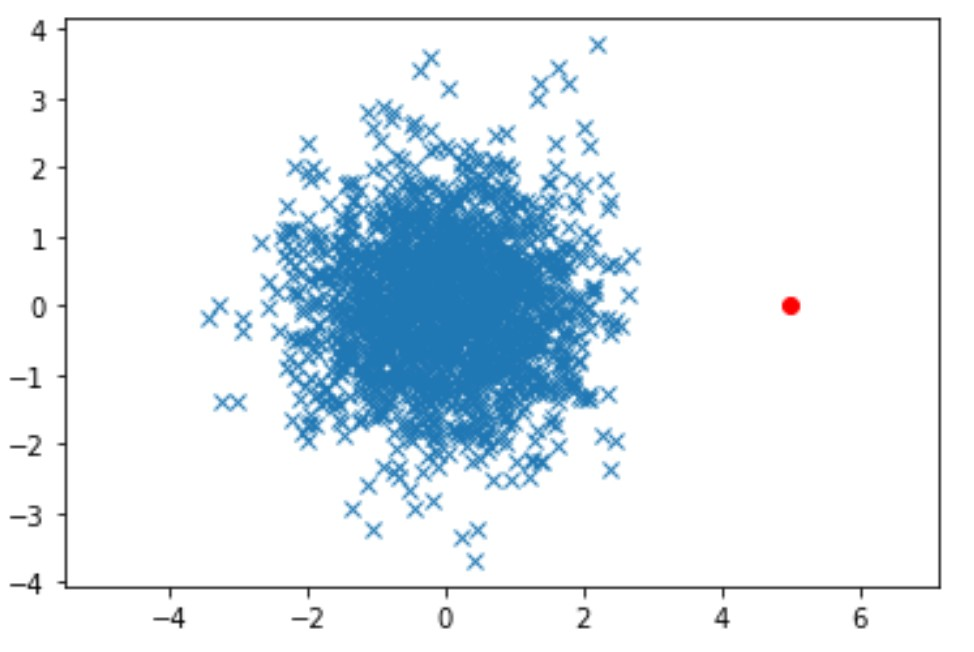
</p>
<p align="left">
  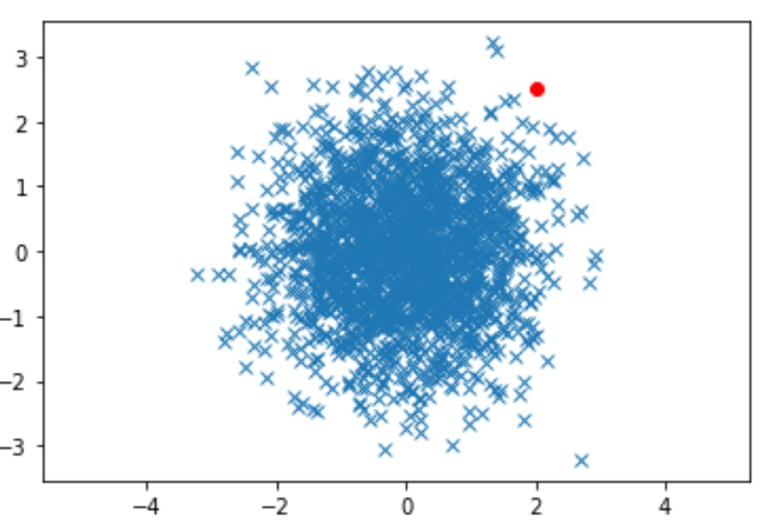
</p>

> The intuition: most points cluster together in a dense cloud (normal behavior), and a point far from the cloud, like the red dot, is an anomaly. This is mainly unsupervised, though it can feel like a hybrid, since labeled anomalies help tune the threshold. Applications include fraud detection, machine failure detection, and spotting unusual behavior in data center servers.

<br>

<p align="left">
  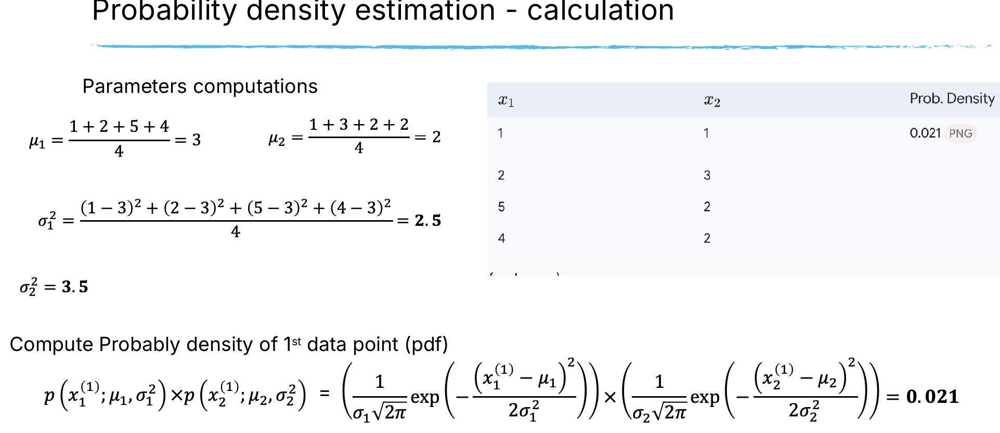
</p>

> Calculating probability density: first fit the parameters from the data, $\mu_j = \frac{1}{m}\sum x_j^{(i)}$ and $\sigma_j^2 = \frac{1}{m}\sum (x_j^{(i)} - \mu_j)^2$ for each feature. If the features are treated as independent, a point's total density is the product of its features' densities, $p(x) = p(x_1; \mu_1, \sigma_1^2) \times p(x_2; \mu_2, \sigma_2^2)$. This example is worked out step by step in the Worked Examples below.

<br>

<p align="left">
  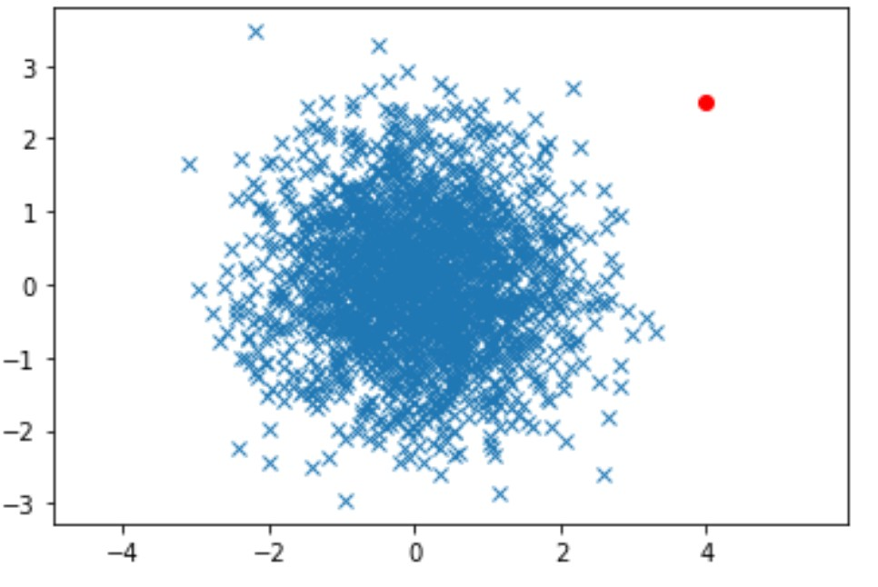
</p>

> Detecting anomalies with a threshold: with $\mu_1 = \mu_2 = 0$, $\sigma_1 = 2$, and $\sigma_2 = 1$, the data forms an oval cloud, and the contour rings show where density is high (center) and low (edges). Choose a threshold $\varepsilon$, say 0.02, compute $p(x_1) \times p(x_2)$ for each point, and flag any point with density below $\varepsilon$, like the test point outside the outer ring.

**The algorithm:**

1. Choose features $x_i$ that you think indicate anomalies
2. Fit $\mu$ and $\sigma$ for each feature
3. Choose a threshold $\varepsilon$, the density below which a point is an anomaly
4. For a new example, compute $p(x)$
5. Flag it as an anomaly if $p(x) < \varepsilon$

<p align="left">
  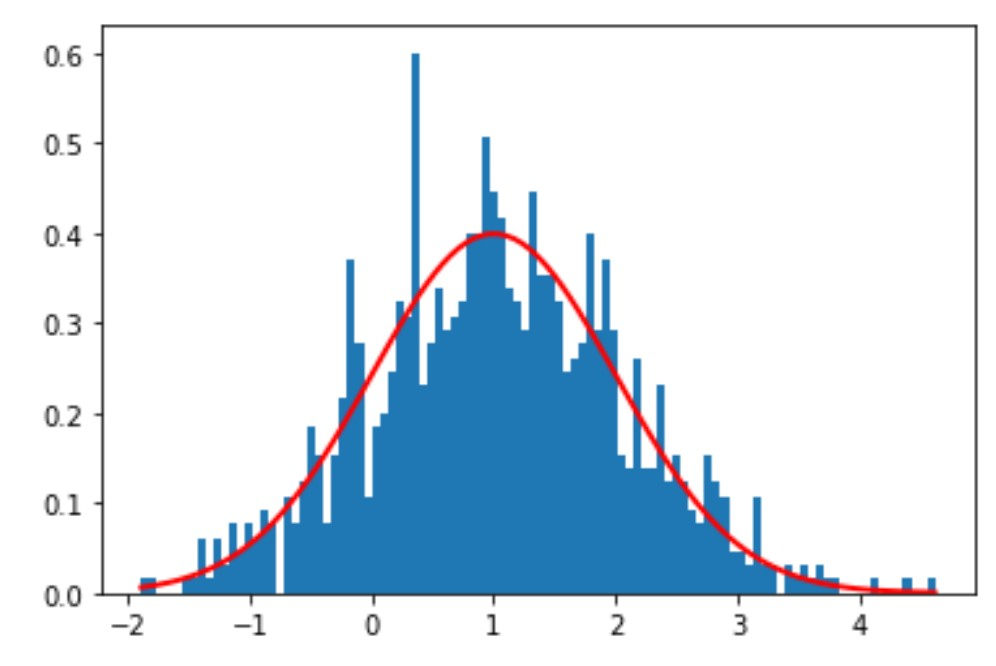
</p>

> Dealing with non Gaussian data: the top histogram fits a bell curve well. The middle one is skewed with a long tail, so it isn't Gaussian. A preprocessing step can reshape it with a power transformation, like $\log(x)$, $\log(x + c)$, $x^2$, or $x^{0.5}$, giving something closer to the bottom histogram. Always check a feature's distribution before fitting a Gaussian.

### Setting Up an Anomaly Detection System

Using auto engines as the example, with 10,000 good engines ($y = 0$) and 20 anomalous ones ($y = 1$):

| Set | Good engines | Anomalous engines |
|---|---|---|
| Training | 6000 | 0 |
| Cross validation (CV) | 2000 | 10 |
| Test | 2000 | 10 |

1. Fit the model on the training set (only normal engines)
2. Tune $\varepsilon$ until it works well on the CV set
3. Check the final performance on the test set
4. Measure accuracy with true and false positives and negatives

<p align="left">
  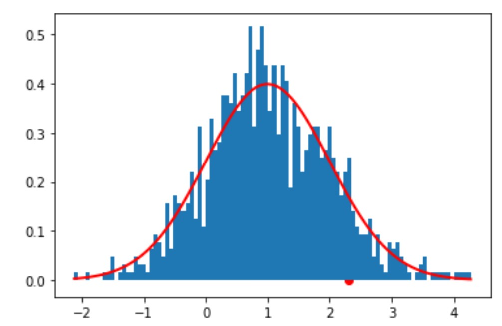
</p>
<p align="left">
  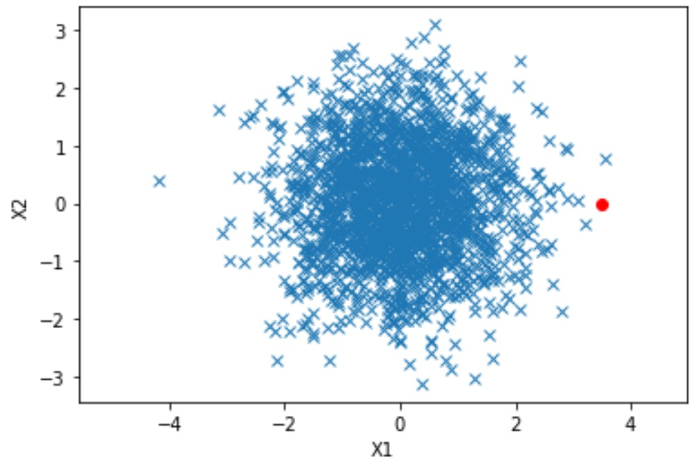
</p>

> Adding features that influence anomalies: a good system gives normal examples high density and anomalies low density. A common problem is that $p(x)$ looks normal for both, either because the fault is new or, more often, because not every relevant feature was included. Here, the red anomaly sits in the normal range of $X_1$ alone (top), but adding a second feature $X_2$ makes it stand out clearly (bottom).

**Derived features:** when monitoring data center computers with features like memory use ($x_1$), disk accesses per second ($x_2$), CPU load ($x_3$), and network traffic ($x_4$), a program stuck in an infinite loop drives CPU load up while everything else stays normal, which may not cross the threshold. New features like $x_5 = \frac{\text{CPU load}}{\text{network traffic}}$ or $x_6 = \frac{(\text{CPU load})^2}{\text{network traffic}}$ become very large in that situation, so the model catches it easily.

<p align="left">
  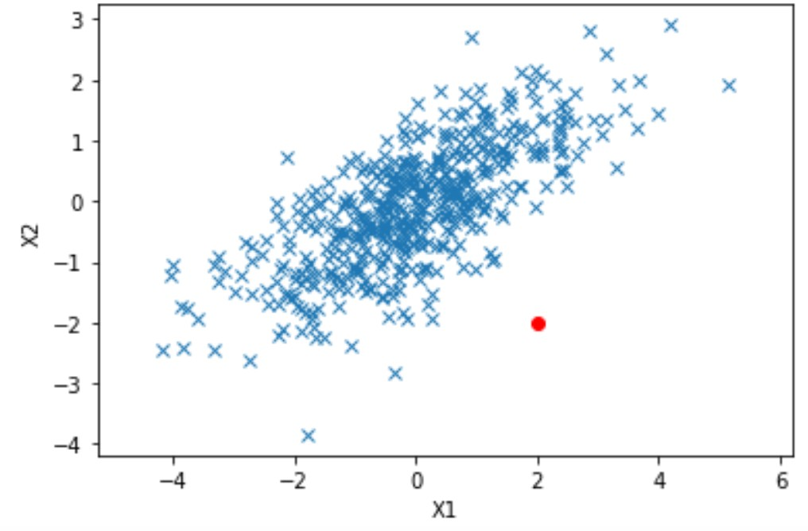
</p>
<p align="left">
  
</p>

> The case for the multivariate Gaussian: the red anomaly is obvious to the eye, but a univariate model (a product of individual probabilities) misses it, because its contours are always aligned with the axes (top). The multivariate version accounts for covariance, so its contours tilt to follow the data (bottom), and the anomaly falls clearly outside them.

### Implementing the Multivariate Model

Calculate the mean and covariance of the features,

$$
\mu = \frac{1}{m} \sum_{i=1}^{m} x^{(i)}
\qquad
\Sigma = \frac{1}{m} \sum_{i=1}^{m} (x^{(i)} - \mu)(x^{(i)} - \mu)^T
$$

then plug them into the multivariate Gaussian formula,

$$
p(x; \mu, \Sigma) = \frac{1}{\sqrt{(2\pi)^n |\Sigma|}} \exp\left(-\frac{1}{2} (x - \mu)^T \Sigma^{-1} (x - \mu)\right)
$$

where $|\Sigma|$ is the determinant of the covariance matrix and $\Sigma^{-1}$ is its inverse. The univariate model is the special case where the off diagonal entries of $\Sigma$ are all zero.

```python
import numpy as np

sigma = np.cov(x["x1"], x["x2"])   # covariance matrix
sigdet = np.linalg.det(sigma)       # determinant
siginv = np.linalg.pinv(sigma)      # (pseudo) inverse
```

| Original (univariate) model | Multivariate Gaussian |
|---|---|
| $p(x) = p(x_1; \mu_1, \sigma_1^2) \times p(x_2; \mu_2, \sigma_2^2) \times \dots$ | $p(x; \mu, \Sigma)$ using the covariance matrix |
| Unusual combinations need hand made derived features | Captures correlations between features automatically |
| Computationally cheap, scales to 10,000+ features | Computationally heavy, since inverting a large matrix is expensive |
| Works with large or small training sets | Needs more samples than features (and no redundant features), or $\Sigma$ can't be inverted |

## 2. DBSCAN

<p align="left">
  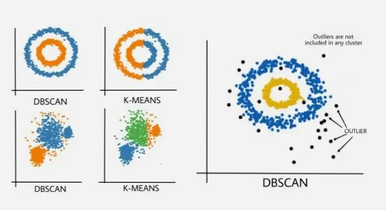
</p>
<p align="left">
  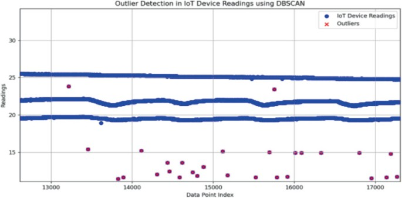
</p>

> DBSCAN (Density Based Spatial Clustering of Applications with Noise): an unsupervised clustering algorithm that groups data by density. Points in dense regions form clusters, and sparse points are anomalies, automatically labeled as noise. Unlike k means, it doesn't need the number of clusters ahead of time and can find curved, ring shaped clusters (top). It's used for things like flagging unusual IoT sensor readings over time (bottom).

<br>

<p align="left">
  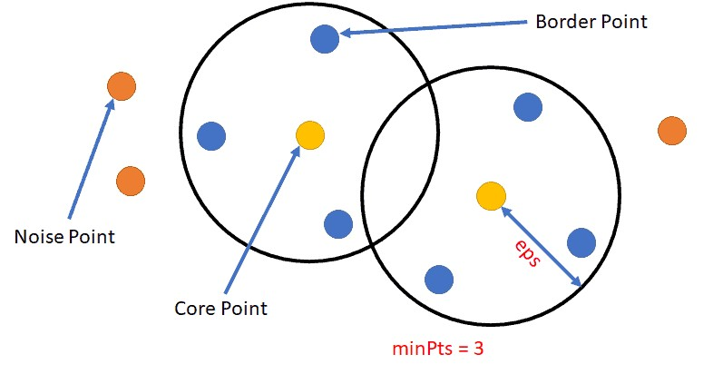
</p>

> Core, border, and noise points: with two key parameters, eps ($\varepsilon$, the maximum distance between neighbors) and min_samples (the minimum number of points to form a dense region), a core point has at least min_samples neighbors within eps. A border point is within eps of a core point but has too few neighbors of its own, and a noise point is neither. The algorithm picks a random point, and if it's a core point, expands the cluster by adding every point density reachable from it, repeating until all points are visited.

<br>

<p align="left">
  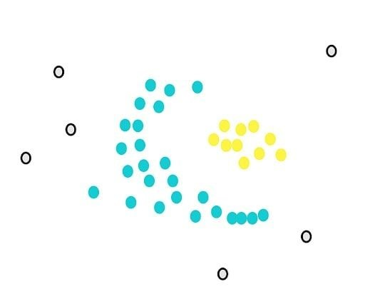
</p>

> The math and the result: point $p$ is density reachable from $q$ if there's a path of core points from $q$ to $p$, each within eps of the next. A cluster is a set of density connected points (core plus border), and everything else, the scattered points outside the clusters, is labeled noise (−1) and treated as an anomaly.

<br>

<p align="left">
  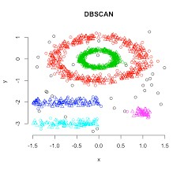
</p>

> Strengths and limitations: DBSCAN finds clusters of arbitrary shapes (like this ring around a center blob) and explicitly labels outliers, without needing a cluster count. But its results depend heavily on eps and min_samples, it can be slow on large datasets, and it struggles when clusters have very different densities. Use it for spatial or geometric data like sensor readings and geolocation, or when clusters have odd shapes or noise is present. Avoid it for high dimensional data. The analogy: DBSCAN finds crowded neighborhoods in a city, and anomalies are the isolated houses.

## 3. Isolation Forest

<p align="left">
  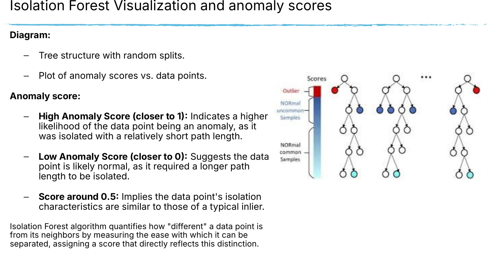
</p>

> Isolation Forest (iForest): builds an ensemble of isolation trees that split the data randomly until every point is isolated. Anomalies are "few and different," so they get isolated in just a few splits near the top of the tree (red), while normal points need many splits to separate (blue). The path length $h(x)$ is the number of edges from the root to the leaf where a point ends up, and the anomaly score is $s(x, n) = 2^{-E(h(x)) / c(n)}$, where $E(h(x))$ is the average path length across all trees and $c(n)$ normalizes for the sample size. A score near 1 means a likely anomaly, near 0 means normal, and around 0.5 means a typical point.

> Note: the summary slide says Isolation Forest anomalies have *low* scores (below the 5th percentile). That refers to scikit-learn's `score_samples`, which returns the negative of the paper's score, so lower means more abnormal there. The formula above uses the paper's version, where higher means more abnormal.

## 4. Autoencoders

<p align="left">
  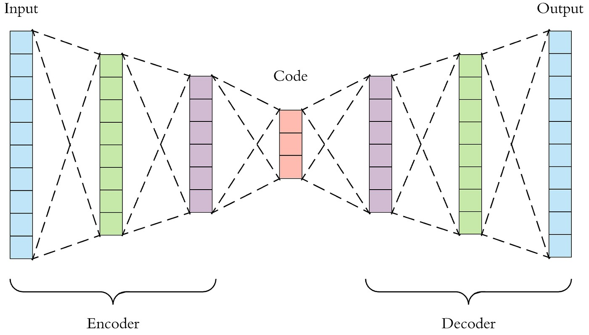
</p>

> Autoencoder: learns to compress and then reconstruct normal data. The encoder squeezes the input into a smaller latent space (the narrow middle, or code), and the decoder rebuilds the original input from it. Training minimizes the reconstruction error, the difference between the input and the output, using a self supervised approach where the input is also the target. Once trained on normal data, it reconstructs normal points well but struggles with anomalies, and that high error flags them.

<br>

<p align="left">
  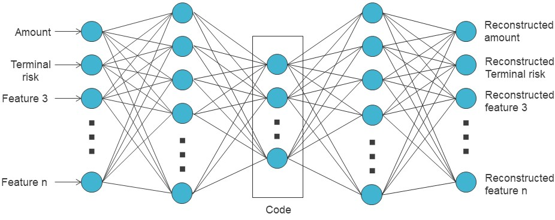
</p>

> Autoencoder math: the input $x$ is encoded into the latent representation $z = f(x)$ and decoded into the reconstruction $\hat{x} = g(z)$, with loss $\mathcal{L}(x, \hat{x}) = \lVert x - \hat{x} \rVert^2$. Compute the reconstruction error for each point and flag it as an anomaly if $\mathcal{L}(x, \hat{x}) > \tau$. Autoencoders work well for high dimensional data like images and time series and capture nonlinear patterns, but they need tuning (architecture and threshold) and are computationally expensive.

**Reading the reconstruction error plot (Coded Example 5):** the x axis is each data point's index and the y axis is its MSE. The first ~1950 points (normal data) have consistently low error, while the last ~50 (anomalies, like defective images) spike sharply. A red dashed line at the 95th percentile of the errors separates them cleanly. In practice, you'd swap the synthetic data for real images, such as from a manufacturing line, and monitor live data in real time.

## Summary

| Algorithm | Best for | How anomalies show up |
|---|---|---|
| Gaussian methods | Features that are (or can be made) roughly Gaussian | Density below the threshold $\varepsilon$ |
| DBSCAN | 1D or 2D spatial data, like vibration or sensor readings | Labeled as noise (−1) |
| Isolation Forest | Tabular data, like temperature and pressure | Short paths: paper score near 1, or a low scikit-learn score (such as below the 5th percentile) |
| Autoencoder (PyTorch) | Image data, like product defects | High reconstruction error (such as above the 95th percentile) |

## Worked Examples

### Probability Density of One Point

The slide's dataset has two features:

| $x_1$ | 1 | 2 | 5 | 4 |
|---|---|---|---|---|
| $x_2$ | 1 | 3 | 2 | 2 |

**Fit the parameters:**

$$
\mu_1 = \frac{1 + 2 + 5 + 4}{4} = 3
\qquad
\sigma_1^2 = \frac{(1-3)^2 + (2-3)^2 + (5-3)^2 + (4-3)^2}{4} = \frac{10}{4} = 2.5
$$

$$
\mu_2 = \frac{1 + 3 + 2 + 2}{4} = 2
\qquad
\sigma_2^2 = \frac{(1-2)^2 + (3-2)^2 + (2-2)^2 + (2-2)^2}{4} = \frac{2}{4} = 0.5
$$

**Density of the first point, (1, 1):**

$$
p(x_1 = 1) = \frac{1}{\sqrt{2\pi(2.5)}} \exp\left(-\frac{(1 - 3)^2}{2(2.5)}\right) = 0.2523 \times e^{-0.8} \approx 0.1134
$$

$$
p(x_2 = 1) = \frac{1}{\sqrt{2\pi(0.5)}} \exp\left(-\frac{(1 - 2)^2}{2(0.5)}\right) = 0.5642 \times e^{-1} \approx 0.2076
$$

$$
p(x) = 0.1134 \times 0.2076 \approx 0.024
$$

> Note: the slide lists $\sigma_2^2 = 3.5$ and gets a final answer of 0.021. Using 3.5 does give 0.021, but the listed $x_2$ values (1, 3, 2, 2) have a variance of 0.5, which gives 0.024. Either the data or the variance on the slide has a typo.

### Flagging a Test Point

With $\mu_1 = \mu_2 = 0$, $\sigma_1 = 2$, $\sigma_2 = 1$, and $\varepsilon = 0.02$:

| Point | $p(x_1)$ | $p(x_2)$ | $p(x)$ | Result |
|---|---|---|---|---|
| (0, 0), the center | $\frac{1}{2\sqrt{2\pi}} \approx 0.1995$ | $\frac{1}{\sqrt{2\pi}} \approx 0.3989$ | ≈ 0.0796 | Above 0.02, so normal |
| (4, 2), far out | $0.1995 \times e^{-16/8} \approx 0.0270$ | $0.3989 \times e^{-4/2} \approx 0.0540$ | ≈ 0.0015 | Below 0.02, so **anomaly** |

### Why a Derived Feature Helps

Normally a server runs at about 30% CPU load with 30 MB/s of network traffic, so $\frac{\text{CPU}}{\text{network}} \approx 1$. A program stuck in an infinite loop pushes CPU to 95% while traffic drops to 2 MB/s:

$$
\frac{95}{2} = 47.5
$$

CPU load alone (95%) might still sit within its normal range on busy days, but a ratio of 47.5 instead of about 1 is far out in the tail of that feature's distribution, so its density drops below $\varepsilon$ and the anomaly is caught.

### Univariate vs. Multivariate on a Correlated Point

Two strongly correlated features with $\mu = (0, 0)$ and

$$
\Sigma = \begin{bmatrix} 1 & 0.8 \\ 0.8 & 1 \end{bmatrix}
$$

Test the point $x = (1.5, -1.5)$, which breaks the correlation (one feature high, the other low), with $\varepsilon = 0.005$.

**Univariate model (ignores the correlation):**

$$
p(1.5) = \frac{1}{\sqrt{2\pi}} e^{-1.5^2 / 2} \approx 0.1295
\qquad
p(x) = 0.1295 \times 0.1295 \approx 0.0168
$$

That's above 0.005, so the univariate model calls it **normal**.

**Multivariate model:** $|\Sigma| = 1 - 0.8^2 = 0.36$ and $\Sigma^{-1} = \frac{1}{0.36}\begin{bmatrix} 1 & -0.8 \\ -0.8 & 1 \end{bmatrix}$, so

$$
(x - \mu)^T \Sigma^{-1} (x - \mu) = \frac{1.5^2 + (-1.5)^2 - 2(0.8)(1.5)(-1.5)}{0.36} = \frac{2.25 + 2.25 + 3.6}{0.36} = 22.5
$$

$$
p(x) = \frac{1}{2\pi\sqrt{0.36}} e^{-22.5 / 2} \approx 0.265 \times 0.000013 \approx 0.0000035
$$

That's far below 0.005, so the multivariate model correctly flags it as an **anomaly**. This is the tilted contour picture in numbers.

### DBSCAN by Hand

One dimensional points: $1, 2, 3, 4, 10$, with eps = 1.5 and min_samples = 3 (scikit-learn counts the point itself as one of its neighbors).

| Point | Neighbors within 1.5 | Count | Type |
|---|---|---|---|
| 1 | 1, 2 | 2 | Border (within eps of core point 2) |
| 2 | 1, 2, 3 | 3 | **Core** |
| 3 | 2, 3, 4 | 3 | **Core** |
| 4 | 3, 4 | 2 | Border (within eps of core point 3) |
| 10 | 10 | 1 | **Noise (−1), anomaly** |

Points 1 through 4 form one cluster, and 10 is flagged as an anomaly.

### Isolation Forest Score

For a sample size of $n = 256$, the normalizing average path length is

$$
c(n) = 2H(n - 1) - \frac{2(n - 1)}{n}
\qquad
H(i) \approx \ln(i) + 0.5772
$$

$$
c(256) \approx 2(\ln 255 + 0.5772) - \frac{2(255)}{256} \approx 12.24 - 1.99 = 10.25
$$

| Average path length $E(h(x))$ | Score $2^{-E(h(x)) / 10.25}$ | Meaning |
|---|---|---|
| 3 (isolated quickly) | ≈ 0.82 | Likely anomaly |
| 10.25 (average) | 0.5 | Typical point |
| 15 (hard to isolate) | ≈ 0.36 | Normal |

### Autoencoder Threshold

After training on normal data, suppose the reconstruction errors (MSE) on a validation set have a 95th percentile of 0.04. That becomes the threshold $\tau$:

| Point | Reconstruction error | Result |
|---|---|---|
| A normal bottle | 0.012 | Below 0.04, so normal |
| A slightly unusual bottle | 0.035 | Below 0.04, so normal |
| A cracked bottle | 0.31 | Above 0.04, so **anomaly** |

Setting $\tau$ at the 95th percentile means about 5% of normal points would be flagged too, so in practice the threshold is tuned on a validation set that includes some known anomalies, just like $\varepsilon$ for the Gaussian method.
