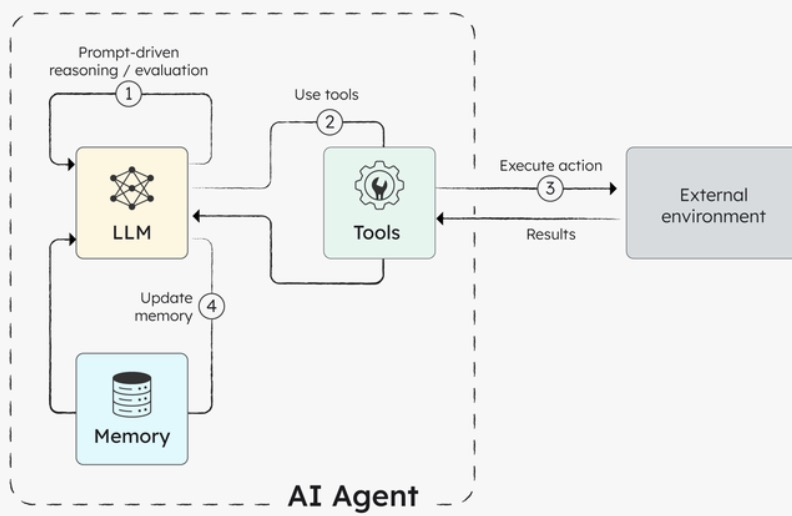
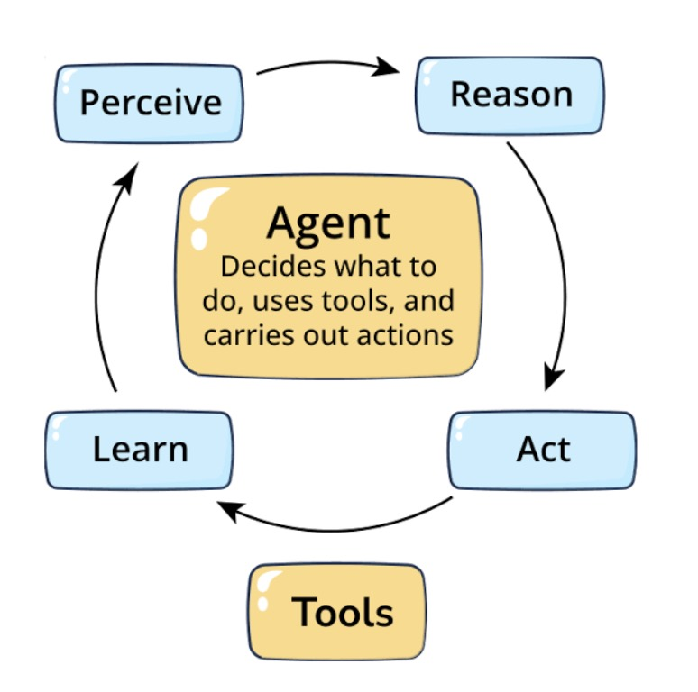

# Agentic AI & MCP

_More notes coming once the Agentic AI and MCP unit is covered._

## Generative AI vs. AI Agents vs. Agentic AI

  

> Generative AI vs. AI agent vs. agentic AI: generative AI creates new content (text, images, audio, or video) and is reactive, answering a user's prompt directly, like a chatbot. An AI agent is an LLM with external tools (search, APIs, and data sources) that performs a single, specific task, like finding and summarizing today's news. Agentic AI is a system of agents that communicate and work together toward a complex goal, like turning a video into a blog post with separate transcription, title creation, and summarizing agents.

## How an AI Agent Works

  

> Inside an AI agent: (1) the LLM reasons about the prompt, (2) decides to use tools, (3) executes actions in the external environment and gets results back, and (4) updates its memory, repeating until the task is done.

 

  

> The agent loop: an agent perceives its environment, reasons about what to do, acts by using tools to carry out actions, and learns from the results, cycling until it reaches its goal.
