# Agentic AI & MCP

## Generative AI vs. AI Agents vs. Agentic AI

<p align="left">
  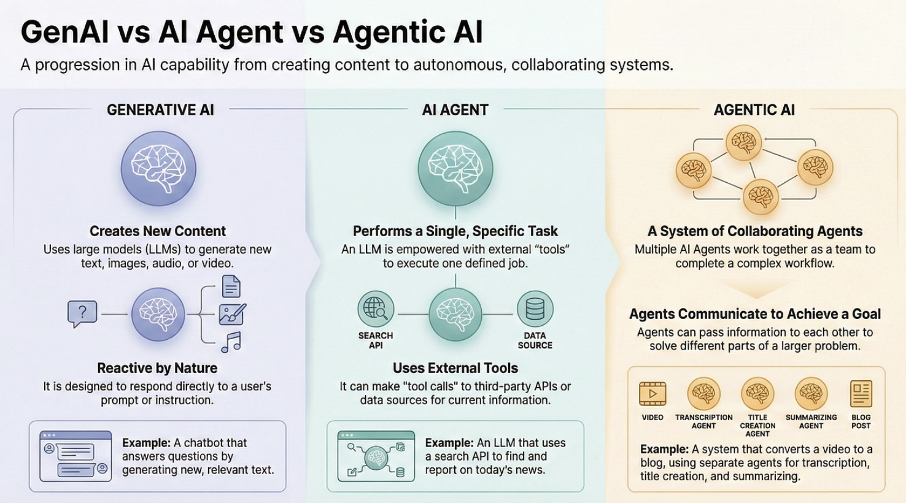
</p>

> Generative AI vs. AI agent vs. agentic AI: generative AI creates new content (text, images, audio, or video) and is reactive, answering a user's prompt directly, like a chatbot. An AI agent is an LLM with external tools (search, APIs, and data sources) that performs a single, specific task, like finding and summarizing today's news. Agentic AI is a system of agents that communicate and work together toward a complex goal, like turning a video into a blog post with separate transcription, title creation, and summarizing agents.

## How an AI Agent Works

<p align="left">
  
</p>

> Inside an AI agent: (1) the LLM reasons about the prompt, (2) decides to use tools, (3) executes actions in the external environment and gets results back, and (4) updates its memory, repeating until the task is done.

<br>

<p align="left">
  
</p>

> The agent loop: an agent perceives its environment, reasons about what to do, acts by using tools to carry out actions, and learns from the results, cycling until it reaches its goal.

## Traditional AI vs. Generative AI

<p align="left">
  
</p>

> Traditional AI answers fixed questions: it's trained to recognize patterns and give a predetermined type of output, so it's good at structured tasks with clear right or wrong answers, like classifying spam, predicting customer churn, detecting fraud, or routing support tickets. Generative AI creates new content: it's trained on vast amounts of language and knowledge to produce original text, code, and summaries from your instructions, like writing a draft, summarizing a report, explaining something for a non technical audience, or reformatting data as a table.

**What an LLM can do:** think of a large language model as a co-worker who has read an enormous amount of text (books, articles, code, conversations) and learned to respond intelligently. You give it plain language instructions and it gives back useful output. It can **understand** loosely worded instructions, **summarize** long documents, **generate** drafts, emails, explanations, and code, **reason** through examples and edge cases, and **transform** content by reformatting, translating, or restructuring it.

## Types of AI

| Term | What it does | Key trait |
|---|---|---|
| Assistant | Responds to a single request | Reactive |
| Skill | Repeats a saved instruction pattern | Repeatable |
| Tool | Performs a defined function | Predictable |
| Agent | Works toward a goal autonomously | Autonomous |
| Workflow | Connects multiple AI assisted steps | Orchestrated |

**Five questions to ask about any AI use case:**

1. **Task:** what is the AI being asked to do?
2. **Data:** what information does it need to work with?
3. **Output:** what should the result look like?
4. **Review:** who checks it, and what are they looking for?
5. **Limits:** what should the AI *not* do in this scenario?

These work for a single prompt, a reusable skill, a defined tool, or a multi step agent, and the answer to question 5 is often the most important one in the room.

## MCP (Model Context Protocol)

<p align="left">
  
</p>

> MCP for plants and IIoT devices: industrial systems speak many protocols (OPC UA, Modbus, MQTT, historian, and CMMS interfaces). An MCP server wraps each one and exposes a few clear tools the AI can call. The AI app (the host, like an operator assistant) talks to every server through one MCP client using one standard protocol. Start with read before write: read only tags and history first, with setpoint changes either not exposed or needing approval. For security, the servers run inside the OT network zone, so PLCs are never exposed directly to the AI app or the internet, and safety interlocks and real time control stay in the PLC, never in the AI path.

<br>

<p align="left">
  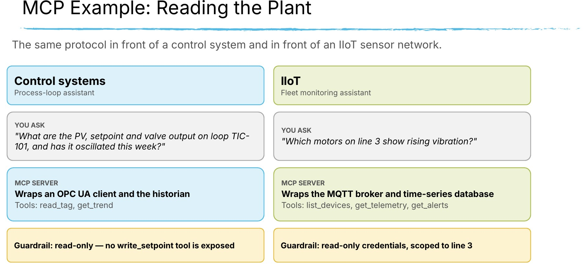
</p>

> MCP example, reading the plant: the same protocol sits in front of a control system and an IIoT sensor network. A process loop assistant answers "What are the PV, setpoint, and valve output on loop TIC-101, and has it oscillated this week?" through an MCP server that wraps an OPC UA client and the historian, with tools `read_tag` and `get_trend` and no `write_setpoint` tool exposed. A fleet monitoring assistant answers "Which motors on line 3 show rising vibration?" through a server that wraps the MQTT broker and time series database, with tools `list_devices`, `get_telemetry`, and `get_alerts`, using read only credentials scoped to line 3.

## AI Agents in Industrial Systems

<p align="left">
  
</p>

> Agents above the control layer: control stays deterministic, with PLCs and PID loops running in milliseconds on fixed, tested logic. Agents work above it, observing, diagnosing, and recommending, but never closing the fast loop. The stack runs from the advisory AI agent, to SCADA/HMI (operator view and approval), to the PLC (real time control and interlocks), to the sensors and actuators of the physical process. The agent loop is read tags, form a hypothesis, run an analysis, then recommend. Guardrails keep it read only by default, require operator approval for any setpoint change, and enforce limits in the controller.

<br>

<p align="left">
  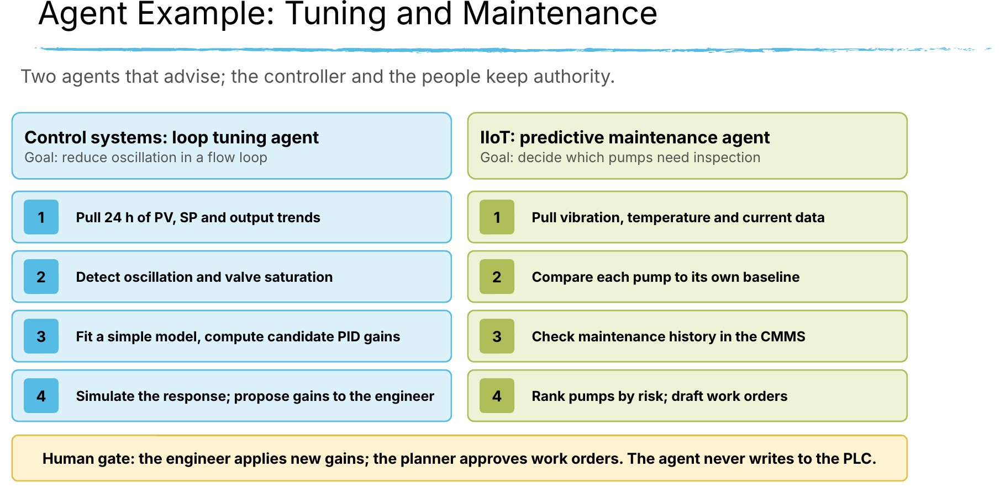
</p>

> Agent examples, tuning and maintenance: a loop tuning agent (goal: reduce oscillation in a flow loop) pulls 24 hours of PV, SP, and output trends, detects oscillation and valve saturation, fits a simple model to compute candidate PID gains, and simulates the response before proposing gains to the engineer. A predictive maintenance agent (goal: decide which pumps need inspection) pulls vibration, temperature, and current data, compares each pump to its own baseline, checks maintenance history in the CMMS, and ranks pumps by risk while drafting work orders. In both, there's a human gate: the engineer applies new gains, the planner approves work orders, and the agent never writes to the PLC.

## Workflows for Industrial Operations

<p align="left">
  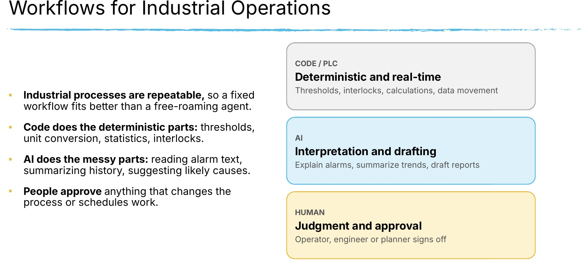
</p>

> Splitting the work: industrial processes are repeatable, so a fixed workflow fits better than a free roaming agent. Code and PLCs handle the deterministic, real time parts (thresholds, interlocks, calculations, unit conversion, statistics, data movement). AI handles the messy parts (interpreting alarm text, summarizing history and trends, suggesting likely causes, drafting reports). People handle judgment and approval, signing off on anything that changes the process or schedules work.

<br>

<p align="left">
  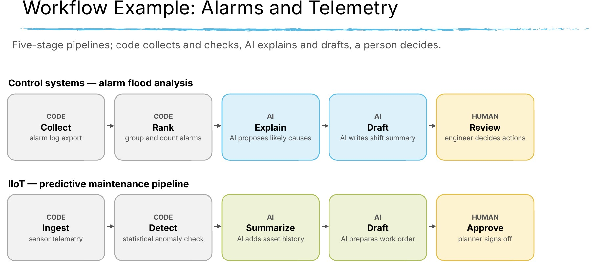
</p>

> Workflow examples, alarms and telemetry: both are five stage pipelines where code collects and checks, AI explains and drafts, and a person decides. For alarm flood analysis, code collects the alarm log and ranks alarms by grouping and counting them, AI explains likely causes and drafts a shift summary, and an engineer reviews and decides on actions. For an IIoT predictive maintenance pipeline, code ingests sensor telemetry and runs a statistical anomaly check, AI summarizes the asset's history and drafts a work order, and a planner approves it.

<br>

<p align="left">
  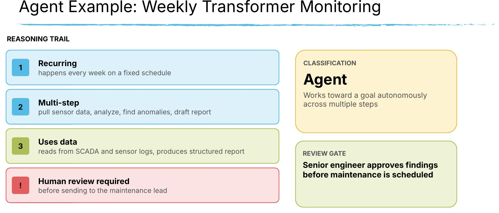
</p>

> Classifying a use case, weekly transformer monitoring: it recurs every week on a fixed schedule, it's multi step (pull sensor data, analyze, find anomalies, draft a report), it uses data from SCADA and sensor logs to produce a structured report, and it needs human review before going to the maintenance lead. That makes it an **agent**, working toward a goal autonomously across multiple steps, with a review gate where a senior engineer approves the findings before maintenance is scheduled.

## The Big Picture: Four Layers

<p align="left">
  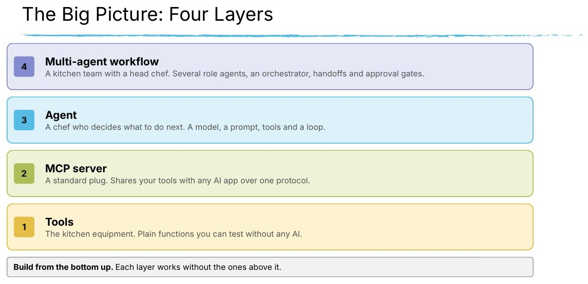
</p>

> The four layers of an agentic system, built from the bottom up: (1) **tools**, the kitchen equipment, are plain functions you can test without any AI; (2) an **MCP server** is a standard plug that shares your tools with any AI app over one protocol; (3) an **agent** is a chef who decides what to do next, made of a model, a prompt, tools, and a loop; (4) a **multi agent workflow** is a kitchen team with a head chef, with several role agents, an orchestrator, handoffs, and approval gates. Each layer works without the ones above it.

## MCP: What It Is and How to Build It

<p align="left">
  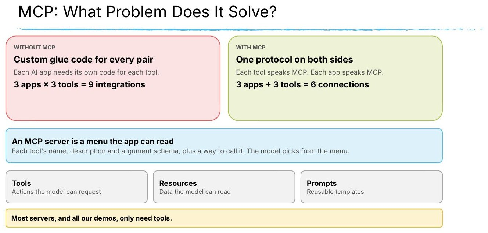
</p>

> The problem MCP solves: without it, every AI app needs its own glue code for every tool, so 3 apps × 3 tools = 9 integrations. With MCP, each tool speaks MCP and each app speaks MCP, so 3 apps + 3 tools = 6 connections. An MCP server is a menu the app can read: each tool's name, description, and argument schema, plus a way to call it, and the model picks from the menu. A server can expose **tools** (actions the model can request), **resources** (data the model can read), and **prompts** (reusable templates), but most servers, and all the course demos, only need tools.

<br>

<p align="left">
  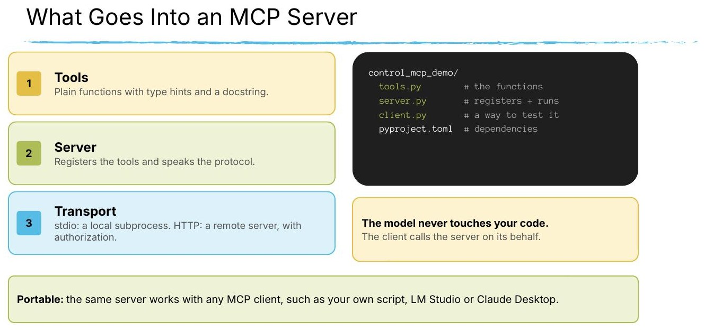
</p>

> What goes into an MCP server: (1) **tools**, plain functions with type hints and a docstring; (2) the **server**, which registers the tools and speaks the protocol; (3) the **transport**, either stdio (a local subprocess) or HTTP (a remote server, with authorization). The demo project keeps these in separate files: `tools.py` for the functions, `server.py` to register and run them, `client.py` to test it, and `pyproject.toml` for dependencies. The model never touches your code, since the client calls the server on its behalf, and the same server works with any MCP client (your own script, LM Studio, or Claude Desktop).

<br>

<p align="left">
  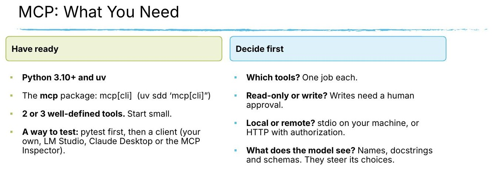
</p>

> What you need before building: Python and uv, the `mcp[cli]` package, 2 or 3 well defined tools, and a way to test (pytest first, then a client like your own, LM Studio, Claude Desktop, or the MCP Inspector). Decide first: which tools (one job each), read only or write (writes need human approval), local or remote (stdio on your machine, or HTTP with authorization), and what the model sees (names, docstrings, and schemas, which steer its choices).

> [!NOTE]
> The slide's install command has a typo (`uv sdd ‘mcp[cli]”`). The correct command is `uv add "mcp[cli]"`, with matching straight quotes so your shell doesn't treat the brackets as a pattern. Also, this slide says Python 3.10+, while the Week 11 walkthrough uses Python 3.12+.

<br>

<p align="left">
  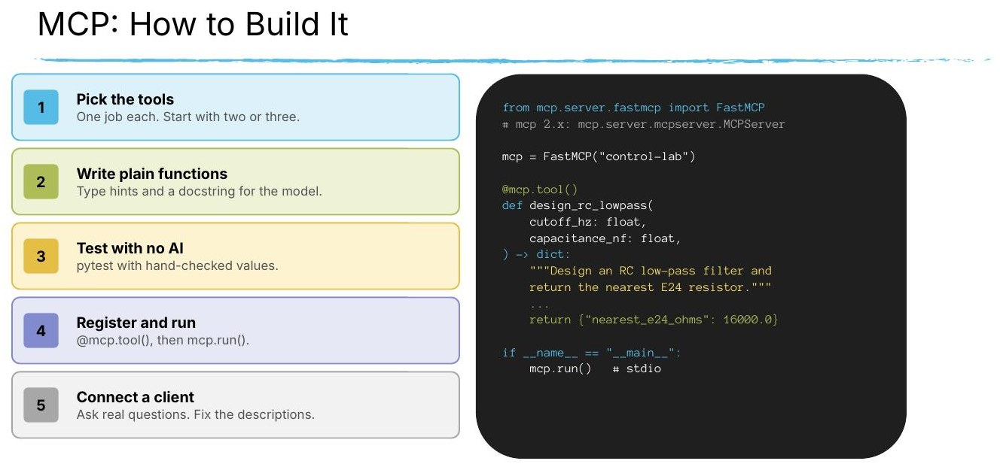
</p>

> How to build an MCP server in five steps: (1) pick the tools, one job each, starting with two or three; (2) write plain functions with type hints and a docstring for the model; (3) test them with no AI, using pytest with hand checked values; (4) register them with `@mcp.tool()` and start the server with `mcp.run()`; (5) connect a client, ask real questions, and fix the descriptions. In mcp 1.x the server class is `FastMCP` (from `mcp.server.fastmcp`); in mcp 2.x it's `MCPServer` (from `mcp.server.mcpserver`).

## Agents: What They Are and How to Build Them

<p align="left">
  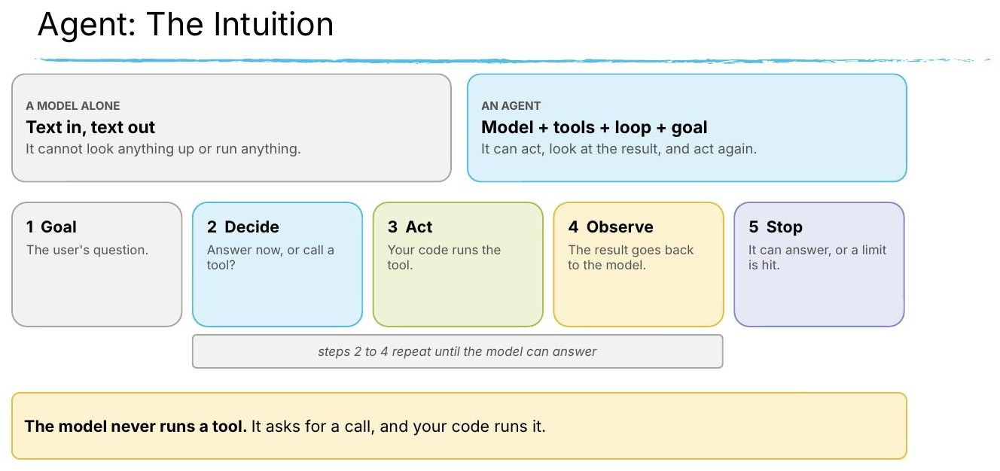
</p>

> The intuition: a model alone is text in, text out, so it can't look anything up or run anything. An agent is a **model + tools + loop + goal**, so it can act, look at the result, and act again. The loop is (1) goal, the user's question; (2) decide, answer now or call a tool; (3) act, your code runs the tool; (4) observe, the result goes back to the model; (5) stop, when it can answer or a limit is hit. Steps 2 to 4 repeat until the model can answer. The model never runs a tool: it asks for a call, and your code runs it.

<br>

<p align="left">
  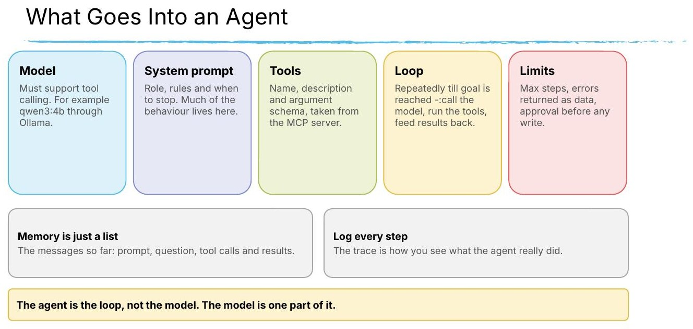
</p>

> What goes into an agent: a **model** that supports tool calling (like `qwen3:4b` through Ollama); a **system prompt** with the role, rules, and when to stop, where much of the behaviour lives; **tools** with a name, description, and argument schema taken from the MCP server; a **loop** that calls the model, runs the tools, and feeds the results back until the goal is reached; and **limits** (max steps, errors returned as data, approval before any write). Memory is just the list of messages so far, and you should log every step, since the trace is how you see what the agent really did. The agent is the loop, not the model.

<br>

<p align="left">
  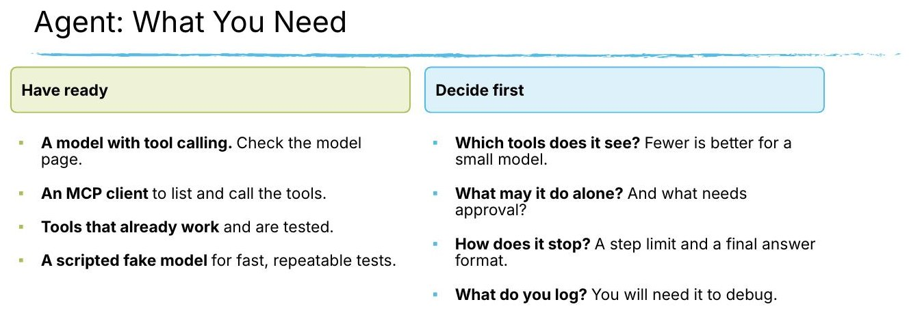
</p>

> What you need for an agent: a model with tool calling (check the model page), an MCP client to list and call the tools, tools that already work and are tested, and a scripted fake model for fast, repeatable tests. Decide first: which tools it sees (fewer is better for a small model), what it may do alone and what needs approval, how it stops (a step limit and a final answer format), and what you log, since you'll need it to debug.

<br>

<p align="left">
  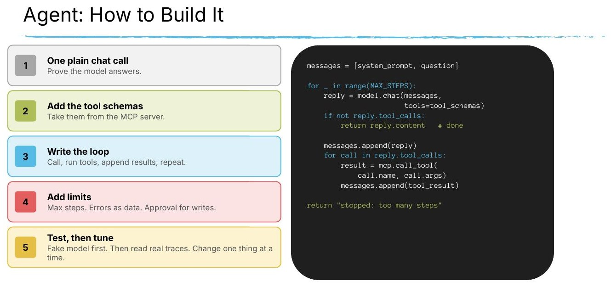
</p>

> How to build an agent: (1) make one plain chat call to prove the model answers; (2) add the tool schemas from the MCP server; (3) write the loop: call the model, run any tools it asks for, append the results, and repeat; (4) add limits: max steps, errors as data, and approval for writes; (5) test with a fake model first, then read real traces and change one thing at a time. In the code, the loop runs up to `MAX_STEPS` times, and if the reply has no tool calls the model is done; if it never finishes, it returns `"stopped: too many steps"`.

## Multi-Agent Workflows

<p align="left">
  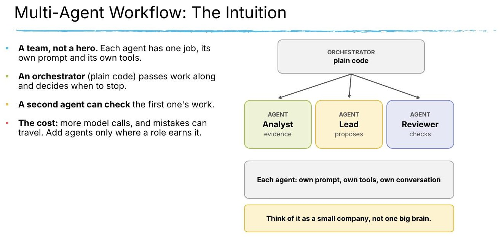
</p>

> The intuition: a team, not a hero. Each agent has one job, its own prompt, its own tools, and its own conversation. An **orchestrator** written in plain code passes work along and decides when to stop, and a second agent can check the first one's work (here an Analyst gathers evidence, a Lead proposes, and a Reviewer checks). The cost is more model calls, and mistakes can travel from one agent to the next, so add agents only where a role earns it. Think of it as a small company, not one big brain.

<br>

<p align="left">
  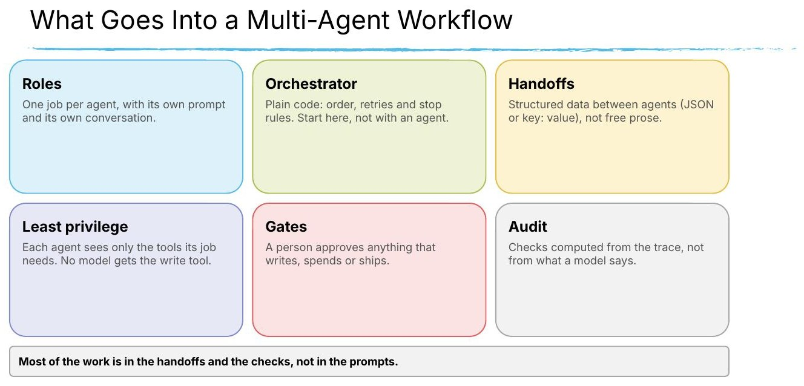
</p>

> What goes into a multi agent workflow: **roles** (one job per agent, with its own prompt and conversation); an **orchestrator** (plain code for order, retries, and stop rules, which is where you start, not with an agent); **handoffs** (structured data between agents, JSON or `key: value`, not free prose); **least privilege** (each agent sees only the tools its job needs, and no model gets the write tool); **gates** (a person approves anything that writes, spends, or ships); and an **audit** (checks computed from the trace, not from what a model says). Most of the work is in the handoffs and the checks, not the prompts.

<br>

<p align="left">
  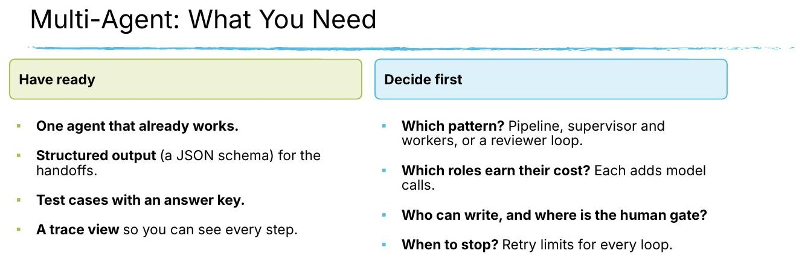
</p>

> What you need for multi agent: one agent that already works, structured output (a JSON schema) for the handoffs, test cases with an answer key, and a trace view so you can see every step. Decide first: which pattern (pipeline, supervisor and workers, or a reviewer loop), which roles earn their cost, who can write and where the human gate is, and when to stop (retry limits for every loop).

<br>

<p align="left">
  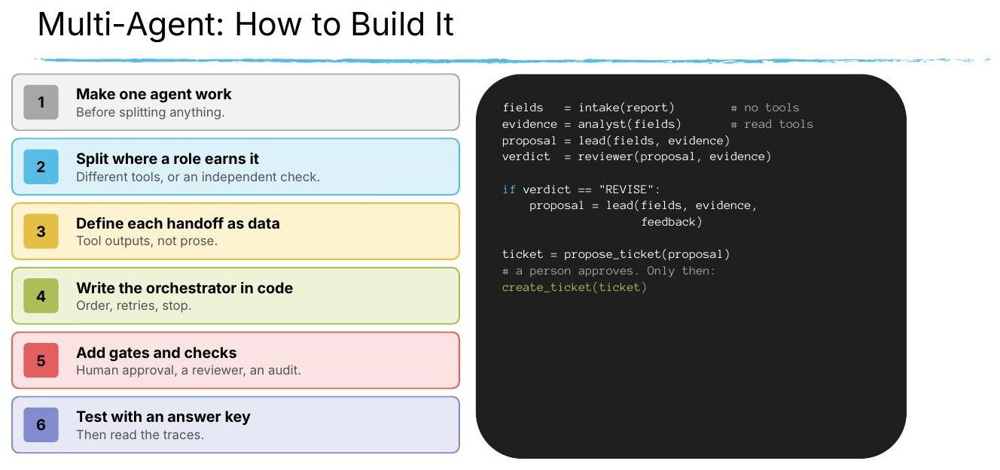
</p>

> How to build it: (1) make one agent work before splitting anything; (2) split only where a role earns it, through different tools or an independent check; (3) define each handoff as data (tool outputs, not prose); (4) write the orchestrator in code (order, retries, stop); (5) add gates and checks (human approval, a reviewer, an audit); (6) test with an answer key, then read the traces. In the code, the reviewer can send the proposal back once with `"REVISE"`, and `create_ticket` only runs after a person approves.

<br>

<p align="left">
  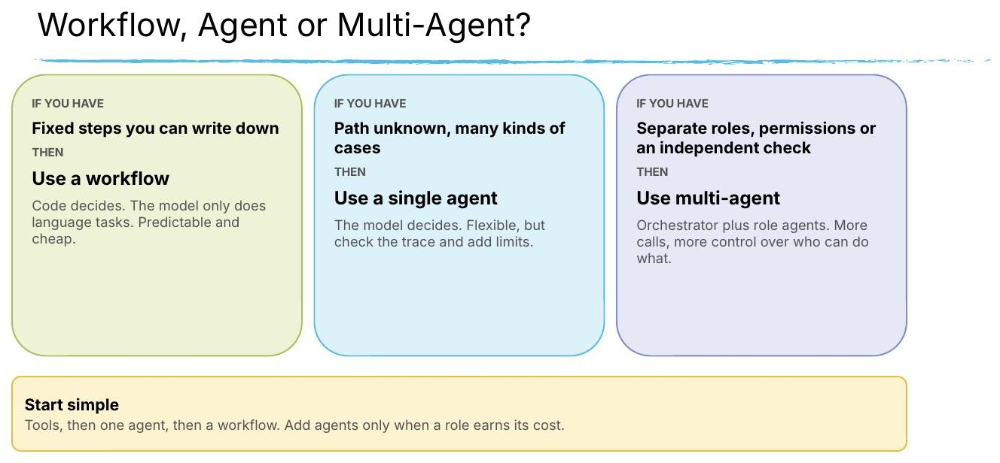
</p>

> Workflow, agent, or multi agent? If you have **fixed steps you can write down**, use a workflow: code decides and the model only does language tasks, so it's predictable and cheap. If the **path is unknown, with many kinds of cases**, use a single agent: the model decides, which is flexible, but check the trace and add limits. If you need **separate roles, permissions, or an independent check**, use multi agent: an orchestrator plus role agents, with more calls but more control over who can do what. Start simple: tools, then one agent, then a workflow, and add agents only when a role earns its cost.

## Build Recipe: Start to Finish

<p align="left">
  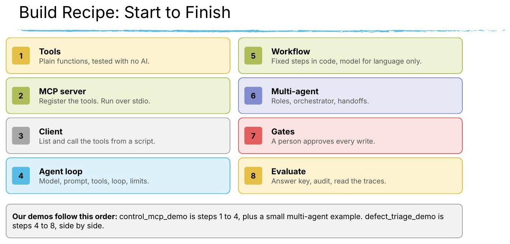
</p>

> The eight step build recipe: (1) tools, plain functions tested with no AI; (2) MCP server, register the tools and run over stdio; (3) client, list and call the tools from a script; (4) agent loop, model, prompt, tools, loop, and limits; (5) workflow, fixed steps in code with the model for language only; (6) multi agent, roles, orchestrator, and handoffs; (7) gates, a person approves every write; (8) evaluate, with an answer key, an audit, and reading the traces. The demos follow this order: `control_mcp_demo` covers steps 1 to 4 plus a small multi agent example, and `defect_triage_demo` covers steps 4 to 8 side by side. All four demos (Control Lab, Voltage Divider, Defect Triage, Sales BI) run on a laptop with a small local model.

## Demo 1: Control Lab Tools and an MCP Server

The `control_mcp_demo` project exposes three tools: `simulate_pid`, `design_rc_lowpass`, and `read_log_stats`.

<p align="left">
  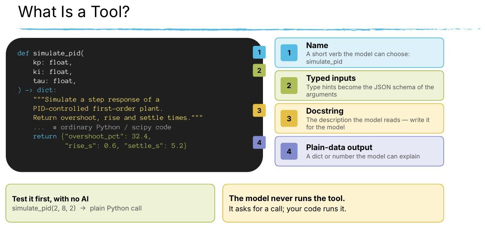
</p>

> What is a tool? Using `simulate_pid` as the example, a tool has (1) a **name**, a short verb the model can choose; (2) **typed inputs**, whose type hints become the JSON schema of the arguments; (3) a **docstring**, the description the model reads, so write it for the model; and (4) **plain data output**, a dict or number the model can explain. Test it first with no AI, as a plain Python call like `simulate_pid(2, 8, 2)`. The model never runs the tool; it asks for a call and your code runs it.

<br>

<p align="left">
  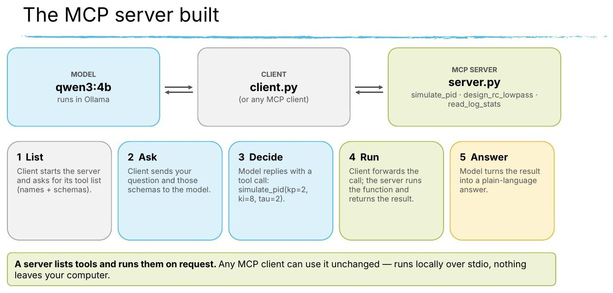
</p>

> The MCP server in action, with the model (`qwen3:4b` in Ollama), the client (`client.py` or any MCP client), and the server (`server.py`): (1) **list**, the client starts the server and asks for its tool names and schemas; (2) **ask**, the client sends your question and those schemas to the model; (3) **decide**, the model replies with a tool call like `simulate_pid(kp=2, ki=8, tau=2)`; (4) **run**, the client forwards the call and the server runs the function and returns the result; (5) **answer**, the model turns the result into a plain language answer. Everything runs locally over stdio, so nothing leaves your computer.

<br>

<p align="left">
  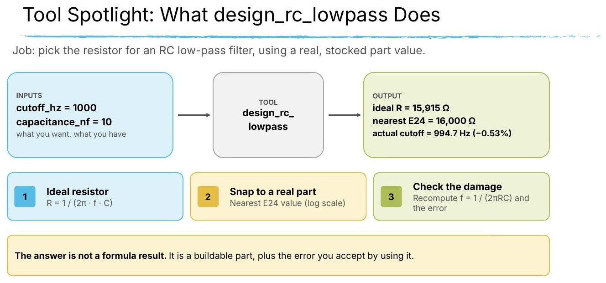
</p>

> Tool spotlight, `design_rc_lowpass`: its job is to pick the resistor for an RC low pass filter using a real, stocked part value. Given `cutoff_hz = 1000` and `capacitance_nf = 10` (what you want and what you have), it (1) computes the ideal resistor $R = 1/(2\pi f C)$ = 15,915 Ω, (2) snaps it to the nearest E24 value on a log scale, 16,000 Ω, and (3) checks the damage by recomputing $f = 1/(2\pi R C)$ = 994.7 Hz, an error of −0.53%. The answer isn't a formula result; it's a buildable part plus the error you accept by using it.

<br>

<p align="left">
  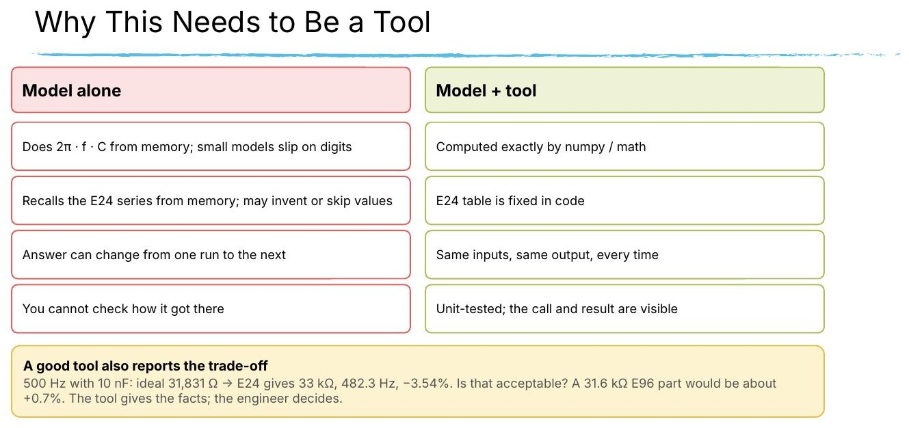
</p>

> Why this needs to be a tool: a model alone does $2\pi f C$ from memory and small models slip on digits, while a tool computes it exactly with numpy or math. A model may invent or skip E24 values, while the tool has the table fixed in code. A model's answer can change between runs and you can't check how it got there, while a tool gives the same output for the same inputs, is unit tested, and shows its call and result. A good tool also reports the trade off: 500 Hz with 10 nF gives an ideal 31,831 Ω, the E24 part is 33 kΩ, so the cutoff is 482.3 Hz (−3.54%). A 31.6 kΩ E96 part would be about +0.7%. The tool gives the facts; the engineer decides.

<br>

<p align="left">
  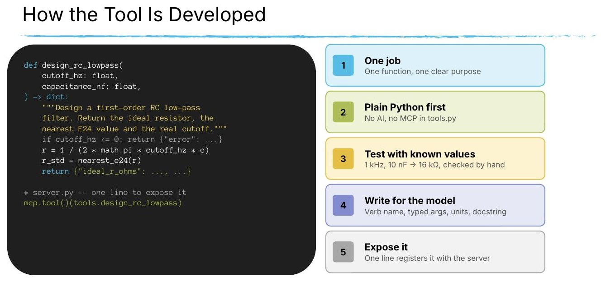
</p>

> How the tool is developed: (1) one job, one function with one clear purpose; (2) plain Python first, with no AI and no MCP in `tools.py`; (3) test with known values (1 kHz and 10 nF should give 16 kΩ, checked by hand); (4) write for the model with a verb name, typed arguments, units, and a docstring; (5) expose it with one line in `server.py`, `mcp.tool()(tools.design_rc_lowpass)`. Bad input like `cutoff_hz <= 0` returns `{"error": ...}` instead of crashing.

<br>

<p align="left">
  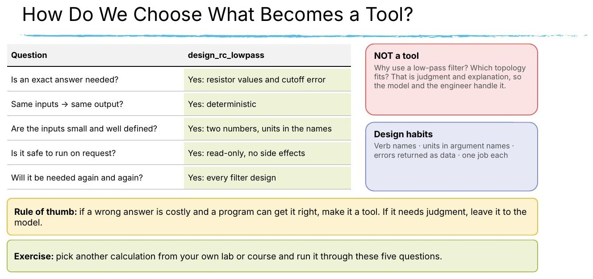
</p>

> How to choose what becomes a tool, using `design_rc_lowpass`: an exact answer is needed (resistor values and cutoff error), the same inputs give the same output (it's deterministic), the inputs are small and well defined (two numbers with units in the names), it's safe to run on request (read only, no side effects), and it's needed again and again (every filter design). Questions like "why use a low pass filter?" or "which topology fits?" are judgment and explanation, so they're not tools. Design habits: verb names, units in argument names, errors returned as data, one job each. Rule of thumb: if a wrong answer is costly and a program can get it right, make it a tool; if it needs judgment, leave it to the model.

<br>

<p align="left">
  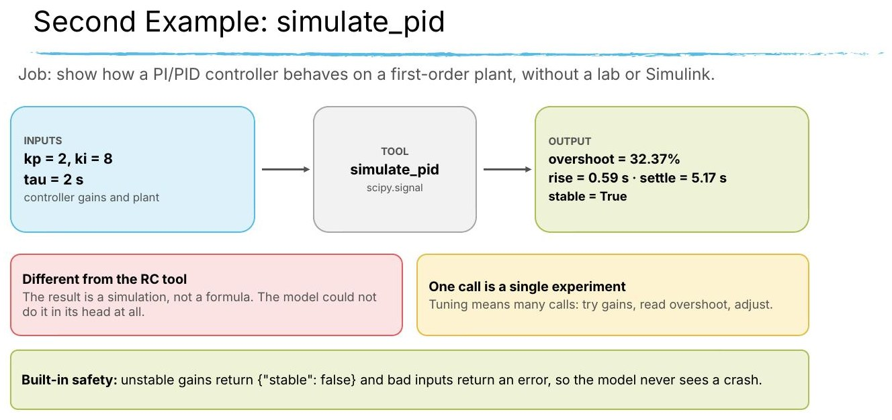
</p>

> Second example, `simulate_pid`: its job is to show how a PI or PID controller behaves on a first order plant without a lab or Simulink. With `kp = 2`, `ki = 8`, and `tau = 2 s`, scipy.signal gives 32.37% overshoot, a 0.59 s rise, a 5.17 s settle, and `stable = True`. Unlike the RC tool, the result is a simulation, not a formula, so the model couldn't do it in its head at all. One call is a single experiment, so tuning means many calls (try gains, read the overshoot, adjust). It has built in safety: unstable gains return `{"stable": false}` and bad inputs return an error, so the model never sees a crash.

<br>

<p align="left">
  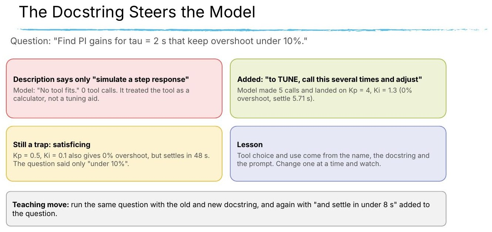
</p>

> The docstring steers the model. Asked to "find PI gains for tau = 2 s that keep overshoot under 10%," a model whose tool description only said "simulate a step response" replied "No tool fits" and made 0 calls, treating the tool as a calculator instead of a tuning aid. After adding "to TUNE, call this several times and adjust," it made 5 calls and landed on Kp = 4, Ki = 1.3 (0% overshoot, 5.71 s settle). There's still a trap, **satisficing**: Kp = 0.5, Ki = 0.1 also gives 0% overshoot but settles in 48 s, and the question only said "under 10%." Tool choice and use come from the name, docstring, and prompt, so change one at a time and watch.

<br>

<p align="left">
  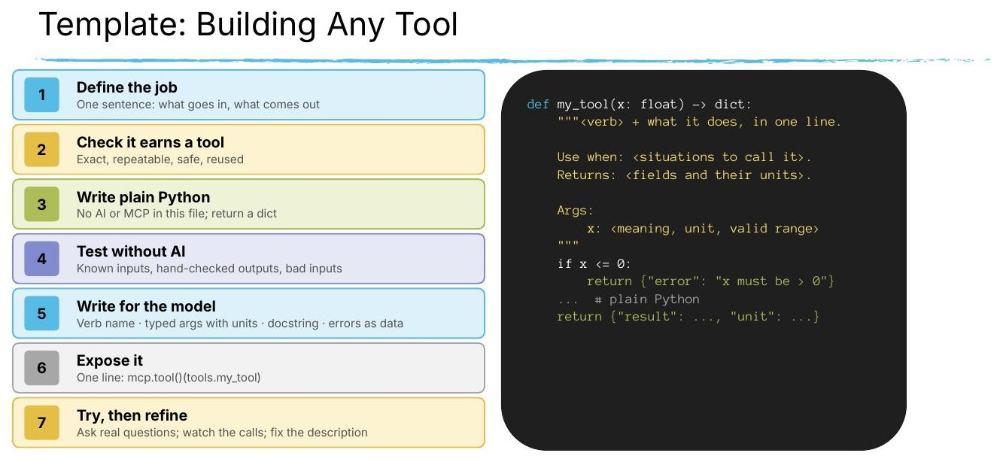
</p>

> Template for building any tool: (1) define the job in one sentence (what goes in, what comes out); (2) check that it earns a tool (exact, repeatable, safe, reused); (3) write plain Python with no AI or MCP, returning a dict; (4) test without AI using known inputs, hand checked outputs, and bad inputs; (5) write for the model (verb name, typed arguments with units, docstring, errors as data); (6) expose it in one line with `mcp.tool()(tools.my_tool)`; (7) try real questions, watch the calls, and fix the description. The template docstring has a one line verb summary, a "Use when" line, a "Returns" line with fields and units, and an Args section with each argument's meaning, unit, and valid range.

## Demo 2: Voltage Divider, a Designer and a Checker

<p align="left">
  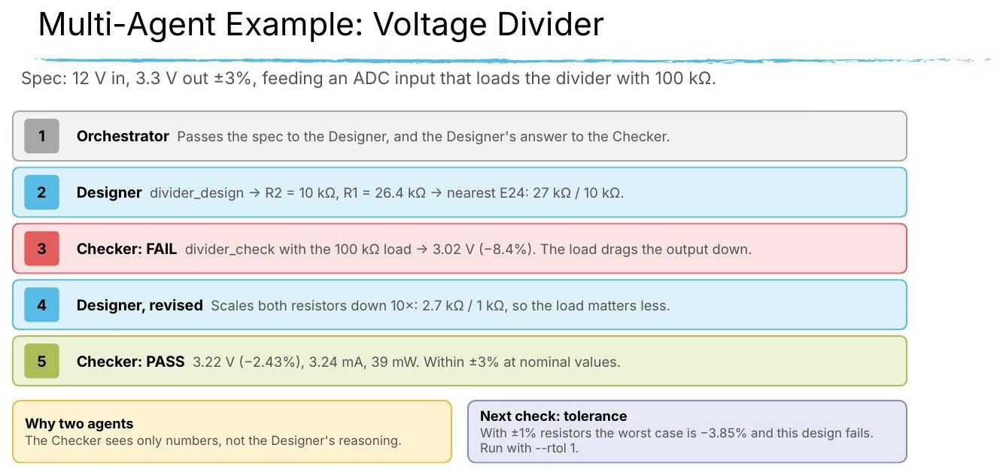
</p>

> A two agent example from `control_mcp_demo` (`divider_design`, `divider_check`, and `multi_agent.py`). The spec is 12 V in, 3.3 V out within ±3%, feeding an ADC input that loads the divider with 100 kΩ. The orchestrator passes the spec to the Designer and the Designer's answer to the Checker. (1) The Designer calls `divider_design`, picks R2 = 10 kΩ, gets R1 = 26.4 kΩ, and rounds to the E24 pair 27 kΩ / 10 kΩ. (2) The Checker calls `divider_check` with the load and gets 3.02 V (−8.4%): **FAIL**, because the load drags the output down. (3) The Designer scales both resistors down 10× to 2.7 kΩ / 1 kΩ so the load matters less. (4) The Checker gets 3.22 V (−2.43%), 3.24 mA, 39 mW: **PASS** at nominal values. Two agents help because the Checker only sees numbers, not the Designer's reasoning. The next check is tolerance: with ±1% resistors the worst case is −3.85%, so this design fails (run with `--rtol 1`).

## Demo 3: Defect Triage, One Report Three Ways

The `defect_triage_demo` project solves the same problem as a single agent, a workflow, and a multi agent system, with a Streamlit UI.

<p align="left">
  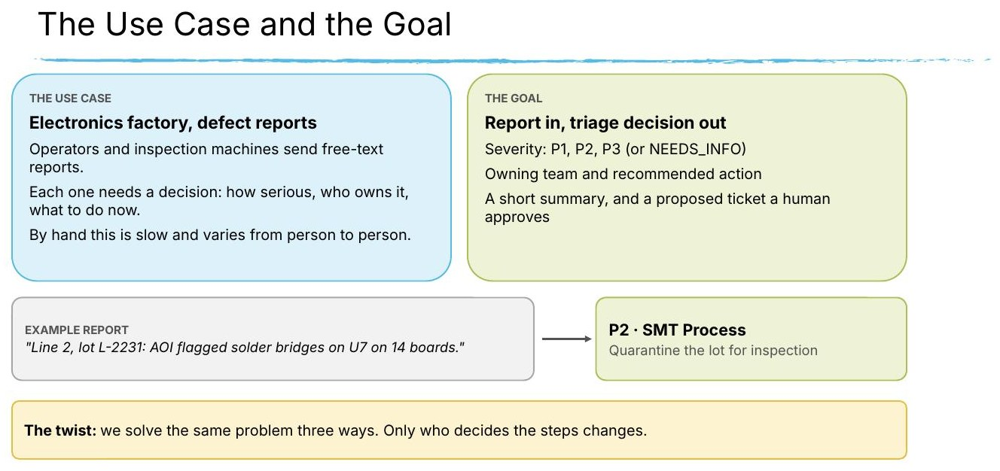
</p>

> The use case: in an electronics factory, operators and inspection machines send free text defect reports, and each one needs a decision on how serious it is, who owns it, and what to do now. By hand this is slow and varies from person to person. The goal is report in, triage decision out: a severity (P1, P2, P3, or NEEDS_INFO), the owning team and recommended action, a short summary, and a proposed ticket a human approves. For example, "Line 2, lot L-2231: AOI flagged solder bridges on U7 on 14 boards" becomes P2, SMT Process, quarantine the lot for inspection. Only who decides the steps changes between the three ways.

<br>

<p align="left">
  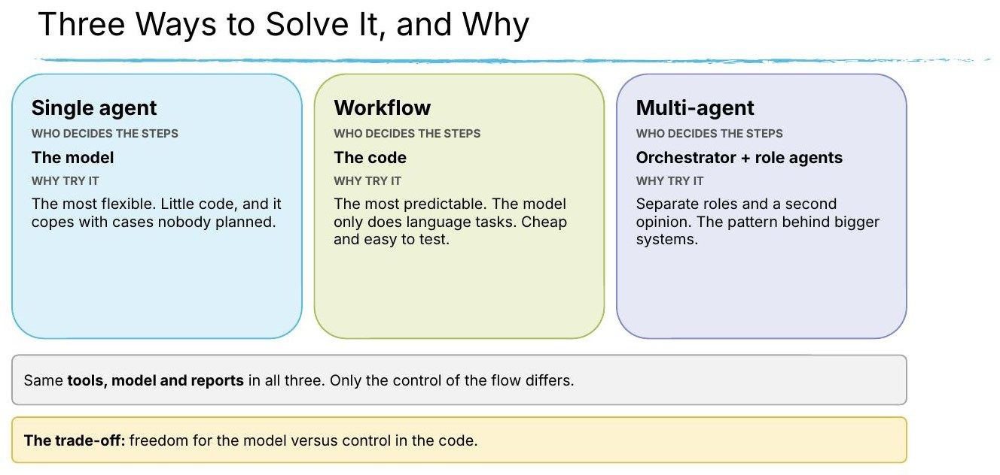
</p>

> Three ways to solve it: in a **single agent** the model decides the steps, which is the most flexible, needs little code, and copes with cases nobody planned. In a **workflow** the code decides, which is the most predictable; the model only does language tasks, so it's cheap and easy to test. In **multi agent**, an orchestrator plus role agents decide, which gives separate roles and a second opinion and is the pattern behind bigger systems. The tools, model, and reports are the same in all three; the trade off is freedom for the model versus control in the code.

<br>

<p align="left">
  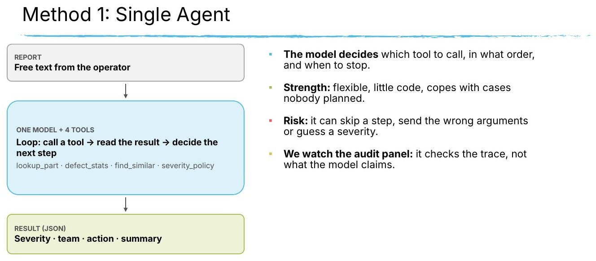
</p>

> Method 1, single agent: the free text report goes to one model with four tools (`lookup_part`, `defect_stats`, `find_similar`, `severity_policy`), which loops by calling a tool, reading the result, and deciding the next step, then returns JSON with the severity, team, action, and summary. The model decides which tool to call, in what order, and when to stop. Its strength is flexibility with little code; its risk is that it can skip a step, send the wrong arguments, or guess a severity. The audit panel checks the trace, not what the model claims.

<br>

<p align="left">
  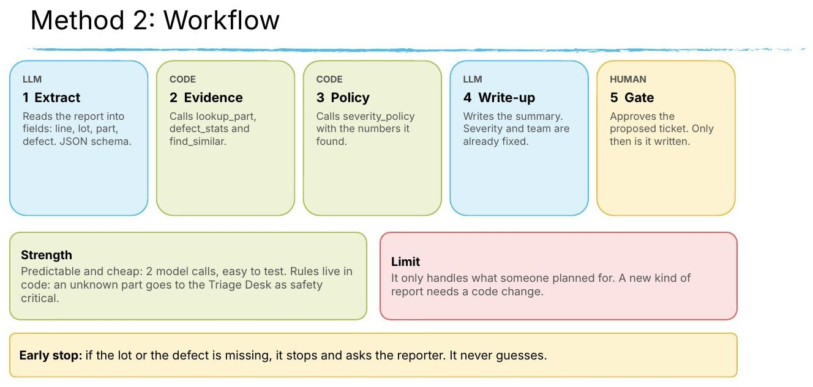
</p>

> Method 2, workflow: (1) the LLM **extracts** the report into fields (line, lot, part, defect) using a JSON schema; (2) code gathers **evidence** by calling `lookup_part`, `defect_stats`, and `find_similar`; (3) code applies the **policy** by calling `severity_policy` with the numbers it found; (4) the LLM writes the **summary**, with severity and team already fixed; (5) a **human gate** approves the proposed ticket, and only then is it written. It's predictable and cheap (2 model calls) and the rules live in code, like sending an unknown part to the Triage Desk as safety critical. If the lot or defect is missing, it stops early and asks the reporter instead of guessing. Its limit is that it only handles what someone planned for, so a new kind of report needs a code change.

<br>

<p align="left">
  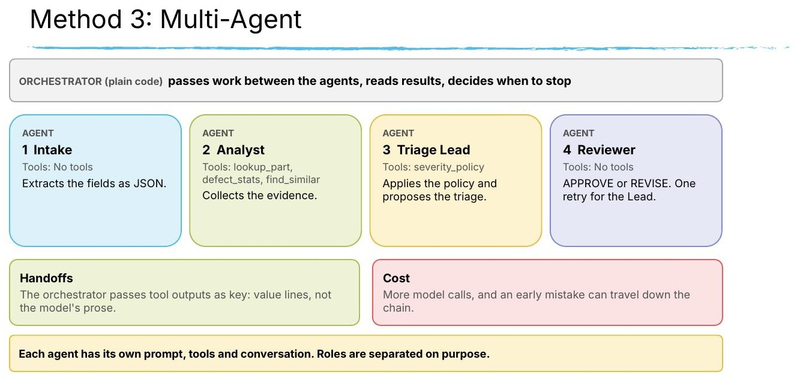
</p>

> Method 3, multi agent: a plain code orchestrator passes work between four agents, reads the results, and decides when to stop. (1) **Intake** (no tools) extracts the fields as JSON; (2) the **Analyst** (`lookup_part`, `defect_stats`, `find_similar`) collects the evidence; (3) the **Triage Lead** (`severity_policy`) applies the policy and proposes the triage; (4) the **Reviewer** (no tools) answers APPROVE or REVISE, with one retry for the Lead. Handoffs pass tool outputs as `key: value` lines, not the model's prose. Each agent has its own prompt, tools, and conversation, with roles separated on purpose. The cost is more model calls, and an early mistake can travel down the chain.

<br>

<p align="left">
  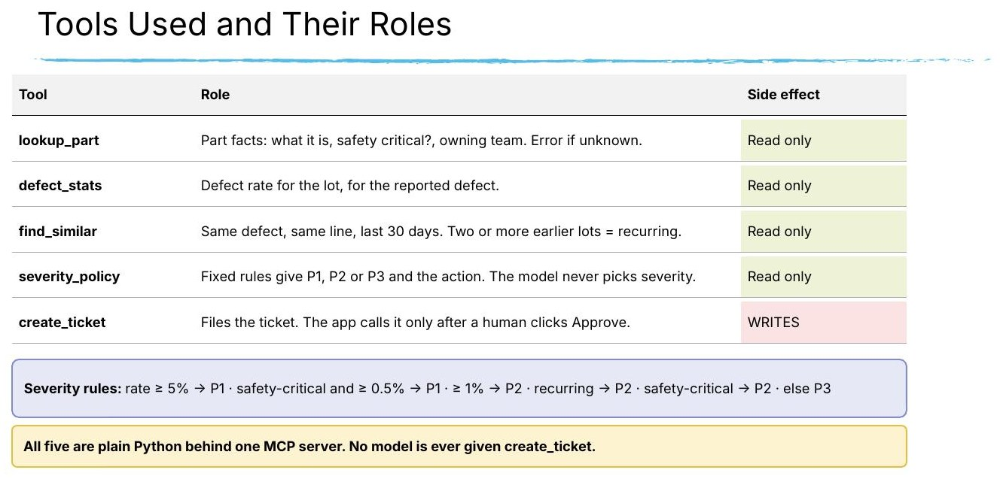
</p>

> The tools and their roles: `lookup_part` returns part facts (what it is, whether it's safety critical, the owning team, or an error if unknown); `defect_stats` returns the defect rate for the lot; `find_similar` looks for the same defect on the same line in the last 30 days, where two or more earlier lots means **recurring**; `severity_policy` applies fixed rules to give P1, P2, or P3 and the action, so the model never picks severity. These four are read only. `create_ticket` **writes**, so the app only calls it after a human clicks Approve, and no model is ever given it. Severity rules, checked in order: rate ≥ 5% → P1; safety critical and ≥ 0.5% → P1; ≥ 1% → P2; recurring → P2; safety critical → P2; otherwise P3.

<br>

<p align="left">
  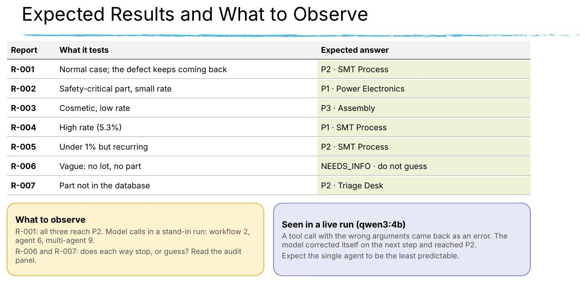
</p>

> Expected results: R-001 (normal, recurring) → P2 SMT Process; R-002 (safety critical part, small rate) → P1 Power Electronics; R-003 (cosmetic, low rate) → P3 Assembly; R-004 (high rate, 5.3%) → P1 SMT Process; R-005 (under 1% but recurring) → P2 SMT Process; R-006 (vague, no lot or part) → NEEDS_INFO, don't guess; R-007 (part not in the database) → P2 Triage Desk. For R-001 all three ways reach P2, with 2 model calls for the workflow, 6 for the agent, and 9 for multi agent in a stand in run. For R-006 and R-007, watch whether each way stops or guesses. In a live run with `qwen3:4b`, a tool call with wrong arguments came back as an error and the model corrected itself on the next step. Expect the single agent to be the least predictable.

## Demo 4: Sales BI Assistant

The `ai_demos` project answers business questions with governed KPIs, a data quality gate, and a human approved report.

<p align="left">
  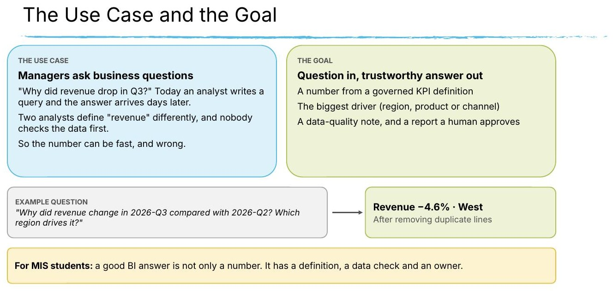
</p>

> The use case: managers ask questions like "Why did revenue drop in Q3?" Today an analyst writes a query and the answer arrives days later, two analysts define "revenue" differently, and nobody checks the data first, so the number can be fast and wrong. The goal is question in, trustworthy answer out: a number from a governed KPI definition, the biggest driver (region, product, or channel), a data quality note, and a report a human approves. For "Why did revenue change in 2026 Q3 compared with Q2? Which region drives it?" the answer is revenue −4.6%, driven by West, after removing duplicate lines. A good BI answer isn't only a number; it has a definition, a data check, and an owner.

<br>

<p align="left">
  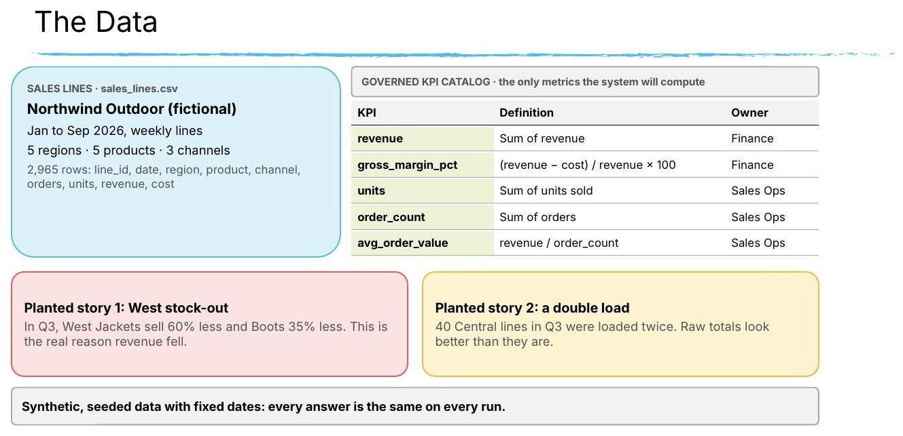
</p>

> The data: `sales_lines.csv` for Northwind Outdoor (a fictional company), weekly lines from January to September 2026 across 5 regions, 5 products, and 3 channels, 2,965 rows in total. The governed KPI catalog is the only set of metrics the system will compute: `revenue` (sum of revenue, owned by Finance), `gross_margin_pct` ((revenue − cost) / revenue × 100, Finance), `units` (sum of units sold, Sales Ops), `order_count` (sum of orders, Sales Ops), and `avg_order_value` (revenue / order_count, Sales Ops). Two stories are planted: a **West stock out**, where West Jackets sell 60% less and Boots 35% less in Q3 (the real reason revenue fell), and a **double load**, where 40 Central lines in Q3 were loaded twice so raw totals look better than they are. The data is synthetic and seeded, so every answer is the same on every run.

<br>

<p align="left">
  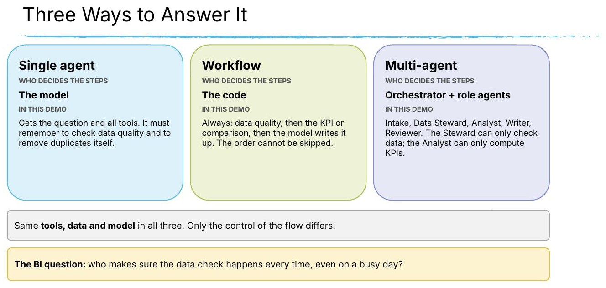
</p>

> Three ways to answer it: the **single agent** gets the question and all the tools, and must remember to check data quality and remove duplicates itself. The **workflow** always runs data quality, then the KPI or comparison, then has the model write it up, so the order can't be skipped. The **multi agent** version has Intake, Data Steward, Analyst, Writer, and Reviewer roles, where the Steward can only check data and the Analyst can only compute KPIs. The BI question is who makes sure the data check happens every time, even on a busy day.

<br>

<p align="left">
  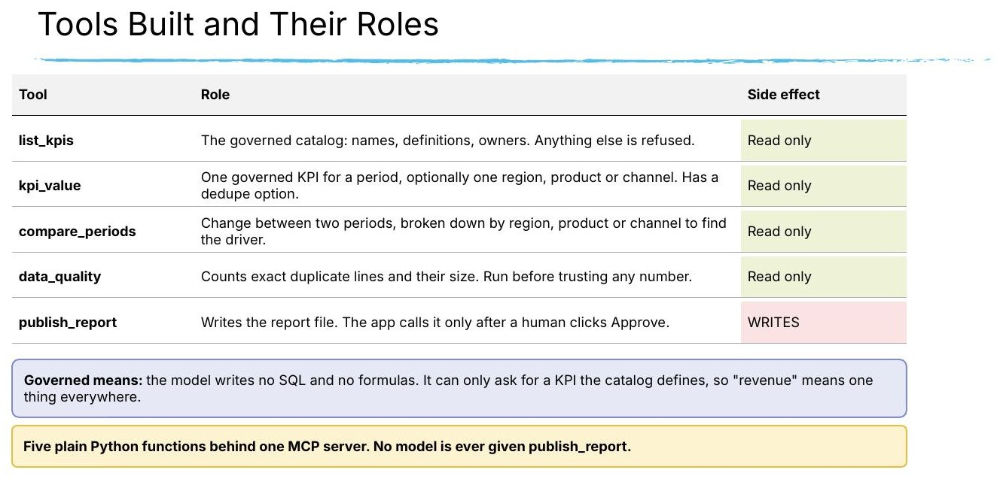
</p>

> The tools: `list_kpis` returns the governed catalog (names, definitions, owners) and anything else is refused; `kpi_value` returns one governed KPI for a period, optionally for one region, product, or channel, with a dedupe option; `compare_periods` returns the change between two periods broken down by region, product, or channel to find the driver; `data_quality` counts exact duplicate lines and their size, and should run before trusting any number. These four are read only. `publish_report` **writes** the report file, so the app only calls it after a human clicks Approve, and no model is given it. Governed means the model writes no SQL and no formulas, so "revenue" means one thing everywhere.

<br>

<p align="left">
  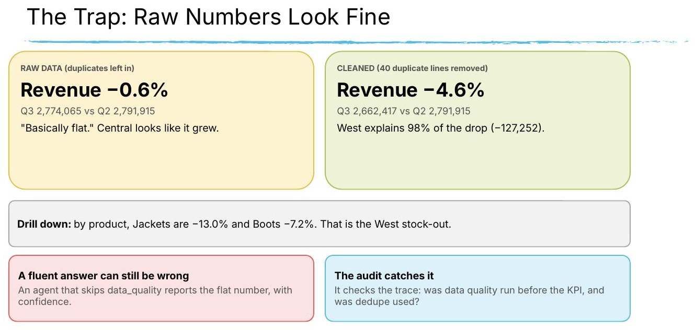
</p>

> The trap, raw numbers look fine: with duplicates left in, revenue is −0.6% (Q3 2,774,065 vs. Q2 2,791,915), which looks "basically flat," and Central looks like it grew. After removing the 40 duplicate lines, revenue is −4.6% (Q3 2,662,417), and West explains 98% of the drop (−127,252). Drilling down by product, Jackets are −13.0% and Boots −7.2%, which is the West stock out. A fluent answer can still be wrong: an agent that skips `data_quality` reports the flat number with confidence. The audit catches it by checking the trace for whether data quality ran before the KPI and whether dedupe was used.

<br>

<p align="left">
  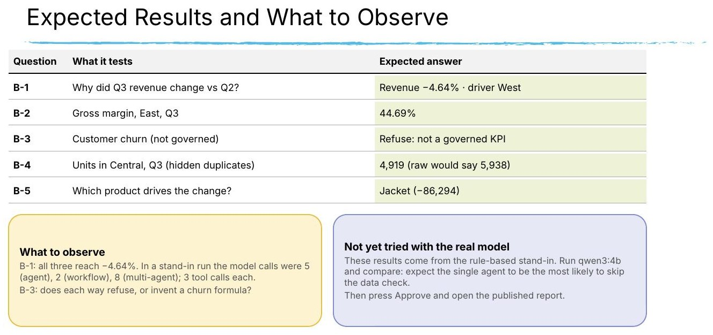
</p>

> Expected results: B-1 (why did Q3 revenue change vs. Q2?) → −4.64%, driver West; B-2 (gross margin, East, Q3) → 44.69%; B-3 (customer churn, which isn't governed) → refuse; B-4 (units in Central, Q3, with hidden duplicates) → 4,919 (raw would say 5,938); B-5 (which product drives the change?) → Jacket (−86,294). For B-1 all three ways reach −4.64%, with 5 model calls for the agent, 2 for the workflow, and 8 for multi agent, and 3 tool calls each. For B-3, watch whether each way refuses or invents a churn formula. These results come from a rule based stand in, not the real model yet; with `qwen3:4b`, expect the single agent to be the most likely to skip the data check.

## Agent Building Walkthrough: A Voltage Divider With a Load

Week 11 builds the whole stack step by step with one running example, in four files built in order (`tools.py`, `server.py`, `client.py`, `agent.py`), each working before the next starts.

### The Running Example

<p align="left">
  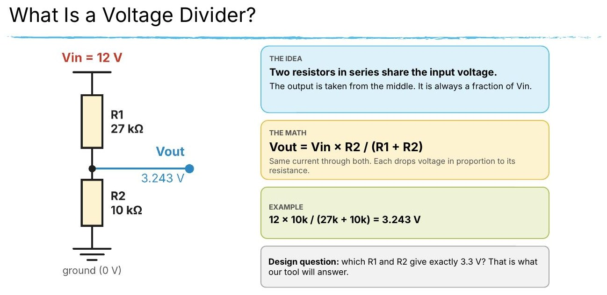
</p>

> A voltage divider is two resistors in series that share the input voltage, with the output taken from the middle, so it's always a fraction of Vin: $V_{out} = V_{in} \cdot R_2 / (R_1 + R_2)$. The same current flows through both, and each drops voltage in proportion to its resistance. For example, 12 × 10k / (27k + 10k) = 3.243 V. The design question, which R1 and R2 give exactly 3.3 V, is what the tool will answer.

<br>

<p align="left">
  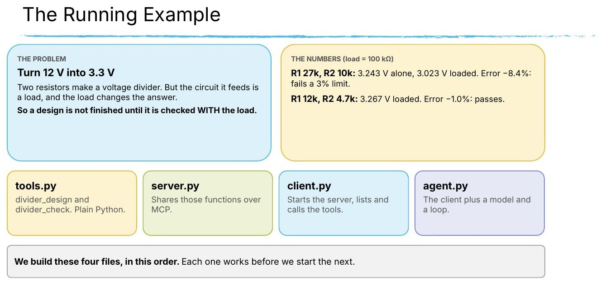
</p>

> The problem is turning 12 V into 3.3 V, but the circuit the divider feeds is a load, and the load changes the answer, so a design isn't finished until it's checked **with** the load. With a 100 kΩ load, R1 = 27k and R2 = 10k give 3.243 V alone but 3.023 V loaded, an error of −8.4% that fails a 3% limit, while R1 = 12k and R2 = 4.7k give 3.267 V loaded, an error of −1.0% that passes. The four files: `tools.py` (`divider_design` and `divider_check` in plain Python), `server.py` (shares them over MCP), `client.py` (starts the server, lists and calls the tools), and `agent.py` (the client plus a model and a loop).

### Step 0: Setup

<p align="left">
  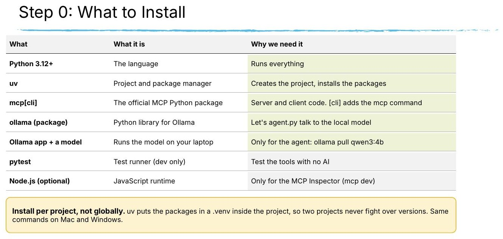
</p>

> What to install: Python 3.12+; uv (creates the project and installs packages); `mcp[cli]` (the official MCP package, where `[cli]` adds the `mcp` command); the `ollama` Python package (lets `agent.py` talk to the local model); the Ollama app plus a model (only for the agent, `ollama pull qwen3:4b`); pytest (dev only, to test the tools with no AI); and optionally Node.js (only for the MCP Inspector). Install per project, not globally: uv puts the packages in a `.venv` inside the project so two projects never fight over versions, with the same commands on Mac and Windows.

<br>

<p align="left">
  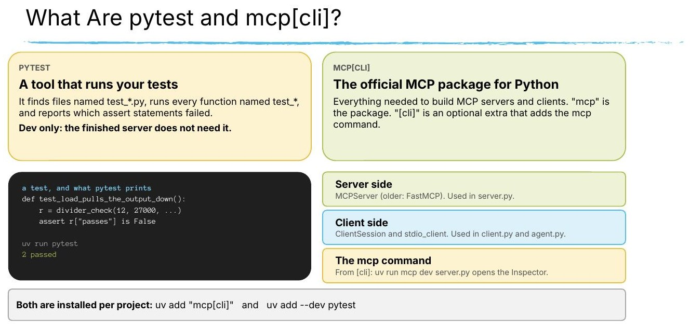
</p>

> **pytest** finds files named `test_*.py`, runs every function named `test_*`, and reports which `assert` statements failed; it's dev only, so the finished server doesn't need it. **mcp[cli]** has everything for building MCP servers and clients: the server side (`MCPServer`, or `FastMCP` in older versions) used in `server.py`, the client side (`ClientSession` and `stdio_client`) used in `client.py` and `agent.py`, and the `mcp` command from `[cli]`, where `uv run mcp dev server.py` opens the Inspector. Install them with `uv add "mcp[cli]"` and `uv add --dev pytest`.

<br>

<p align="left">
  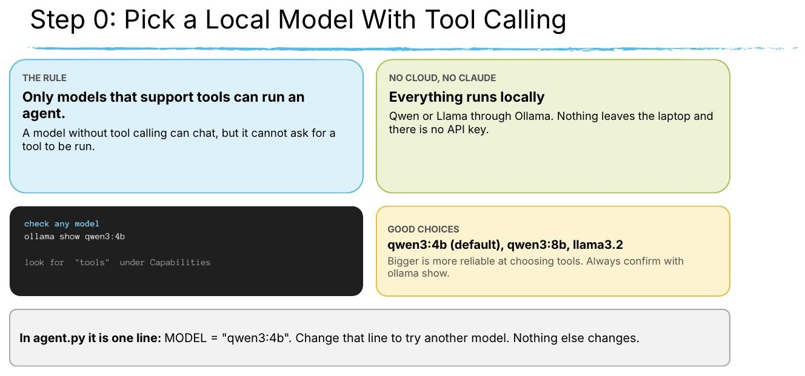
</p>

> Pick a local model with tool calling: only models that support tools can run an agent, since a model without tool calling can chat but can't ask for a tool to be run. Everything runs locally (Qwen or Llama through Ollama), so nothing leaves the laptop and there's no API key. Check any model with `ollama show qwen3:4b` and look for "tools" under Capabilities. Good choices are `qwen3:4b` (the default), `qwen3:8b`, and `llama3.2`, where bigger is more reliable at choosing tools. In `agent.py` it's one line, `MODEL = "qwen3:4b"`, so trying another model changes nothing else.

<br>

<p align="left">
  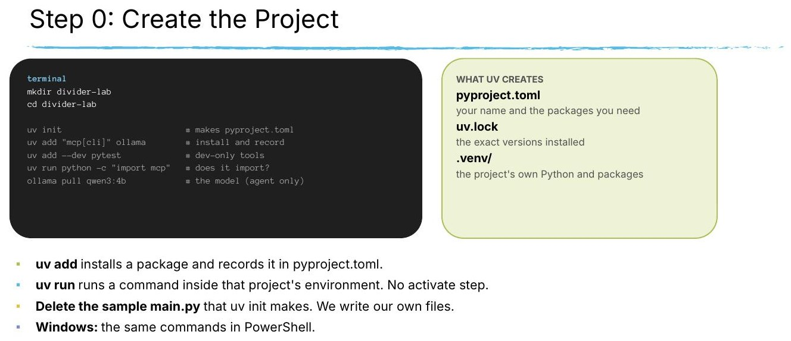
</p>

> Creating the project: `mkdir divider-lab`, `cd divider-lab`, `uv init` (makes `pyproject.toml`), `uv add "mcp[cli]" ollama` (installs and records the packages), `uv add --dev pytest`, `uv run python -c "import mcp"` (checks the import), and `ollama pull qwen3:4b`. uv creates `pyproject.toml` (your name and the packages you need), `uv.lock` (the exact versions installed), and `.venv/` (the project's own Python and packages). `uv add` installs and records a package, and `uv run` runs a command inside the project's environment with no activate step. Delete the sample `main.py` that `uv init` makes.

### The Tool

<p align="left">
  
</p>

> Tool step 1, start with the math, a plain calculation and nothing else. A load in parallel with R2 gives $R_{2,eff} = R_2 R_L / (R_2 + R_L)$, the divider formula becomes $V_{out} = V_{in} \cdot R_{2,eff} / (R_1 + R_{2,eff})$, and the error against the target is in percent. Checking by hand with 12 V, R1 = 27k, R2 = 10k, and a 100k load: R2eff = 9.09k, so Vout = 12 × 9.09 / 36.09 = 3.023 V, compared to 3.243 V without the load. That gap is the lesson.

<br>

<p align="left">
  
</p>

> Tool step 2, the signature is the schema: type hints and defaults become the argument schema the server sends. Argument names become schema names, `float` becomes JSON type `"number"`, an argument with no default is required, a default makes it optional, and `float | None` means "a number, or leave it out" (`anyOf` number or null, default null). Here `vin`, `r1_ohms`, `r2_ohms`, and `target_vout` are required, while `load_ohms` and `tolerance_pct` (default 3.0) are optional. No hints means no schema, so always write the type hints.

<br>

<p align="left">
  
</p>

> Tool step 3, the docstring is the description: the whole docstring, including Args, is sent as the tool description the model reads to choose the tool. The first sentence says what it does and when to use it ("Check a voltage divider WITH its load connected... Use it to verify a design"), and the Args section gives units and limits for every argument (like "vin: input voltage in volts (> 0)"), since the model can't guess them. A vague docstring means wrong tool calls.

<br>

<p align="left">
  
</p>

> Tool step 4, guard inputs and return data: validate first and return `{"error": "vin, r1, r2 and target_vout must be > 0"}` instead of crashing, so bad input gives an error the model can read. Return numbers and booleans, not sentences: `vout_v`, `error_pct`, and `passes`. A `passes` flag of True or False lets code decide with no text parsing, and rounding makes the model quote clean numbers.

<br>

<p align="left">
  
</p>

> Tool step 5, test it with no AI, before MCP or a model is anywhere near it. `test_load_pulls_the_output_down` checks that 27k/10k with a 100k load gives `vout_v == 3.023` and `passes is False`, using the hand calculation 10k ∥ 100k = 9.09k first. `test_smaller_resistors_survive_the_load` checks that 12k/4.7k passes. `uv run pytest` prints "2 passed." A failing test here is cheap, while the same bug inside an agent is hard to find, so only move on to the server once it passes.

<br>

<p align="left">
  
</p>

> MCP ready, what changes? `tools.py` doesn't change at all: no decorator, no MCP import, no new code, so the same function still works in a test, a notebook, or a script. `server.py` is new, about 15 lines that import the functions, register them, and run, holding all the MCP knowledge. MCP ready means "described well" (type hints and a docstring), not "decorated." Rule: if a function can't be tested without MCP, it isn't a good tool yet.

### The Server

<p align="left">
  
</p>

> Server vs. client: the **MCP server** owns the tools. It describes each tool (name, purpose, arguments), runs a tool when asked and returns the result, and knows nothing about the model (`server.py`). The **MCP client** uses the tools. It starts or connects to the server, asks what tools exist and asks for one to be run, and gives the tools and results to the model (`client.py` and `agent.py`). The client sends "list tools" and gets back names and schemas, then sends "call divider_check" and gets back 3.023 V. Two roles mean you write the server once and your own client, LM Studio, or any other MCP app can use it without changing `tools.py`.

<br>

<p align="left">
  
</p>

> The whole `server.py`: (1) import the tested functions from `tools`, then create the server with `mcp = Server("divider-lab")`, where a try/except imports `MCPServer` (mcp 2.x) or falls back to `FastMCP` (mcp 1.x) so it runs on both, and the name is what clients display; (2) register each tool in one line with `mcp.tool()(divider_design)` and `mcp.tool()(divider_check)`, which reads the signature and docstring, builds the schema, and remembers the function; (3) run with `mcp.run()`, which waits for requests over stdio. Never `print()` in a server, since output on stdout breaks the protocol, so use stderr or logging. You rarely run it by hand, since the client starts it as a subprocess. The call form is used instead of the `@mcp.tool()` decorator so `tools.py` stays free of MCP, and a tool that writes or deletes isn't registered unless a person approves its use.

<br>

<p align="left">
  
</p>

> What the server does at runtime: (1) the client starts `server.py` as a subprocess and connects to its stdin and stdout; (2) **initialize**, the handshake on protocol version and what each side supports; (3) **tools/list**, the server sends every tool's name, description, and schema; (4) **tools/call**, the client sends a name and arguments and the server runs your function; (5) the result goes back as text content for the model to read. In a simplified `tools/call`, the client sends `name: divider_check` with arguments like `{"vin": 12, "r1_ohms": 27000, ...}` and gets back `content: [{"type": "text", "text": "{\"vout_v\": 3.023, ...}"}]`. This is the same on every MCP server; only the tools differ, which is why any MCP app can use any MCP server.

<br>

<p align="left">
  
</p>

> Checking the server with no client: `uv run mcp dev server.py` opens the **MCP Inspector** in your browser. (1) Connect, and the Inspector starts your server for you; (2) go to Tools → List Tools to see both tools and their schemas; (3) pick `divider_check` and fill in the arguments in a form generated from the schema; (4) click Run Tool and the result comes back with no model involved. It needs Node.js, since the Inspector is a JavaScript tool, so without Node skip it and use `client.py`. If the tools look right here (names, descriptions, argument types), any client will see the same thing, and if they look wrong, fix the tool, not the model.

### The Client

<p align="left">
  
</p>

> Do you need a client? If you use an existing app like LM Studio or Claude Desktop, the app **is** the client, so you only add your server to its configuration and write no client code. If you're building your own agent or app, you write the client (about 30 lines), which does four things: **connect** (launch or reach the server), **list** (ask what tools exist), **call** (run a tool with arguments), and **relay** (pass tool schemas and results to the model). The model never talks to MCP; the client does, on its behalf.

<br>

<p align="left">
  
</p>

> Why asyncio? Most of the time the program is waiting, for the server to start, a tool to answer, or the model to reply, and the computer is idle. Normal code does one wait at a time, while async lets the waits overlap, so three waits finish after one. The honest part: the demos do things in order, so async doesn't make them faster; they use it because the MCP and Ollama libraries are built on it. It pays off with independent waits, like two agents calling a model at once or ten tool calls that don't depend on each other.

<br>

<p align="left">
  
</p>

> The four asyncio pieces, all used in `client.py`: `async def` makes a **coroutine**, a function that may pause, and calling it doesn't run it yet; `await` runs it and pauses there until the answer is ready, while other work can run; `async with` is a with block whose setup and cleanup may wait, like starting and stopping the server; and `asyncio.run(main())` starts the event loop and runs main, once, at the bottom. Rule: `await` only works inside an `async def`.

<br>

<p align="left">
  
</p>

> Seeing the overlap with `async_demo.py` (no MCP, no model), where `asyncio.sleep` stands in for a slow model call: `one_by_one` awaits three 1 second fetches in a row, so each finishes before the next starts and it takes 3.0 s, while `together` uses `asyncio.gather` to start all three and then wait for all of them, taking 1.0 s. Common mistakes: forgetting `await` gives a "never awaited" warning, and `time.sleep` inside async code freezes everything, so use `await asyncio.sleep` instead.

<br>

<p align="left">
  
</p>

> Client step 1, start the server and open a session: `StdioServerParameters` describes how to launch the server as a command and its arguments, using `sys.executable` so the server runs on the same Python and packages, with the full path to `server.py`. `stdio_client` starts the subprocess, `ClientSession` speaks the protocol, and `initialize()` is the handshake, and is first.

<br>

<p align="left">
  
</p>

> Client step 2, list the tools and call one, still with no model: `list_tools()` returns what the server sent at tools/list, `call_tool(name, arguments)` returns content items, and `result.content[0].text` is the tool's answer as text. Running `uv run python client.py` prints each tool with the first line of its description ("divider_design - Pick R1 for a resistive voltage divider..." and "divider_check - Check a voltage divider WITH its load...") and then the result `{"vout_v": 3.023, "error_pct": -8.4, "passes": false}`.

### The Agent

<p align="left">
  
</p>

> Agent step 1, show the tools to the model: `to_ollama` translates each MCP tool into the format Ollama expects (`{"type": "function", "function": {name, description, parameters}}`). It's the same three things, name, description, and parameter schema, with the fields just renamed. `getattr(tool, "input_schema", None) or tool.inputSchema` covers both SDK versions, since mcp 1.x calls it `inputSchema` and 2.x calls it `input_schema`.

<br>

<p align="left">
  
</p>

> Agent step 2, the loop: messages start with the user's question, and up to 8 times the agent calls `ollama.AsyncClient().chat(model=MODEL, messages=messages, tools=tools)` and appends the reply. If the reply has no tool calls, the model is done, so print the answer. Otherwise run each call through the MCP session with `session.call_tool(name, args)` and append the result as a `"tool"` message with the tool's name. `range(8)` is the guardrail so it can't loop forever. Speed tip: Qwen3 thinks by default, so add `think=False` to `chat()` for faster answers.

### Going Multi-Agent

<p align="left">
  
</p>

> What if it were multi agent? With **one agent and two tools** (`agent.py`), one model sees both `divider_design` and `divider_check` and decides the order. With **two agents and one tool each** (`multi_agent.py`), a Designer proposes R1 and R2 with `divider_design` and a Checker tests with the load using `divider_check`. The tools are the same; what changes is who sees which tool and who decides what happens next. It's not a new tool or server, since the MCP server is unchanged; multi agent is just a different way of using the same client.

<br>

<p align="left">
  
</p>

> Multi agent step 1, a reusable `run_agent(session, role, task, known)`: it's the same loop as `agent.py` (ask, run the tools, repeat), with two new inputs, a system prompt for the role and a list of tool names the agent may use, so it filters the tool list to `role["tools"]`. It allows up to 6 steps per agent and returns text instead of printing, so the next agent can use it, or `"no answer"` if it runs out of steps.

<br>

<p align="left">
  
</p>

> Multi agent step 2, a role is a prompt and tools, so each agent is just data. The spec is "12 V in, 3.3 V out, 100 kOhm load, within 3 percent." The **DESIGNER** may only use `divider_design`, and its system prompt says to get R1 for a chosen R2, that a load pulls the output down so it should try a smaller R2 after a failed check, and to reply with one line, `R1 = <ohms>, R2 = <ohms>`. The **CHECKER** may only use `divider_check`, and its prompt says to include the load and reply PASS or FAIL with the output voltage and error percent. `"tools"` is the only thing each can call, and `"system"` sets its job and answer format.

<br>

<p align="left">
  
</p>

> Multi agent step 3, the orchestrator, plain Python that runs the agents in order and decides when to stop. For up to 3 rounds (`range(1, 4)`), it runs the Designer, then passes the spec and the design to the Checker as text. If the verdict starts with PASS, it stops; otherwise it sends the verdict back to the Designer with "Your last try failed." If nothing passes it prints "No passing design after 3 rounds." No model decides the order, which is why it's predictable and easy to test, and capping the rounds means agents never talk forever.

<br>

<p align="left">
  
</p>

> A run, round by round, with `uv run python multi_agent.py`: in round 1 the Designer calls `divider_design` with R2 = 10k and gets R1 = 26.4k, and the Checker calls `divider_check` with the 100 kΩ load and gets 3.077 V, off by 6.76%: FAIL. Code adds "your last try failed" and asks the Designer again. In round 2, R2 = 1k and R1 = 2.64k give 3.276 V (−0.72%): PASS, so it stops. The first design failed because the textbook R1 assumes no load, but the load shares R2 and pulls the output down, and a smaller R2 makes the load matter less. The trade off is that smaller resistors draw more current from the 12 V supply (about 3.3 mA here). The numbers are real, but the model is scripted, so a real Qwen or Llama may take other steps.

> [!NOTE]
> These numbers differ from the Week 10 version of the demo (3.02 V, −8.4%) because Week 10 rounded R1 to the E24 value 27 kΩ, while this run uses the exact 26.4 kΩ.

<br>

<p align="left">
  
</p>

> Who decides the steps? What was built here is **code decides**: the orchestrator has a fixed order and a fixed stop rule, so it's predictable, easy to test and cap, and the best default. The next step up is **a supervisor agent decides**, where a third model reads the results and picks the next agent, which is flexible but harder to predict and needs a stronger model. Use with care: **agents decide among themselves**, where peers call each other as tools or pass messages, which is the most flexible and the hardest to control, so cap everything. The more the model decides, the more guardrails you need (step caps, round caps, and checks done in code).

<br>

<p align="left">
  
</p>

> Is it worth it? Use more than one agent when there are many tools and one small model picks the wrong one, when you want an independent check on an answer, or when roles need different prompts or even different models. Otherwise start with one agent: for this divider, one agent with two tools already works, so split only when one agent fails and you know why, since every extra agent costs more model calls and more waiting. Pitfalls: handoffs are plain text (the Checker had to read R1 and R2 out of a sentence); text verdicts are fragile (`startswith("PASS")` breaks if the model words it differently, so prefer reading the tool's `passes` flag in code); and two agents on the same model share the same blind spots, so tools should give the real check. Always cap steps and rounds.

### Packaging and Wrapping Up

<p align="left">
  
</p>

> Putting it together: the **model** (`qwen3:4b` in Ollama) chooses which tool to call; `agent.py` is the MCP client plus the loop, carrying requests and results; `server.py` is the MCP server that lists and runs the tools; and `tools.py` holds plain functions, the only place with engineering logic. The `divider-lab/` folder holds `tools.py`, `server.py`, `client.py` (no model), `agent.py` (with a model), `multi_agent.py` (two agents), `pyproject.toml`, `tests/`, and `README.md`. Each layer works alone: tools run without MCP and the server runs without a model, so swapping the model changes nothing below it, and adding a tool only changes `tools.py` and one line of `server.py`.

<br>

<p align="left">
  
</p>

> Package it so others can run it: `pyproject.toml` lists the project (name `divider-lab`, version, description, `requires-python = ">=3.12"`) and its dependencies (`mcp[cli]>=1.2` and `ollama>=0.5.1`), so one file replaces "install this, then that." A classmate runs `uv sync` (which builds the same `.venv`, with `uv.lock` pinning the versions), then `uv run python client.py` and `uv run python agent.py`. Zip the folder without `.venv`, include a README with the three commands, and ship the tests so `uv run pytest` shows it works before they try the model.

<br>

<p align="left">
  
</p>

> Connecting it to other MCP apps: an `mcp.json` file with an `mcpServers` entry for `divider-lab` gives the command (`uv`) and args (`run --directory /FULL/PATH/TO/mcp_walkthrough python server.py`), so the app starts your server for you and acts as the client. Use the full path to the folder, check each app's own documentation since the file name, location, and format differ, and restart the app after editing the config. The `mcpServers` form is common but not universal, so if it fails, test with `client.py` first to be sure the server itself works.

<br>

<p align="left">
  
</p>

> Build order and common mistakes. The order is: (1) write the tool, (2) test it with no AI, (3) wrap it in a server, (4) inspect it, (5) write a client, (6) add the model to make the agent, (7) package it. Common mistakes: `print()` in `server.py` breaks the stdio protocol; no type hints or a vague docstring means the model calls the tool wrongly or not at all; a relative path to `server.py` fails when you run from another folder; editing a tool without restarting means the client still has the old server; and returning prose instead of numbers and booleans. Every step works before the next one starts, and that's the whole method.

## Worked Examples

### Classifying AI Use Cases

Using the types of AI table and the five questions, here's how some example use cases would be classified:

| Use case | Type | Why |
|---|---|---|
| "Draft a reply to this customer email" | Assistant | A single request with a single response |
| Every Monday, summarize the weekly sales report using the same saved prompt | Skill | Repeats a saved instruction pattern |
| Convert sensor readings from °F to °C | Tool | One defined, predictable function, best done by code |
| Each week, pull transformer data, find anomalies, and draft a maintenance report for review | Agent | Works toward a goal across multiple steps on its own |
| Collect alarms → rank them (code) → explain causes (AI) → draft summary (AI) → engineer decides | Workflow | Orchestrates several steps, mixing code, AI, and people |

**Applying the five questions to the transformer monitoring agent:**

| Question | Answer |
|---|---|
| Task | Find developing problems in transformers each week |
| Data | SCADA readings and sensor logs (read only) |
| Output | A structured report of anomalies, ranked by risk |
| Review | A senior engineer checks the findings before maintenance is scheduled |
| Limits | No writing to PLCs or changing setpoints, and no scheduling work without approval |

### Counting Integrations With and Without MCP

Without MCP, every app needs its own glue code for every tool. With MCP, each app and each tool only needs to speak the protocol once:

$$\text{Without MCP} = N_{apps} \times N_{tools} \qquad \text{With MCP} = N_{apps} + N_{tools}$$

The slide's case is 3 apps and 3 tools: $3 \times 3 = 9$ vs. $3 + 3 = 6$. The gap grows fast. Suppose a plant has 4 AI apps (an operator assistant, an engineering workstation, a reporting bot, and a maintenance planner) and 6 systems (OPC UA, Modbus, MQTT, a historian, a CMMS, and a time series database):

$$4 \times 6 = 24 \text{ integrations} \qquad 4 + 6 = 10 \text{ connections}$$

Adding a 7th system costs 4 new integrations without MCP (one per app) but only 1 new MCP server with it.

### Designing an RC Low Pass Filter by Hand

This is what `design_rc_lowpass` does for `cutoff_hz = 1000` and `capacitance_nf = 10`.

**Step 1, the ideal resistor:**

$$R = \frac{1}{2\pi f C} = \frac{1}{2\pi (1000)(10 \times 10^{-9})} = \frac{1}{6.283 \times 10^{-5}} \approx 15{,}915 \ \Omega$$

**Step 2, snap to the nearest E24 part.** The E24 values near this are 15 kΩ and 16 kΩ. "Nearest on a log scale" compares ratios, not differences:

$$\frac{15{,}915}{15{,}000} = 1.061 \qquad \frac{16{,}000}{15{,}915} = 1.005$$

16 kΩ is closer, so the tool picks it.

**Step 3, check the damage:**

$$f = \frac{1}{2\pi (16{,}000)(10 \times 10^{-9})} \approx 994.7 \text{ Hz} \qquad \text{error} = \frac{994.7 - 1000}{1000} \times 100 = -0.53\%$$

**The 500 Hz case.** The ideal resistor doubles to 31,831 Ω. Its E24 neighbors are 30 kΩ and 33 kΩ, with ratios $31{,}831/30{,}000 = 1.061$ and $33{,}000/31{,}831 = 1.037$, so 33 kΩ wins:

$$f = \frac{1}{2\pi (33{,}000)(10 \times 10^{-9})} \approx 482.3 \text{ Hz} \qquad \text{error} = -3.54\%$$

That's the trade off the tool reports. A 31.6 kΩ E96 part would give about 503.6 Hz (+0.7%), and the engineer decides which is acceptable.

### From Signature to Schema

The type hints and defaults of a tool become its JSON schema. Take this made up tool:

```python
def rc_settle_time(r_ohms: float, c_uf: float, settle_pct: float = 1.0, label: str | None = None) -> dict:
    """Compute how long an RC circuit takes to settle within settle_pct of its final value."""
```

| Argument | Type hint | Default | JSON type | Required? |
|---|---|---|---|---|
| `r_ohms` | `float` | none | `"number"` | Yes |
| `c_uf` | `float` | none | `"number"` | Yes |
| `settle_pct` | `float` | `1.0` | `"number"`, default 1.0 | No |
| `label` | `str \| None` | `None` | `anyOf` string or null, default null | No |

So the schema's `"required"` list is `["r_ohms", "c_uf"]`. The units live in the argument names (`_ohms`, `_uf`, `_pct`), because the model only sees the names, types, and docstring.

As a check on what the tool would return: an RC circuit settles within $p\%$ after $t = \tau \ln(100/p)$, where $\tau = RC$. With 10 kΩ, 100 µF, and 1%:

$$\tau = (10{,}000)(100 \times 10^{-6}) = 1 \text{ s} \qquad t = 1 \cdot \ln(100) \approx 4.6 \text{ s}$$

### Why simulate_pid Overshoots 32%

The `simulate_pid` example uses a PI controller $C(s) = K_p + K_i/s$ on a first order plant $G(s) = 1/(\tau s + 1)$ with $K_p = 2$, $K_i = 8$, and $\tau = 2$. The closed loop transfer function is:

$$T(s) = \frac{C(s)G(s)}{1 + C(s)G(s)} = \frac{K_p s + K_i}{\tau s^2 + (1 + K_p)s + K_i} = \frac{2s + 8}{2s^2 + 3s + 8}$$

Dividing by 2 gives $s^2 + 1.5s + 4$, so matching it to $s^2 + 2\zeta\omega_n s + \omega_n^2$:

$$\omega_n = \sqrt{4} = 2 \text{ rad/s} \qquad \zeta = \frac{1.5}{2 \cdot 2} = 0.375$$

A damping ratio well under 1 means an underdamped, oscillating response. The textbook overshoot for a pure second order system is:

$$M_p = e^{-\pi\zeta/\sqrt{1-\zeta^2}} = e^{-\pi(0.375)/0.927} \approx 0.28 = 28\%$$

The tool reports 32.37%, which is higher because the PI controller adds a zero (the $2s$ term in the numerator), and a zero speeds up the rise and adds extra overshoot. The simple formula can't account for that, which is exactly why this is a simulation tool and not something the model can do in its head.

The tuned gains from the docstring slide, $K_p = 4$ and $K_i = 1.3$, give $T(s) = (4s + 1.3)/(2s^2 + 5s + 1.3)$. Simulating it confirms 0% overshoot and about 5.7 s to settle within 2%, while the satisficing answer, $K_p = 0.5$ and $K_i = 0.1$, also has no overshoot but takes about 48 s.

### Checking a Voltage Divider With a Load

**Unloaded divider**, 12 V with R1 = 27 kΩ and R2 = 10 kΩ:

$$V_{out} = 12 \cdot \frac{10}{27 + 10} = 3.243 \text{ V}$$

**Loaded divider.** The 100 kΩ load sits in parallel with R2:

$$R_{2,eff} = \frac{R_2 R_L}{R_2 + R_L} = \frac{(10)(100)}{10 + 100} = 9.091 \text{ k}\Omega$$

$$V_{out} = 12 \cdot \frac{9.091}{27 + 9.091} = 3.023 \text{ V} \qquad \text{error} = \frac{3.023 - 3.3}{3.3} \times 100 = -8.4\% \rightarrow \text{FAIL (limit } \pm 3\%)$$

**Smaller resistors**, R1 = 12 kΩ and R2 = 4.7 kΩ:

$$R_{2,eff} = \frac{(4.7)(100)}{104.7} = 4.489 \text{ k}\Omega \qquad V_{out} = 12 \cdot \frac{4.489}{12 + 4.489} = 3.267 \text{ V} \qquad \text{error} = -1.0\% \rightarrow \text{PASS}$$

The load barely affects the second design, because 100 kΩ is about 21 times R2 instead of 10 times.

### What divider_design Computes

To design without a load, solve the divider formula for R1 given a chosen R2:

$$V_{out} = V_{in}\frac{R_2}{R_1 + R_2} \quad\Rightarrow\quad R_1 = R_2\left(\frac{V_{in}}{V_{out}} - 1\right)$$

With R2 = 10 kΩ: $R_1 = 10{,}000\,(12/3.3 - 1) = 10{,}000 \times 2.636 = 26{,}363.6 \ \Omega$, matching round 1 of the multi agent run. Here's how both rounds play out with the 100 kΩ load:

| Round | R1 | R2 | R2eff | Vout | Error | Verdict |
|---|---|---|---|---|---|---|
| 1 | 26,363.6 Ω | 10,000 Ω | 9,090.9 Ω | 3.077 V | −6.76% | FAIL |
| 2 | 2,636.4 Ω | 1,000 Ω | 990.1 Ω | 3.276 V | −0.72% | PASS |

For round 2, the cost is current drawn from the supply:

$$I = \frac{V_{in}}{R_1 + R_{2,eff}} = \frac{12}{2{,}636.4 + 990.1} = 3.31 \text{ mA} \qquad P = V_{in} I = 12 \times 3.31 \text{ mA} \approx 40 \text{ mW}$$

That's about 10 times the current of the round 1 design, the trade off the slide mentions.

### Worst Case With Resistor Tolerance

Week 10's passing design was 2.7 kΩ / 1 kΩ (E24 values), giving 3.22 V (−2.43%) at nominal values. With ±1% resistors, the output is lowest when R1 is 1% high and R2 is 1% low:

$$R_1 = 2{,}727 \ \Omega \qquad R_2 = 990 \ \Omega \qquad R_{2,eff} = \frac{(990)(100{,}000)}{100{,}990} = 980.3 \ \Omega$$

$$V_{out} = 12 \cdot \frac{980.3}{2{,}727 + 980.3} = 3.173 \text{ V} \qquad \text{error} = -3.85\% \rightarrow \text{FAIL}$$

So a design that passes on paper can still fail with real parts, which is why the Checker's next test is `--rtol 1`.

### Tracing the Agent Loop

Here's how the `messages` list grows when the single agent (both tools) is asked "Design a 12 V to 3.3 V divider for a 100 kΩ load within 3%." The steps are illustrative, since a real model may take a different path:

| Step | Model call? | What the model does | Appended to `messages` | Length |
|---|---|---|---|---|
| Start | | | the user question | 1 |
| 1 | Yes | asks for `divider_design(vin=12, target_vout=3.3, r2_ohms=10000)` | the reply, then the tool result | 3 |
| 2 | Yes | asks for `divider_check(..., load_ohms=100000)` | the reply, then the result (FAIL, −6.76%) | 5 |
| 3 | Yes | asks for `divider_design` again with `r2_ohms=1000` | the reply, then the tool result | 7 |
| 4 | Yes | asks for `divider_check` again | the reply, then the result (PASS, −0.72%) | 9 |
| 5 | Yes | no tool calls, so it answers | the final reply | 10 |

That's 5 model calls and 4 tool calls, well under the `range(8)` cap. If the model kept asking for tools past 8 model calls, the loop would end with no answer instead of running forever. The whole list is the agent's memory, and it's also the trace you read to debug.

### Applying the Severity Policy

The rules are checked in order, and the first one that matches wins:

| Order | Rule | Severity |
|---|---|---|
| 1 | defect rate ≥ 5% | P1 |
| 2 | safety critical and rate ≥ 0.5% | P1 |
| 3 | rate ≥ 1% | P2 |
| 4 | recurring | P2 |
| 5 | safety critical | P2 |
| 6 | anything else | P3 |

The defect rate is defective units over inspected units. For the slide's example report, 14 boards with solder bridges, suppose the lot had 400 boards (a made up lot size):

$$\text{rate} = \frac{14}{400} \times 100 = 3.5\%$$

Rules 1 and 2 don't match (3.5% < 5% and U7 isn't safety critical), but rule 3 does, so it's **P2**, which matches the slide's answer. More made up cases:

| Report | Rate | Safety critical? | Recurring? | First rule that matches | Severity |
|---|---|---|---|---|---|
| A | 6.0% | No | No | 1 | P1 |
| B | 0.8% | Yes | No | 2 | P1 |
| C | 0.3% | Yes | No | 5 | P2 |
| D | 0.6% | No | Yes | 4 | P2 |
| E | 0.3% | No | No | 6 | P3 |

Report B is like R-002: the rate is small, but a safety critical part at 0.5% or more jumps straight to P1. Because these are fixed rules in `severity_policy`, the model never picks the severity.

### Why the Raw Revenue Number Lies

Percent change is $(\text{Q3} - \text{Q2}) / \text{Q2} \times 100$.

**Raw, with the duplicates:**

$$\frac{2{,}774{,}065 - 2{,}791{,}915}{2{,}791{,}915} \times 100 = \frac{-17{,}850}{2{,}791{,}915} \times 100 = -0.64\%$$

**Cleaned, after removing the 40 duplicate lines:**

$$\frac{2{,}662{,}417 - 2{,}791{,}915}{2{,}791{,}915} \times 100 = \frac{-129{,}498}{2{,}791{,}915} \times 100 = -4.64\%$$

The double load added $2{,}774{,}065 - 2{,}662{,}417 = 111{,}648$ in fake revenue, which hid most of the real drop. West's share of the real drop is:

$$\frac{127{,}252}{129{,}498} \times 100 = 98.3\%$$

The same problem shows up in B-4: Central's Q3 units are 4,919 after deduping but 5,938 raw, so $5{,}938 - 4{,}919 = 1{,}019$ units were counted twice, inflating the number by about 21%.

**Gross margin** (B-2) uses the governed formula. With made up East Q3 numbers of 500,000 in revenue and 276,550 in cost:

$$\text{gross\_margin\_pct} = \frac{500{,}000 - 276{,}550}{500{,}000} \times 100 = 44.69\%$$

### Sequential vs. Concurrent Waits

When awaits run one after another, the total time is the **sum** of the waits. With `asyncio.gather`, they overlap, so the total is roughly the **longest** single wait:

$$t_{sequential} = \sum_i t_i \qquad t_{gather} \approx \max_i t_i$$

The slide's demo is three 1 s waits: 3.0 s vs. 1.0 s. Now suppose three independent tool calls take 2 s, 1 s, and 4 s:

$$t_{sequential} = 2 + 1 + 4 = 7 \text{ s} \qquad t_{gather} \approx 4 \text{ s}$$

This only works when the calls don't depend on each other. In the divider agent, `divider_check` needs the R1 from `divider_design`, so those two have to run in order no matter what, which is why async doesn't speed up the course demos.

### Picking Workflow, Agent, or Multi-Agent

| Use case | Choice | Why |
|---|---|---|
| Every shift, export alarms, group and count them, have AI explain the top causes, and email a summary | Workflow | The steps are fixed and can be written down, so code decides and the model only writes |
| An engineer asks open questions about any loop in the plant ("why is TIC-101 oscillating?") | Single agent | The path is unknown and changes per question, so the model picks which tools to call |
| Propose a new PID tuning, have a separate checker simulate it, and only let the engineer apply it | Multi agent | It needs separate roles and an independent check, with the write left to a human |
| Convert a lot's defect count into a rate | Tool | One exact calculation, so it's just code |
| Triage defect reports that always contain line, lot, part, and defect | Workflow | Known fields and fixed rules, so it's cheaper and more predictable than an agent |
