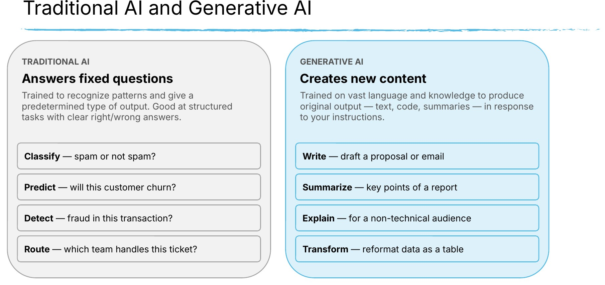
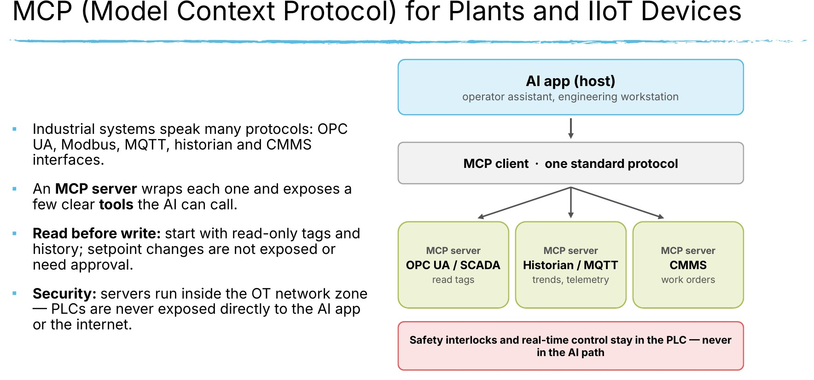
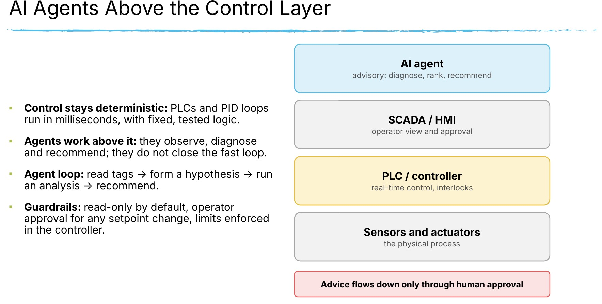

# Agentic AI & MCP

## Generative AI vs. AI Agents vs. Agentic AI

  

> Generative AI vs. AI agent vs. agentic AI: generative AI creates new content (text, images, audio, or video) and is reactive, answering a user's prompt directly, like a chatbot. An AI agent is an LLM with external tools (search, APIs, and data sources) that performs a single, specific task, like finding and summarizing today's news. Agentic AI is a system of agents that communicate and work together toward a complex goal, like turning a video into a blog post with separate transcription, title creation, and summarizing agents.

## How an AI Agent Works

  

> Inside an AI agent: (1) the LLM reasons about the prompt, (2) decides to use tools, (3) executes actions in the external environment and gets results back, and (4) updates its memory, repeating until the task is done.

 

  

> The agent loop: an agent perceives its environment, reasons about what to do, acts by using tools to carry out actions, and learns from the results, cycling until it reaches its goal.

## Traditional AI vs. Generative AI

  

> Traditional AI answers fixed questions: it's trained to recognize patterns and give a predetermined type of output, so it's good at structured tasks with clear right or wrong answers, like classifying spam, predicting customer churn, detecting fraud, or routing support tickets. Generative AI creates new content: it's trained on vast amounts of language and knowledge to produce original text, code, and summaries from your instructions, like writing a draft, summarizing a report, explaining something for a non technical audience, or reformatting data as a table.

**What an LLM can do:** think of a large language model as a co-worker who has read an enormous amount of text (books, articles, code, conversations) and learned to respond intelligently. You give it plain language instructions and it gives back useful output. It can **understand** loosely worded instructions, **summarize** long documents, **generate** drafts, emails, explanations, and code, **reason** through examples and edge cases, and **transform** content by reformatting, translating, or restructuring it.

## Types of AI

| Term | What it does | Key trait |
|---|---|---|
| Assistant | Responds to a single request | Reactive |
| Skill | Repeats a saved instruction pattern | Repeatable |
| Tool | Performs a defined function | Predictable |
| Agent | Works toward a goal autonomously | Autonomous |
| Workflow | Connects multiple AI assisted steps | Orchestrated |

**Five questions to ask about any AI use case:**

1. **Task:** what is the AI being asked to do?
2. **Data:** what information does it need to work with?
3. **Output:** what should the result look like?
4. **Review:** who checks it, and what are they looking for?
5. **Limits:** what should the AI *not* do in this scenario?

These work for a single prompt, a reusable skill, a defined tool, or a multi step agent, and the answer to question 5 is often the most important one in the room.

## MCP (Model Context Protocol)

  

> MCP for plants and IIoT devices: industrial systems speak many protocols (OPC UA, Modbus, MQTT, historian, and CMMS interfaces). An MCP server wraps each one and exposes a few clear tools the AI can call. The AI app (the host, like an operator assistant) talks to every server through one MCP client using one standard protocol. Start with read before write: read only tags and history first, with setpoint changes either not exposed or needing approval. For security, the servers run inside the OT network zone, so PLCs are never exposed directly to the AI app or the internet, and safety interlocks and real time control stay in the PLC, never in the AI path.

 

  

> MCP example, reading the plant: the same protocol sits in front of a control system and an IIoT sensor network. A process loop assistant answers "What are the PV, setpoint, and valve output on loop TIC-101, and has it oscillated this week?" through an MCP server that wraps an OPC UA client and the historian, with tools `read_tag` and `get_trend` and no `write_setpoint` tool exposed. A fleet monitoring assistant answers "Which motors on line 3 show rising vibration?" through a server that wraps the MQTT broker and time series database, with tools `list_devices`, `get_telemetry`, and `get_alerts`, using read only credentials scoped to line 3.

## AI Agents in Industrial Systems

  

> Agents above the control layer: control stays deterministic, with PLCs and PID loops running in milliseconds on fixed, tested logic. Agents work above it, observing, diagnosing, and recommending, but never closing the fast loop. The stack runs from the advisory AI agent, to SCADA/HMI (operator view and approval), to the PLC (real time control and interlocks), to the sensors and actuators of the physical process. The agent loop is read tags, form a hypothesis, run an analysis, then recommend. Guardrails keep it read only by default, require operator approval for any setpoint change, and enforce limits in the controller, so advice only flows down through human approval.

 

  

> Agent examples, tuning and maintenance: a loop tuning agent (goal: reduce oscillation in a flow loop) pulls 24 hours of PV, SP, and output trends, detects oscillation and valve saturation, fits a simple model to compute candidate PID gains, and simulates the response before proposing gains to the engineer. A predictive maintenance agent (goal: decide which pumps need inspection) pulls vibration, temperature, and current data, compares each pump to its own baseline, checks maintenance history in the CMMS, and ranks pumps by risk while drafting work orders. In both, there's a human gate: the engineer applies new gains, the planner approves work orders, and the agent never writes to the PLC.

## Workflows for Industrial Operations

  

> Splitting the work: industrial processes are repeatable, so a fixed workflow fits better than a free roaming agent. Code and PLCs handle the deterministic, real time parts (thresholds, interlocks, calculations, unit conversion, statistics, data movement). AI handles the messy parts (interpreting alarm text, summarizing history and trends, suggesting likely causes, drafting reports). People handle judgment and approval, signing off on anything that changes the process or schedules work.

 

  

> Workflow examples, alarms and telemetry: both are five stage pipelines where code collects and checks, AI explains and drafts, and a person decides. For alarm flood analysis, code collects the alarm log and ranks alarms by grouping and counting them, AI explains likely causes and drafts a shift summary, and an engineer reviews and decides on actions. For an IIoT predictive maintenance pipeline, code ingests sensor telemetry and runs a statistical anomaly check, AI summarizes the asset's history and drafts a work order, and a planner approves it.

 

  

> Classifying a use case, weekly transformer monitoring: it recurs every week on a fixed schedule, it's multi step (pull sensor data, analyze, find anomalies, draft a report), it uses data from SCADA and sensor logs to produce a structured report, and it needs human review before going to the maintenance lead. That makes it an **agent**, working toward a goal autonomously across multiple steps, with a review gate where a senior engineer approves the findings before maintenance is scheduled.

> Upcoming weeks cover building MCP servers, agents, and agentic workflows.

## Worked Examples

### Classifying AI Use Cases

Using the types of AI table and the five questions, here's how some example use cases would be classified:

| Use case | Type | Why |
|---|---|---|
| "Draft a reply to this customer email" | Assistant | A single request with a single response |
| Every Monday, summarize the weekly sales report using the same saved prompt | Skill | Repeats a saved instruction pattern |
| Convert sensor readings from °F to °C | Tool | One defined, predictable function, best done by code |
| Each week, pull transformer data, find anomalies, and draft a maintenance report for review | Agent | Works toward a goal across multiple steps on its own |
| Collect alarms → rank them (code) → explain causes (AI) → draft summary (AI) → engineer decides | Workflow | Orchestrates several steps, mixing code, AI, and people |

**Applying the five questions to the transformer monitoring agent:**

| Question | Answer |
|---|---|
| Task | Find developing problems in transformers each week |
| Data | SCADA readings and sensor logs (read only) |
| Output | A structured report of anomalies, ranked by risk |
| Review | A senior engineer checks the findings before maintenance is scheduled |
| Limits | No writing to PLCs or changing setpoints, and no scheduling work without approval |
